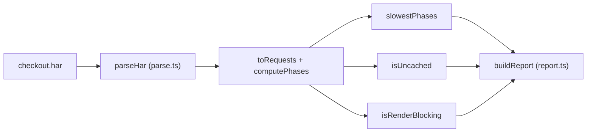

# HAR waterfall report: from file to report

**Data flow** · teaches Network panel, Waterfall timing phases, HAR export

**Why this visual.** See how one HAR file becomes three lists: slowest phases, uncached requests and render-blocking candidates.

## What it shows

The tool parses the HAR text, turns each entry into a request with its seven timing phases, and sends those requests to three small checks. buildReport prints the three answers. The phase values keep -1 as not applicable, so a missing phase is never counted as fast.

Text alternative: Flowchart: checkout.har goes to parseHar, then to toRequests with computePhases, which feeds slowestPhases, isUncached and isRenderBlocking; all three feed buildReport.

## Check yourself

Where does a phase that did not happen, such as DNS on a reused connection, stay out of the results?

Answer: computePhases keeps it as -1, and slowestPhases and the total skip every value below zero.

## Sources

- Chrome DevTools: Network features reference — https://developer.chrome.com/docs/devtools/network/reference (`chrome-devtools-network-docs`)
- ChromeDevTools/devtools-frontend — https://github.com/ChromeDevTools/devtools-frontend (`chromedevtools-devtools-frontend-repo`)

## Used in

- `projects/frontend-engineering/learning-system-and-workstation/browser-devtools-mastery/mini-02-har-waterfall-report/README.md`

Back to [[visuals-browser-devtools-mastery|all visuals]].

## My insights
