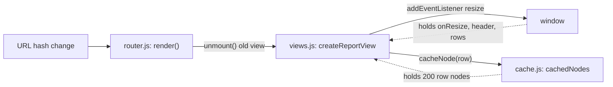

# How the report view leaks on every route change

**Data flow** · teaches Memory panel, Heap snapshot retainers, Detached DOM nodes

**Why this visual.** See which two references keep removed DOM nodes alive after a route change.

## What it shows

The router unmounts the old view and clears the page. The report view still has a resize listener on window and 200 rows in the cachedNodes array, so both keep the removed rows reachable. Removing both holders lets the browser free them.

Text alternative: A URL hash change calls router render, which unmounts the report view. The report view registers a listener on window and caches rows in cachedNodes. Dotted arrows show window and cachedNodes still holding the view's rows.

## Check yourself

Why are the rows still in memory after the router clears the page?

Answer: Because window holds the onResize listener that references them and cachedNodes holds the rows, so they stay reachable.

## Sources

- Fix memory problems — https://developer.chrome.com/docs/devtools/memory-problems (`chrome-devtools-memory-docs`)

## Used in

- `projects/frontend-engineering/learning-system-and-workstation/browser-devtools-mastery/mini-03-find-the-memory-leak/README.md`

Back to [[visuals-browser-devtools-mastery|all visuals]].

## My insights
