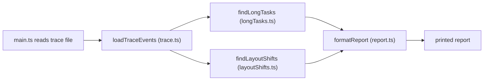

# Trace long task finder: from trace file to report

**Data flow** · teaches Performance panel, Flame chart and long tasks, Live Core Web Vitals

**Why this visual.** Show how a saved Performance trace becomes a list of long tasks and layout shifts.

## What it shows

main.ts reads the trace file. loadTraceEvents cleans the events. findLongTasks keeps RunTask events longer than 50 ms. findLayoutShifts keeps shifts that did not follow user input. formatReport joins both lists into the printed report.

Text alternative: Flowchart: main.ts reads the trace file, loadTraceEvents parses it, then findLongTasks and findLayoutShifts both read the events, and formatReport prints one report.

## Check yourself

Why do findLongTasks and findLayoutShifts read the output of loadTraceEvents and not the raw file?

Answer: Reading is separate from judging, so the file is parsed once and both finders get clean events without metadata.

## Sources

- Chrome DevTools: Performance, Application, Coverage, Rendering and Recorder docs — https://developer.chrome.com/docs/devtools/performance/reference (`chrome-devtools-measure-docs`)
- web.dev: Core Web Vitals, long tasks and bfcache — https://web.dev/articles/vitals (`web-dev-vitals-docs`)
- GoogleChrome/lighthouse — https://github.com/GoogleChrome/lighthouse (`googlechrome-lighthouse-repo`)

## Used in

- `projects/frontend-engineering/learning-system-and-workstation/browser-devtools-mastery/mini-03-trace-long-task-finder/README.md`

Back to [[visuals-browser-devtools-mastery|all visuals]].

## My insights
