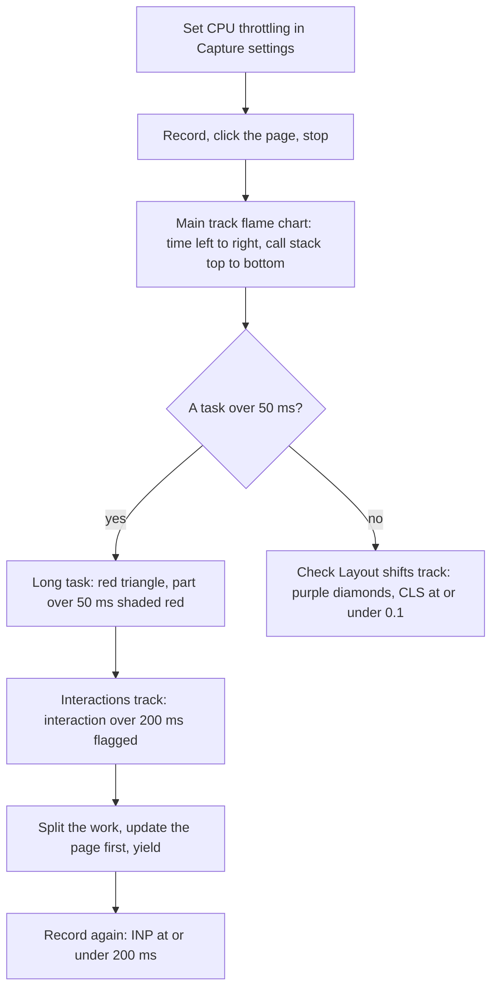

# From a recorded trace to a faster interaction

**Workflow** · teaches Performance panel, Flame chart and long tasks, Live Core Web Vitals, CPU throttling, Layout shifts track

**Why this visual.** Learn the order of steps that finds a long task in a trace and checks that a fix brings INP under 200 ms.

## What it shows

Throttle the CPU, record a trace while you click, and read the Main track. A task over 50 ms is a long task. If the interaction takes over 200 ms, split the work so the page can paint first, then record again.

Text alternative: Flowchart: set CPU throttling, record and click, read the Main track flame chart, decide if a task is over 50 ms; if yes it is a long task, the interaction over 200 ms is flagged, split the work and record again until INP is at or under 200 ms; if no, check the Layout shifts track for CLS at or under 0.1.

## Check yourself

Which part of a 300 ms task does the Performance panel shade red?

Answer: The last 250 ms, the part over 50 ms.

## Sources

- Chrome DevTools: Performance, Application, Coverage, Rendering and Recorder docs — https://developer.chrome.com/docs/devtools/performance/reference (`chrome-devtools-measure-docs`)
- web.dev: Core Web Vitals, long tasks and bfcache — https://web.dev/articles/vitals (`web-dev-vitals-docs`)

## Used in

- `projects/frontend-engineering/learning-system-and-workstation/browser-devtools-mastery/experiences/perf-trace-lab/fallback-visual.json`
- lesson page `/frontend-engineering/learning-system-and-workstation/browser-devtools-mastery/lesson/06-performance-traces/` (file `site/src/content/lessons/frontend-engineering/learning-system-and-workstation/browser-devtools-mastery/06-performance-traces.mdx`)

Back to [[visuals-browser-devtools-mastery|all visuals]].

## My insights
