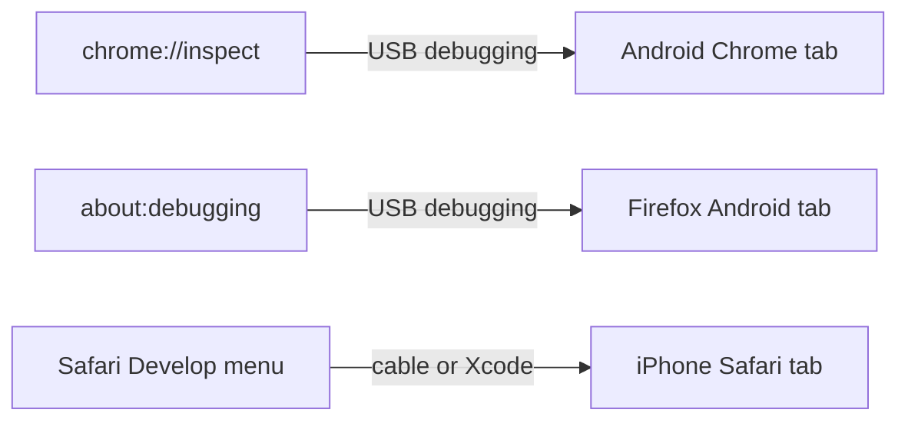

# How desktop DevTools reach a tab on a phone

**Comparison** · teaches Remote device debugging, Android Chrome remote inspection, iOS Safari remote inspection

**Why this visual.** Show that each phone browser pairs with one desktop entry point, and that the phone must allow debugging first.

## What it shows

Each row is one connection path. Desktop Chrome opens chrome://inspect and reaches Chrome on an Android phone with USB debugging on. Desktop Firefox opens about:debugging and reaches Firefox for Android the same way. Desktop Safari lists an iPhone in its Develop menu over a cable or an Xcode wireless pairing. The desktop tools then inspect the real tab on the phone.

Text alternative: Diagram with three connection paths. chrome://inspect connects over USB debugging to an Android Chrome tab. about:debugging connects over USB debugging to a Firefox Android tab. The Safari Develop menu connects by cable or Xcode pairing to an iPhone Safari tab. Conclusion: pick the desktop browser that matches the phone browser.

## Check yourself

A bug appears only in Safari on an iPhone. Which desktop entry point do you open?

Answer: The Develop menu in desktop Safari on a Mac, after you turn on Web Inspector on the iPhone and show developer features on the Mac.

## Sources

- Get started with remote debugging Android devices — https://developer.chrome.com/docs/devtools/remote-debugging (`chrome-devtools-remote-debugging-docs`)
- Firefox DevTools User Docs — https://firefox-source-docs.mozilla.org/devtools-user/ (`firefox-devtools-user-docs`)
- Web Inspector Reference (WebKit) — https://webkit.org/web-inspector/ (`webkit-web-inspector-docs`)

## Used in

- lesson page `/frontend-engineering/learning-system-and-workstation/browser-devtools-mastery/lesson/11-remote-device-debugging/` (file `site/src/content/lessons/frontend-engineering/learning-system-and-workstation/browser-devtools-mastery/11-remote-device-debugging.mdx`)

Back to [[visuals-browser-devtools-mastery|all visuals]].

## My insights
