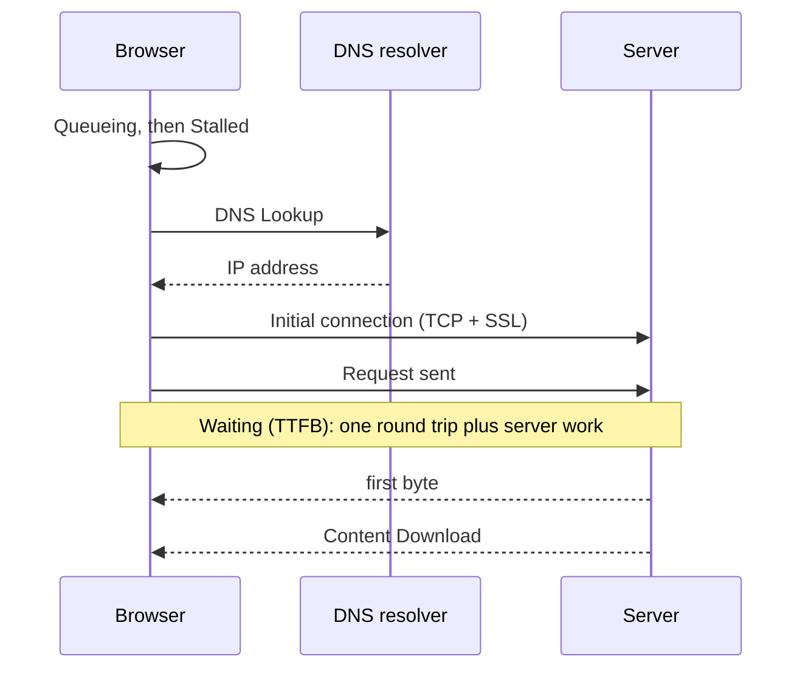

# The timing phases of one network request, in order

**Sequence** · teaches [[Request timing phases]], [[Network panel]]

**Why this visual.** Name the Timing tab phases of one request in order and tell which side of the connection spends each one.

## What it shows

The Network panel Timing tab splits one request into phases. The browser waits in Queueing and Stalled, finds the server address in DNS Lookup, then opens a connection with TCP and SSL. After Request sent, Waiting (TTFB) covers one round trip plus server work. Content Download reads the response body. The long phase tells you what to fix.

Text alternative: A sequence between Browser, DNS resolver and Server. The browser queues and stalls, asks the resolver for the IP address, opens a TCP and SSL connection to the server, sends the request, waits for the first byte, then downloads the body. Each phase depends on the one before it, so a slow early phase delays all later ones.

## Check yourself

A request shows a long Waiting (TTFB) bar and a short Content Download bar. Where do you look first?

Answer: At the server, because Waiting covers one round trip plus server processing time, while the body itself downloads quickly.

## Sources

- Network features reference — https://developer.chrome.com/docs/devtools/network/reference (`chrome-devtools-network-reference`)

## Used in

- lesson page `/frontend-engineering/learning-system-and-workstation/browser-devtools-mastery/lesson/06-network-panel-waterfall/` (file `site/src/content/lessons/frontend-engineering/learning-system-and-workstation/browser-devtools-mastery/06-network-panel-waterfall.mdx`)
- `projects/frontend-engineering/learning-system-and-workstation/browser-devtools-mastery/experiences/network-panel-waterfall/experience.json`

Back to [[visuals-browser-devtools-mastery|all visuals]].

## My insights
