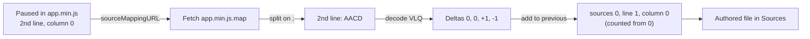

# One paused position traced back through a source map

**Data flow** · teaches [[Source maps]], How a source map encodes positions

**Why this visual.** See how DevTools turns a position in a minified bundle into a file and line in the original source.

## What it shows

DevTools follows the sourceMappingURL link and fetches the map. It finds the segment for the generated line, decodes its VLQ letters into changes, and adds them to the previous segment. The result is an original file, line and column, counted from 0. The example string AACD follows ECMA-426 Sections 6, 9.2 and 11.

Text alternative: Flowchart from left to right: paused in app.min.js on the second line, follow sourceMappingURL to fetch the map, take segment AACD, decode it into the changes 0, 0, +1 and -1, add them to the previous values, and land on sources 0, line 1, column 0, so the Sources panel shows the authored file.

## Check yourself

The previous segment ended at source 0, line 0, column 1. The next segment decodes to 0, 0, +1, -1. Where does it point?

Answer: Source 0, line 1, column 0 (counted from 0), because each field is added to the previous value.

## Sources

- ECMA-426: Source map format specification — https://tc39.es/ecma426/ (`ecma-426-source-map`)
- Chrome DevTools documentation: Elements/CSS, Console, JavaScript debugging, Overrides — https://developer.chrome.com/docs/devtools (`chrome-devtools-docs`)

## Used in

- lesson page `/frontend-engineering/learning-system-and-workstation/browser-devtools-mastery/lesson/04-source-maps-and-overrides/` (file `site/src/content/lessons/frontend-engineering/learning-system-and-workstation/browser-devtools-mastery/04-source-maps-and-overrides.mdx`)

Back to [[visuals-browser-devtools-mastery|all visuals]].

## My insights
