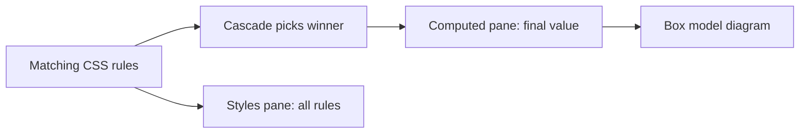

# From matching rules to one computed value

**Data flow** · teaches Elements styles panel, Box model and computed styles, Cascade layers in the Styles pane

**Why this visual.** Show why the Styles pane lists many rules for one property while the Computed pane shows one value.

## What it shows

Several CSS rules can match one element. The Styles pane lists every matching rule and marks the overridden declarations. The cascade picks one winner for each property. The Computed pane shows only that applied value, and its box model diagram shows the final margin, border, padding and content size.

Text alternative: Flowchart: matching CSS rules go to the Styles pane, which lists all of them, and to the cascade, which picks a winner. The winner goes to the Computed pane, which feeds the box model diagram. Conclusion: read Styles for why, Computed for what applies.

## Check yourself

A button's color is wrong. Which pane tells you the value the browser actually uses, and which tells you which rule lost?

Answer: The Computed pane shows the applied value. The Styles pane shows all matching rules, with the overridden declarations marked, so you see which rule lost.

## Sources

- Chrome DevTools documentation: Elements/CSS, Console, JavaScript debugging, Overrides — https://developer.chrome.com/docs/devtools (`chrome-devtools-docs`)

## Used in

- lesson page `/frontend-engineering/learning-system-and-workstation/browser-devtools-mastery/lesson/01-elements-and-styles/` (file `site/src/content/lessons/frontend-engineering/learning-system-and-workstation/browser-devtools-mastery/01-elements-and-styles.mdx`)

Back to [[visuals-browser-devtools-mastery|all visuals]].

## My insights
