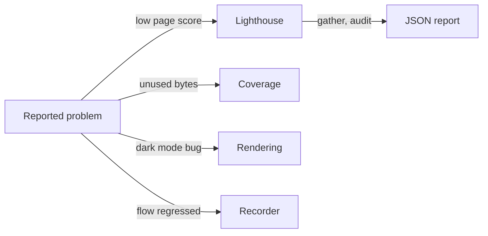

# Pick the panel from the reported problem

**Decision tree** · teaches Lighthouse panel and other panels, Lighthouse audits, Coverage panel, Rendering emulation, Recorder and issues

**Why this visual.** Match a reported problem to the one panel that measures it, and see that Lighthouse gathers before it audits.

## What it shows

A low page score goes to Lighthouse, which gathers a trace and a DevTools log, then audits them into a JSON report (core/runner.js:206-209 @ 3b399f6). Unused bytes go to Coverage. A dark mode bug goes to Rendering, which emulates prefers-color-scheme. A regressed user flow goes to Recorder, which records and replays it.

Text alternative: Decision map: a reported problem branches four ways. Low page score leads to Lighthouse, which gathers then audits into a JSON report; unused bytes lead to Coverage; a dark mode bug leads to Rendering; a regressed flow leads to Recorder. So the symptom picks the panel.

## Check yourself

A report says the checkout flow got slower after the last release. Which panel lets you replay the same flow and measure it again?

Answer: Recorder. It records a user flow, replays it, and measures it.

## Sources

- Chrome DevTools: Performance, Application, Coverage, Rendering and Recorder docs — https://developer.chrome.com/docs/devtools/performance/reference (`chrome-devtools-measure-docs`)
- GoogleChrome/lighthouse — https://github.com/GoogleChrome/lighthouse (`googlechrome-lighthouse-repo`)

## Used in

- lesson page `/frontend-engineering/learning-system-and-workstation/browser-devtools-mastery/lesson/09-audits-and-more-panels/` (file `site/src/content/lessons/frontend-engineering/learning-system-and-workstation/browser-devtools-mastery/09-audits-and-more-panels.mdx`)

Back to [[visuals-browser-devtools-mastery|all visuals]].

## My insights
