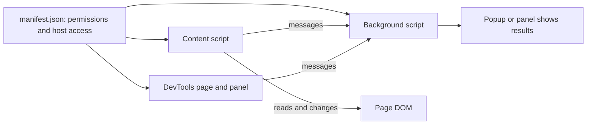

# Browser extension toolkit (install once, used across phases) in brief

## What it is

A browser extension is a small program that adds features to the browser. A frontend toolkit is a short list of extensions that add panels to DevTools or check a page for you: React and Redux DevTools, an accessibility checker, an SEO checker and a few security helpers.

## The problem it solves

Built-in DevTools shows the DOM, but not the React components, the Redux state or the accessibility errors behind it. Without extensions you read raw markup and guess. Each extension also reads the pages you open, so a toolkit you choose with care keeps the help and limits that risk.

## How it works in one picture

The manifest declares the parts and their permissions. A content script reads the page DOM; a DevTools page adds a panel. So the permissions tell you what data a tool can read. [[visual-how-it-works-browser-extension-toolkit|explanation and sources]]

## Where it is used in the real world

- Teams inspect component props and find slow renders with React DevTools instead of adding log lines.
- Teams run axe-based checks on each release page. Automated checks find only some problems, so people still test with a keyboard and a screen reader.
- Teams compare the rendered HTML with the source HTML, because Google indexes the page after it runs JavaScript.

## What you need to know first

- [[Browser developer tools]] — you studied this in the previous section.
- [[Browser extension]] — a small add-on program that adds features to the browser.
- [[Document Object Model]] — the tree of objects the browser builds from HTML.
- [[HTTP request and response]] — the browser sends a request; the server returns status, headers and body.

## What you will be able to do

- Explain what framework devtools extensions show (component tree, renders, store actions) and use them to trace a bug.
- Explain what automated accessibility and SEO checks catch and what they miss.
- Build a script that audits extension manifests for risky permissions.
- Build an accessibility and SEO check that runs on every release page.
- Decide when to use an extension instead of a built-in DevTools panel.

## My insights
