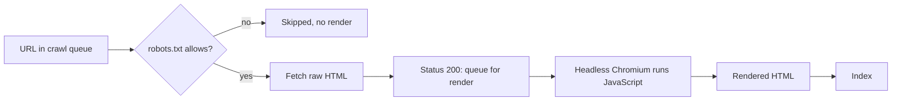

# Understand JavaScript SEO basics

Google Search Central, 2026, official documentation page, read on 2026-11-18.

## The claim in one sentence

Google can crawl, render and index JavaScript pages, but it indexes only what appears in the rendered HTML, so a developer must check that rendered page, the status codes and the head tags on purpose.

## The problem before this

Developers who built pages with JavaScript did not know what a search engine saw. The raw HTML from the server could be almost empty, and the real content appeared only after scripts ran. A single-page app (SPA) made it worse: it changes the view in the browser and often cannot send a real error status. Without clear rules, pages went missing from search or error pages stayed indexed.

## Key ideas

### Three phases: crawl, render, index

Googlebot checks robots.txt before it fetches a URL. Pages that return status 200 are queued for rendering. When resources allow, "a headless Chromium renders the page and executes the JavaScript" (section "How Google processes JavaScript"). The page then goes to the index.

### Google indexes the rendered HTML

Content must be in the [[Rendered HTML]] to count. Google flattens shadow DOM and light DOM, so web component content counts only if it shows up in the rendered output (sections "Rendered HTML" and "Web components"). A tool that shows only the source HTML can mislead you.

### Head tags need care when JavaScript sets them

A robots meta tag can block indexing or link following. Google may skip rendering when it sees `noindex`, so JavaScript may not be able to remove it (section "Meta robots"). A canonical URL should be set in HTML. If JavaScript sets it, the value must match the HTML and there must be only one tag (section "Canonical URL").

### Soft 404s and redirects in SPAs

A [[Soft 404]] is an error view that still returns success. The page suggests two fixes: a JavaScript redirect to a URL that returns a real 404, such as `/not-found`, or a `noindex` robots tag added to the error view (section "Avoid soft 404 errors in single-page apps").

### Real links and the History API

Google follows links that are `<a>` elements with an `href`. SPAs should use the History API for routing, not URL fragments with `#` (sections "Links" and "History API").

### JSON-LD can be added with JavaScript

JavaScript can generate and inject [[Structured data]] in JSON-LD form. The page says to test the result (section "Structured data").

## How it works

In plain words: Google first fetches your page like a simple client. Later it opens the page in a real but headless browser, lets the scripts run, and reads the final result. The final result is what search shows. **Analogy.** The first fetch is a look at a shop's closed window. The render is a walk inside after the staff set up the displays.

The diagram follows the section "How Google processes JavaScript". [[visual-google-js-seo-basics-docs-mechanism-browser-extension-toolkit|Explanation and sources]]

1. The crawler checks robots.txt. A disallowed URL is skipped, and Google will not render JavaScript on blocked pages (section "robots.txt").
2. It fetches the raw HTML and reads the status code. Status codes tell Google that a page is missing, behind a login or moved (section "Use meaningful HTTP status codes").
3. Pages with 200 wait in a render queue.
4. Headless Chromium runs the JavaScript and produces the rendered HTML.
5. Google indexes that rendered HTML.

**Interpretation.** An SEO extension is useful only if it shows the rendered DOM. Compare it with the source HTML (view-source) and check status code, robots meta and canonical in both.

## Results and evidence

- The page states that Googlebot caches aggressively and its rendering may ignore caching headers, so it can use old JavaScript or CSS. Content fingerprinting, a content hash in the file name, avoids this (section "Caching").
- The page names the Rich Results Test and the URL Inspection Tool as ways to view the rendered HTML (sections "Rendered HTML" and "Web components"). It reports no measurements or benchmarks.

## Limitations and criticisms

- It is a statement of Google's behavior. It covers Google Search only, not other search engines, and it gives no data on how long rendering takes.
- It says JavaScript may not remove `noindex` because Google may skip rendering. This means JavaScript fixes for head tags are unreliable; server HTML is safer (section "Meta robots").
- It names no browser extension. Which extension to choose is left to the learner.

## What practitioners took from it

Adoption by practitioners could not be verified from the sources recorded for this topic, so nothing is claimed here.

## How it connects to this topic

- [[01-brief-browser-extension-toolkit|Browser extension toolkit brief]] — this is the source behind the brief's step "compare rendered and source HTML".
- [[Browser extension]] — an SEO extension reads the page DOM, so it sees the rendered result, not the raw response.
- [[HTTP request and response]] — the status code decides what Google does with the page.
- [[Document Object Model]] — rendered HTML is the DOM after scripts ran.

## Test yourself

1. Which HTML does Google index, and what happens to a URL that robots.txt disallows?
2. Why is it unsafe to remove `noindex` with JavaScript?
3. How can an SPA avoid a soft 404 on a missing page?

## My insights
