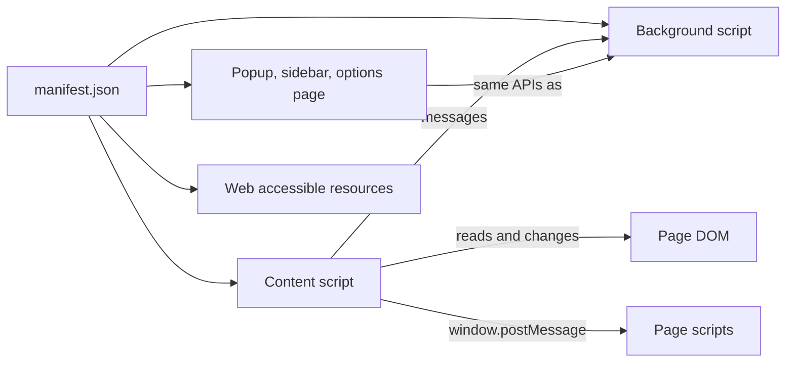

# Anatomy of a WebExtension (MDN)

MDN Web Docs (Mozilla), official reference page, read on 2026-11-18.

## The claim in one sentence

An extension is a bundle of separate parts, all declared in one `manifest.json` file, and each part has its own reach: some touch web pages, others only show interface or react to browser events.

## The problem before this

A newcomer sees an extension as one opaque program. It is hard to tell which piece reads your pages and which piece only draws a button. The page splits an extension into named parts, so you can ask a clear question for each part: what can it see, and what did the manifest give it? The page itself is short and does not explain permissions in depth (see Limitations).

## Key ideas

### manifest.json is the one required file

The page says it is "the only one that must be present in every extension." It holds basic metadata (name, version, required permissions) and points to every other part: background scripts, icons, sidebars, popups, options pages, content scripts and web accessible resources (section "manifest.json").

### Background scripts react to browser events

They run independently of any page or window. A persistent one loads with the extension and stays until it is disabled; only Manifest V2 allows this. A non-persistent one loads for an event and unloads when idle; Manifest V3 allows only this kind. They can use any WebExtensions API the extension has permission for (section "Background scripts").

### Content scripts live inside the page

A [[Content script]] runs in the context of one page. It can reach the page DOM like any page script. It can use only a small subset of the extension APIs. To use more, it messages the background script. It cannot reach normal page scripts directly, but it can exchange messages with them through `window.postMessage()` (section "Content scripts").

### Popups, sidebars and options pages are HTML documents

A popup opens from a toolbar or address bar button. A sidebar is a pane beside the page. An options page opens from the add-on manager. Each has its own HTML, CSS and JavaScript, and its JavaScript can use the same privileged APIs as the background script. Extension pages with no manifest entry have the same API access (sections "Sidebars, popups, and options pages" and "Extension pages").

### Web accessible resources are files the page may load

Images, HTML, CSS and JavaScript bundled in the extension can be exposed to content scripts and page scripts through the `web_accessible_resources` key and a special URI scheme (section "Web accessible resources").

## How it works

In plain words: the manifest is the table of contents. The browser reads it, starts the parts it lists, and lets each part use only the powers it asked for. The part that touches pages is the content script. Everything else talks to it by messages.

The diagram follows the sections "manifest.json" to "Web accessible resources". [[visual-mdn-webextensions-anatomy-docs-mechanism-browser-extension-toolkit|explanation and sources]]

1. The browser loads `manifest.json` and finds the declared parts.
2. A background script waits for events and calls APIs allowed by the requested permissions.
3. A content script runs in a matching page. It reads or changes the DOM.
4. If it needs an API it lacks, it sends a message to the background script.
5. If it needs the page's own scripts, it uses `window.postMessage()`.
6. Popups, sidebars and options pages show interface and call privileged APIs directly.

**Interpretation.** To judge an installed extension, read its manifest. A content script that matches many sites can read all of those pages. A background script with many permissions can act far beyond the page. See [[Extension permissions]].

## Results and evidence

- The page states one hard rule: `manifest.json` must be present in every extension (section "manifest.json").
- It states which background model each manifest version allows: persistent only in V2, non-persistent only in V3 (section "Background scripts").
- It states that content scripts get only a small subset of the APIs, while popups and extension pages get the privileged set (sections "Content scripts" and "Sidebars, popups, and options pages").

## Limitations and criticisms

- The page does not list which manifest keys are required, and it mentions permissions only briefly. It sends the reader to the separate manifest reference. So you cannot judge risk from this page alone.
- It describes structure, not safety. It gives no advice on how to vet an extension, and no measurements. It does not say which host sites a content script may match; that is set elsewhere in the manifest.

## What practitioners took from it

Adoption by practitioners could not be verified from this page, and I did not read the other recorded sources for this digest, so nothing is claimed here.

## How it connects to this topic

- [[01-brief-browser-extension-toolkit|Browser extension toolkit brief]] — its "how it works" picture is this structure.
- [[Browser extension]] — the shared definition this page fills in.
- [[Content script]] — the part that reads the page DOM.
- [[Extension permissions]] — the manifest list that bounds each part.

## Test yourself

1. Which file must every extension have, and what does it list?
2. A content script needs an API it cannot call. What does it do?
3. Why are popups and options pages more privileged than content scripts?

## My insights
