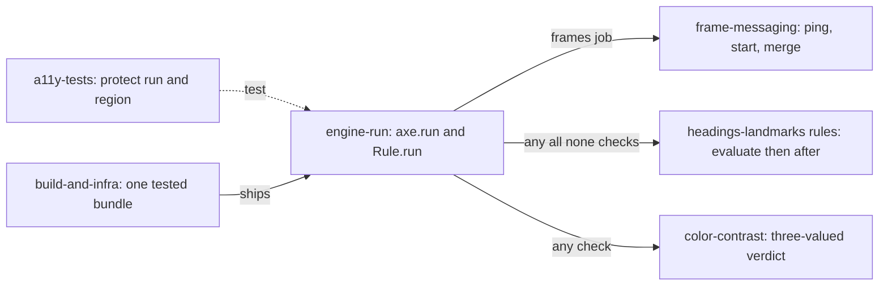
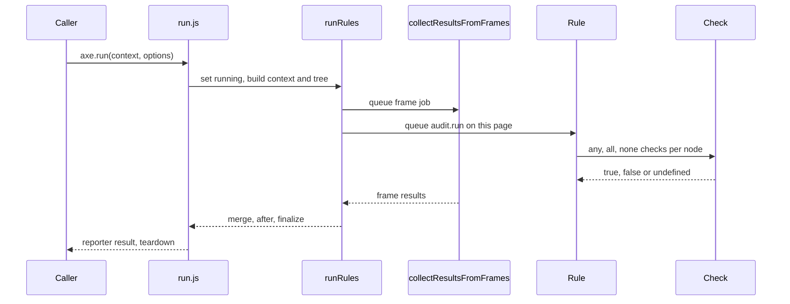

# dequelabs/axe-core — architecture

axe-core is one JavaScript file that runs inside the page you test. This note shows its parts and how one scan flows through them. Everything here comes from the six module notes at commit `e80f6b7`.

## Module map

| Module | Responsibility | Note |
|--------|----------------|------|
| engine-run | `axe.run()`, rule selection, rule and check execution, merge and finalize | [[axe-core-module-engine-run\|engine-run]] |
| frame-messaging | Scan iframes through `postMessage`, or through a two-stage `runPartial` and `finishRun` | [[axe-core-module-frame-messaging\|frame-messaging]] |
| headings-landmarks-rules | Rules for heading order, landmarks and regions, with an `after` phase | [[axe-core-module-headings-landmarks-rules\|headings-landmarks-rules]] |
| color-contrast | Works out real text and background colours and returns pass, fail or incomplete | [[axe-core-module-color-contrast\|color-contrast]] |
| a11y-tests | Tests of the public run API and the `region` check | [[axe-core-module-a11y-tests\|a11y-tests]] |
| build-and-infra | esbuild bundle, CI jobs, release by pull request, supply-chain controls | [[axe-core-module-build-and-infra\|build-and-infra]] |

## The picture

The engine queues a frame job and an audit job together (`lib/core/public/run-rules.js:39-46 @ e80f6b7`). Each rule runs its `any`, `all` and `none` check queues (`lib/core/base/rule.js:259-263 @ e80f6b7`). Heading rules name an `evaluate` and an `after` step (`lib/checks/navigation/heading-order.json:3-4 @ e80f6b7`). The contrast rule runs one check in `any` (`lib/rules/color-contrast.json:3-24 @ e80f6b7`). Tests stub `_runRules` to check what `run` passes in (`test/core/public/run.js:50-57 @ e80f6b7`). The build bundles `lib/core/core.js` (`build/run-build/esbuild-core.mjs:9-18 @ e80f6b7`), and CI jobs download that bundle (`.github/workflows/test.yml:60-75 @ e80f6b7`). [[visual-axe-core-module-map-browser-extension-toolkit|explanation and sources]]

## Main flow

In plain words: the caller asks for a scan, the engine scans this page and its frames side by side, then one place merges the answers and builds the report.

1. `run()` refuses to start while another scan runs, then sets `axe._running = true` (`lib/core/public/run.js:25-35 @ e80f6b7`).
2. `runRules` builds the context and stores the flat tree on `axe._tree` (`lib/core/public/run-rules.js:24-26 @ e80f6b7`).
3. It queues the frame job and the audit job (`lib/core/public/run-rules.js:39-46 @ e80f6b7`). The frame job sends ping, then start, to each frame (`lib/core/utils/send-command-to-frame.js:40-55 @ e80f6b7`).
4. Each rule gathers and matches nodes (`lib/core/base/rule.js:245 @ e80f6b7`), then runs the checks. A check returns `true`, `false` or `undefined` (`lib/core/base/rule.js:272-287 @ e80f6b7`).
5. Results are merged (`lib/core/public/run-rules.js:54-58 @ e80f6b7`). Only the top window runs `audit.after` and finalizes (`lib/core/public/run-rules.js:60-77 @ e80f6b7`).
6. The reporter builds the output and the engine resets (`lib/core/public/run.js:48-49 @ e80f6b7`, `lib/core/public/run.js:103-108 @ e80f6b7`). [[visual-axe-core-request-flow-browser-extension-toolkit|explanation and sources]]

animation candidate, for a `flow` scene:

- Caller → run.js: `axe.run(context, options)` (`lib/core/public/run.js:25-30 @ e80f6b7`)
- run.js → runRules: set running, build tree (`lib/core/public/run-rules.js:24-26 @ e80f6b7`)
- runRules → frames: ping then start (`lib/core/utils/send-command-to-frame.js:40-55 @ e80f6b7`)
- runRules → Rule: gather and match (`lib/core/base/rule.js:245 @ e80f6b7`)
- Rule → Check: any, all, none (`lib/core/base/rule.js:259-263 @ e80f6b7`)
- runRules → run.js: merge, after, finalize (`lib/core/public/run-rules.js:54-77 @ e80f6b7`)

## Module dependencies (when useful)

The checks do not call the frame code. They reach other frames only through the `after` step, which sees merged results (`lib/checks/navigation/heading-order-after.js:54-64 @ e80f6b7`). Colour helpers pass "why I could not tell" to the check through a per-run cache, not through return values (`lib/commons/color/incomplete-data.js:19-27 @ e80f6b7`). Both choices keep each module small and its signature simple.

## Worth exploring interactively

- One scan from `axe.run()` to results: FlowAnimation (`lib/core/public/run-rules.js:39-46 @ e80f6b7`).
- Heading order across frames: AlgorithmStepper, a list grows and each heading turns pass, fail or undefined (`lib/checks/navigation/heading-order-after.js:84-90 @ e80f6b7`).
- Contrast verdict for one element: FlowAnimation through each gate to pass, fail or incomplete (`lib/checks/color/color-contrast-evaluate.js:170-187 @ e80f6b7`).
- Ping and start timeouts: StateMachine with outcomes done, skipped, failed (`lib/core/utils/send-command-to-frame.js:27-37 @ e80f6b7`).
- Rule selection order: first matching branch decides (`lib/core/utils/rule-should-run.js:62-79 @ e80f6b7`).

## Design decisions worth noticing

decision candidate: **how a check reports doubt.** Options: pass or fail only; or add a third value. axe adds `undefined`, so doubtful cases go to a human (`lib/core/base/rule.js:272-287 @ e80f6b7`). The cost is that a user must read the "incomplete" list. See [[axe-core-pattern-three-valued-results]].

decision candidate: **how frames are scanned.** Options: `postMessage` between frames (default); a replaceable transport; or two-stage `runPartial` and `finishRun` with a trusted merger. The default is easy but shares the page's message channel (`doc/frame-messenger.md:3-5 @ e80f6b7`). The two-stage route avoids frame messaging when it is "not possible or not secure" (`doc/run-partial.md:3 @ e80f6b7`).

decision candidate: **rules as JSON, checks as shared functions.** Options: one function per rule, or data plus reusable code. axe reuses `has-descendant-evaluate` for two rules (`lib/checks/keyboard/page-has-main.json:3-8 @ e80f6b7`). See [[axe-core-pattern-rules-as-data]].

Other patterns: [[axe-core-pattern-cleanup-on-every-exit]] and [[axe-core-pattern-compute-once-and-cache]].

## Not analyzed

- `lib/commons` except colour, and `lib/checks` and `lib/rules` beyond headings, landmarks and contrast (about 90 more rules).
- `lib/core/utils/get-selector`, `css-parser`, `preload`.
- `lib/standards` (ARIA tables), `locales/`, typings.
- `test/integration`, `test/act-rules`, `test/aria-practices`.
- `doc/` beyond `frame-messenger.md` and `run-partial.md`.
- `perf/`, `patches/`, and the deploy workflows.

## My insights
