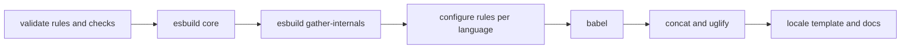

# dequelabs/axe-core — module: build-and-infra

## Responsibility

This slice turns the source in `lib/` into the single `axe.js` file that people inject into a page. It also holds the tools that test that file in real browsers, and the release pipeline. Coverage: the package manifest, workspace file, Node pin, two GitHub workflows, the build scripts `run-build.mjs`, `full-build.mjs` and `esbuild-core.mjs`, and the test-runner config. Other build helpers (`argv.mjs`, `commands.mjs`, `babel-transform.mjs` and so on) are only named by import, not read.

## Key files

| File | Role |
|------|------|
| `package.json` | Name, version, published files, every script, every dev dependency |
| `pnpm-workspace.yaml` | Which install scripts may run, plus one patched dependency |
| `.nvmrc` | Node version for development and CI |
| `.github/workflows/test.yml` | CI: lint, format, build, browser tests, Node matrix, SRI check |
| `.github/workflows/release.yml` | Manual job that opens a release pull request |
| `build/run-build.mjs` | Command router for build, configure, translate, validate |
| `build/run-build/full-build.mjs` | The ordered build pipeline |
| `build/run-build/esbuild-core.mjs` | Bundles the engine and the gather-internals script |
| `test/wtr.config.mjs` | Test runner config with a custom Selenium launcher |

## How it works

The build is a fixed list of steps. A failure in validation stops everything.

1. `pnpm run build` calls `node build/run-build.mjs` (`package.json:80 @ e80f6b7`). A `prebuild` hook first checks the Node version (`package.json:120 @ e80f6b7`).
2. `main()` parses arguments and picks a sub-command: build, configure, translate or validate (`build/run-build.mjs:18-48 @ e80f6b7`).
3. `runFullBuild` cleans old outputs, then validates the rule and check files. If validation fails it throws "Validation failed" (`build/run-build/full-build.mjs:36-42 @ e80f6b7`).
4. It builds a metadata function map, then bundles the engine with esbuild from `lib/core/core.js` to `tmp/core/core.js` (`build/run-build/esbuild-core.mjs:9-18 @ e80f6b7`).
5. It bundles the gather-internals script, then configures rules and checks per language (`build/run-build/full-build.mjs:48-51 @ e80f6b7`).
6. Babel transforms the output, a concat step joins the parts with package data and the year, and uglify makes the minified copy (`build/run-build/full-build.mjs:52-57 @ e80f6b7`).
7. Last come the supported-ARIA docs, the locale template, post-build formatting and a byte-size report (`build/run-build/full-build.mjs:58-65 @ e80f6b7`).
8. The published package contains only `axe.js`, `axe.min.js`, `axe.d.ts`, `sri-history.json`, `locales/`, the third-party license file and `gather-internals.js` (`package.json:59-67 @ e80f6b7`).

The diagram is the step order of `build/run-build/full-build.mjs:36-65 @ e80f6b7`.

## Beyond the textbook

### One build artifact, reused by many CI jobs

- Textbook version: each test job runs its own build.
- What they do: the `build` job uploads `axe.js` as an artifact kept for one day. Later jobs (ACT, ARIA practices, locales, virtual rules, jsdom, SRI, Node matrix) download it and declare `needs: build`.
- Why: the tests must check the exact file that ships. The Node matrix comment says the package "can't be built on Node 6 anymore, but should still run there", so an old Node only runs a prebuilt file.
- Evidence: `.github/workflows/test.yml:60-75 @ e80f6b7`, `.github/workflows/test.yml:149-153 @ e80f6b7`, `.github/workflows/test.yml:240-264 @ e80f6b7`

### Tested on very old runtimes while built on a new one

- Textbook version: test on the Node version you develop with.
- What they do: development pins Node 24, but the test matrix runs the built file on Node 6, 18, 20, 22 and 24. `package.json` says `"node": ">=4"`. The old-Node job calls `node` directly because pnpm cannot run there.
- Why: this is a library injected into unknown pages and test setups, so old environments still matter.
- Evidence: `.nvmrc:1 @ e80f6b7`, `.github/workflows/test.yml:245-264 @ e80f6b7`, `package.json:8-9 @ e80f6b7`

### Real browsers, not a simulated DOM, as the main test bed

- Textbook version: unit tests run in jsdom.
- What they do: unit tests run in headless Chrome and Firefox through web-test-runner (WTR), driven by Selenium. The CI runs the full suite and the integration suite in each browser. jsdom is a separate, smaller job.
- Why: accessibility checks depend on layout and styles (contrast, visibility), which a simulated DOM cannot give. This reason is my inference; the config does not state it.
- Evidence: `.github/workflows/test.yml:77-120 @ e80f6b7`, `.github/workflows/test.yml:196-205 @ e80f6b7`, `test/wtr.config.mjs:191-204 @ e80f6b7`

### A custom launcher so tests run at the top-level page

- Textbook version: use the test runner default, which wraps each test in an iframe.
- What they do: `DirectSeleniumLauncher` navigates the browser straight to each test URL and runs one session at a time through a promise chain.
- Why (from the code comment): tests run with `window === window.top`, `window.location.pathname` is real, and there are no cross-frame problems for frame-sensitive tests. This matters for an engine that scans iframes.
- Evidence: `test/wtr.config.mjs:22-34 @ e80f6b7`, `test/wtr.config.mjs:81-97 @ e80f6b7`

### A size and import budget on the extension script

- Textbook version: bundle and ship; no limits.
- What they do: after bundling `gather-internals`, the build asserts the bundle imports at most 10 files and no input is over 4,000 bytes. The comment says the bundle is for "extension injection and unit tests".
- Why: a script injected into pages by a browser extension must stay small. The build fails if it grows.
- Evidence: `build/run-build/esbuild-core.mjs:26-40 @ e80f6b7`, `build/run-build/esbuild-core.mjs:42-72 @ e80f6b7`

### Supply-chain controls

- Textbook version: `pnpm install` and trust all dependencies.
- What they do: install scripts are allowlisted per package (esbuild and chromedriver allowed, core-js denied). Git-hosted test corpora are pinned to commit hashes. One dependency, colorjs.io, is patched. In CI, third-party actions are pinned to full commit SHAs, `permissions` is empty, and checkout does not persist credentials. A Subresource Integrity (SRI) hash file for releases is validated on master and release branches.
- Why: the library is published and embedded in other products, so the build chain is guarded. The workflow comment states the pin-key rule.
- Evidence: `pnpm-workspace.yaml:3-12 @ e80f6b7`, `package.json:135 @ e80f6b7`, `package.json:181 @ e80f6b7`, `.github/workflows/test.yml:19 @ e80f6b7`, `.github/workflows/test.yml:29-33 @ e80f6b7`, `.github/workflows/test.yml:227-238 @ e80f6b7`

### Release by pull request, not by hand

- Textbook version: bump the version and publish from a laptop.
- What they do: a manual workflow creates a dated `release-YYYY-MM-DD` branch, runs `pnpm run release`, pushes, takes the new CHANGELOG lines as the PR body and opens a PR to master. `package.json` blocks the plain `version` script. A post-bump hook rebuilds, updates the SRI history and stages the rule docs.
- Why: a person reviews every release and its changelog. The tag is skipped at bump time (`skip: tag: true`).
- Evidence: `.github/workflows/release.yml:3 @ e80f6b7`, `.github/workflows/release.yml:24-47 @ e80f6b7`, `package.json:68-75 @ e80f6b7`, `package.json:111-112 @ e80f6b7`

### Concurrency rules that protect the `next` tag

- Textbook version: run every push in parallel.
- What they do: workflows are grouped per branch. Pull request runs cancel older runs. Push runs queue in order.
- Why (from the comment): this keeps the `next` tag from falling out of sync.
- Evidence: `.github/workflows/test.yml:11-17 @ e80f6b7`

## Tests and what they protect

The test scripts split the suite by layer: core, commons, rule-matches, checks, API, virtual rules and gather-internals (`package.json:88-95 @ e80f6b7`). Extra suites check against outside truth: ACT rules and ARIA Authoring Practices examples (`package.json:97 @ e80f6b7`, `package.json:104-105 @ e80f6b7`), locale files, and the rule help-URL version (`package.json:106-108 @ e80f6b7`). The default WTR file list matches the layers above, and each test has a 4,000 ms timeout (`test/wtr.config.mjs:301-310 @ e80f6b7`, `test/wtr.config.mjs:282-287 @ e80f6b7`). `pnpm test` runs the TypeScript check first (`package.json:83-84 @ e80f6b7`). Console noise is filtered so only `log` shows (`test/wtr.config.mjs:293-294 @ e80f6b7`). The test files themselves are outside this slice.

## Error handling, performance, and security

- Errors: the build driver prints the error and sets a non-zero exit code, and unknown commands fail (`build/run-build.mjs:45-53 @ e80f6b7`). A failed validation aborts the build (`build/run-build/full-build.mjs:40-42 @ e80f6b7`).
- Performance: every CI job has a 10-minute timeout (`.github/workflows/test.yml:27 @ e80f6b7`). The build reports elapsed seconds and byte size (`build/run-build/full-build.mjs:64-69 @ e80f6b7`).
- Security: see "Supply-chain controls". The release job uses a secret token named `PAT` (`.github/workflows/release.yml:49 @ e80f6b7`). Chrome runs with `--no-sandbox` because of sandboxed CI (`test/wtr.config.mjs:133-134 @ e80f6b7`). Heartbeat polls the driver every 60 s to keep the session alive (`test/wtr.config.mjs:56-63 @ e80f6b7`).
- One test job, examples, is `continue-on-error` because of an upstream issue; it cannot block deploys (`.github/workflows/test.yml:126-129 @ e80f6b7`).

## Technologies and services seen

- pnpm — package manager, pinned in `packageManager` (`package.json:6 @ e80f6b7`)
- Node.js 24 — dev and CI runtime (`.nvmrc:1 @ e80f6b7`)
- esbuild — bundles the engine and gather-internals (`build/run-build/esbuild-core.mjs:4 @ e80f6b7`)
- Babel — transforms the bundle for older browsers (`package.json:129-130 @ e80f6b7`, `build/run-build/full-build.mjs:53 @ e80f6b7`)
- UglifyJS — minified copy (`package.json:180 @ e80f6b7`)
- TypeScript — type check only via `tsc` (`package.json:84 @ e80f6b7`, `package.json:179 @ e80f6b7`)
- ESLint, Prettier, Husky, lint-staged — lint, format, pre-commit (`package.json:82 @ e80f6b7`, `package.json:116-119 @ e80f6b7`, `package.json:184-192 @ e80f6b7`)
- web-test-runner, Mocha, Chai, Sinon — test framework (`test/wtr.config.mjs:5 @ e80f6b7`, `package.json:134 @ e80f6b7`, `package.json:167 @ e80f6b7`)
- Selenium WebDriver, chromedriver, geckodriver — browser control (`test/wtr.config.mjs:6-14 @ e80f6b7`, `test/wtr.config.mjs:145 @ e80f6b7`, `test/wtr.config.mjs:174-176 @ e80f6b7`)
- Chrome and Firefox (headless, via Xvfb display) — real browsers in CI (`.github/workflows/test.yml:80-89 @ e80f6b7`, `.github/workflows/test.yml:106-116 @ e80f6b7`)
- jsdom — non-browser test (`package.json:164 @ e80f6b7`)
- colorjs.io (patched) — color math dependency (`package.json:143 @ e80f6b7`, `pnpm-workspace.yaml:11-12 @ e80f6b7`)
- w3c/aria-practices and w3c/wcag-act-rules — external test corpora, pinned (`package.json:135 @ e80f6b7`, `package.json:181 @ e80f6b7`)
- commit-and-tag-version — version bump and changelog (`package.json:144 @ e80f6b7`)
- JSDoc — API docs build (`package.json:79 @ e80f6b7`)
- sri-toolbox — Subresource Integrity hashes (`package.json:176 @ e80f6b7`)
- GitHub Actions, GitHub CLI (`gh pr create`) — CI and release PR (`.github/workflows/release.yml:47 @ e80f6b7`)
- Sauce Labs — only referenced in a comment about launcher compatibility (`test/wtr.config.mjs:56 @ e80f6b7`)

## Worth exploring interactively

- Build pipeline — steps: validate (`build/run-build/full-build.mjs:39-42 @ e80f6b7`), esbuild core (`build/run-build/esbuild-core.mjs:13-18 @ e80f6b7`), gather-internals with size assert (`build/run-build/esbuild-core.mjs:69-72 @ e80f6b7`), configure (`build/run-build/full-build.mjs:51 @ e80f6b7`), babel (`build/run-build/full-build.mjs:53 @ e80f6b7`), concat and uglify (`build/run-build/full-build.mjs:55-57 @ e80f6b7`) — fits FlowAnimation because the learner sees source files move through each stage and a failed gate stop the flow.
- CI job graph — steps: `build` uploads `axe.js` (`.github/workflows/test.yml:71-75 @ e80f6b7`), jobs with `needs: build` restore it (`.github/workflows/test.yml:145-153 @ e80f6b7`), Node matrix runs it (`.github/workflows/test.yml:244-264 @ e80f6b7`) — fits SystemDiagram because it shows which job depends on which artifact.

## Open questions

- What `commands.mjs`, `babel-transform.mjs` and `concat-uglify.mjs` do in detail (not in this slice).
- The `.github/actions/install-deps` action that sets up browsers is not in this slice.

## My insights
