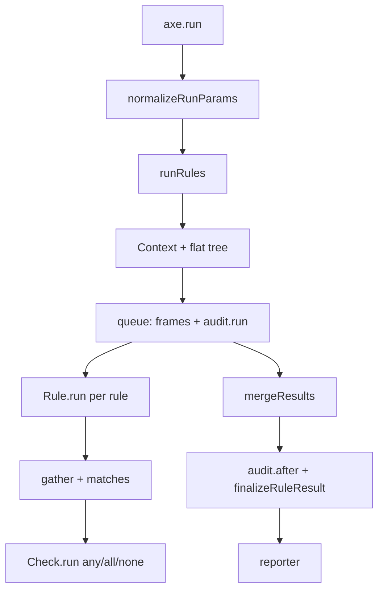

# dequelabs/axe-core — module: engine-run

## Responsibility

This part of the code runs one accessibility scan. `axe.run()` checks its arguments, picks the rules that should run, finds the page elements each rule cares about, runs small checks on each element, and merges the answers into one result. It also makes sure that a crash in one rule cannot leave the engine stuck in a "running" state.

## Key files

| File | Role |
|------|------|
| `lib/core/public/run.js` | Public `axe.run()`: guards, promise or callback, reporter |
| `lib/core/public/run/normalize-run-params.js` | Lets `context`, `options`, `callback` all be optional |
| `lib/core/public/run-rules.js` | Builds the context, runs frames and this page in parallel, merges, finalizes |
| `lib/core/base/rule.js` | A rule: gather nodes, match, run `any`/`all`/`none` checks, `after` step |
| `lib/core/base/check.js` | A check: runs one `evaluate` function and captures its result or error |
| `lib/core/utils/rule-should-run.js` | Decides whether a rule runs, from `runOnly`, `rules`, tags |
| `lib/core/utils/queue.js` | Tiny parallel task queue used everywhere |
| `lib/core/utils/finalize-result.js` | Turns per-node results into grouped outcomes |
| `lib/core/utils/aggregate.js` | Picks the "highest" value from an ordered list |

## How it works

1. `run()` shifts optional arguments into place (`lib/core/public/run/normalize-run-params.js:14-34 @ e80f6b7`), copies the options so the caller's object is not changed, and defaults the reporter to `v1` (`lib/core/public/run/normalize-run-params.js:41-42 @ e80f6b7`).
2. It refuses to start without a configured audit or while another run is active (`lib/core/public/run.js:25-30 @ e80f6b7`), then sets `axe._running = true` (`lib/core/public/run.js:35 @ e80f6b7`).
3. `runRules` builds a `Context`, stores the flattened DOM tree on `axe._tree`, and computes selector data (`lib/core/public/run-rules.js:24-26 @ e80f6b7`).
4. It queues two jobs: collect results from child frames when there are any and `iframes` is not `false`, and run the audit on this document (`lib/core/public/run-rules.js:39-46 @ e80f6b7`).
5. When both finish, the results are merged (`lib/core/public/run-rules.js:54-58 @ e80f6b7`). Only the top-level window (the `initiator`) runs `audit.after`, publishes rule metadata, and finalizes each rule result (`lib/core/public/run-rules.js:60-77 @ e80f6b7`).
6. Inside `Rule.run`, nodes are gathered and matched (`lib/core/base/rule.js:245 @ e80f6b7`). For each node, three check queues run: `any`, `all`, `none` (`lib/core/base/rule.js:259-263 @ e80f6b7`).
7. `Check.run` calls the check's `evaluate` function with a helper as `this`, and stores the return value as the result (`lib/core/base/check.js:97-119 @ e80f6b7`). `true` passes, `false` fails, and `undefined` marks a result that needs review (the rewrite in this slice is the `reviewOnFail` one) of `false` to `undefined` (`lib/core/base/rule.js:272-287 @ e80f6b7`).
8. `finalizeRuleResult` copies the rule's impact onto each check result, then merges the grouped outcome from `aggregateNodeResults` and deletes the raw `nodes` array (`lib/core/utils/finalize-result.js:12-23 @ e80f6b7`). That helper lives in another file outside this slice.
9. The reporter turns the raw results into the final shape and calls `respond` (`lib/core/public/run.js:103-108 @ e80f6b7`).

## Beyond the textbook

### One running scan at a time

- Textbook version: call the scan function whenever you like.
- What they do: a global flag makes a second `run()` fail with a message that tells you to `await` the first one.
- Why: the engine stores the tree on global state (`axe._tree`), so two overlapping scans would corrupt each other.
- Evidence: `lib/core/public/run.js:26-30 @ e80f6b7`, `lib/core/public/run-rules.js:25 @ e80f6b7`

### Every exit path resets state

- Textbook version: set a flag, do the work, clear the flag at the end.
- What they do: the flag is cleared and `teardown()` is called in the success path, the reject path, the reporter-failure path, and the error path of `runRules`.
- Why: a thrown rule must not leave `_running` true, or every later scan in a long-lived page (a browser extension panel, for example) would fail.
- Evidence: `lib/core/public/run.js:48-49 @ e80f6b7`, `lib/core/public/run.js:57-58 @ e80f6b7`, `lib/core/public/run.js:80 @ e80f6b7`, `lib/core/public/run-rules.js:84-90 @ e80f6b7`

### Errors name the rule, the check and the element

- Textbook version: let the exception bubble up.
- What they do: a failing `evaluate` is wrapped in a `RuleError` with rule id, method (`<check>#evaluate`, `#matches`, `<check>#after`) and a serialized element. `Check.run` also attaches `errorNode` to the exception.
- Why: with about a hundred rules, "undefined is not a function" is useless without knowing which rule and which node caused it.
- Evidence: `lib/core/base/rule.js:184-192 @ e80f6b7`, `lib/core/base/rule.js:457-463 @ e80f6b7`, `lib/core/base/rule.js:561-568 @ e80f6b7`, `lib/core/base/check.js:109-113 @ e80f6b7`

### Three-valued results and review-on-fail

- Textbook version: a check returns pass or fail.
- What they do: a check can also return `undefined`, stored as the result. A rule flagged `reviewOnFail` turns every failure into `undefined`, so the finding is reported for human review and not as a violation. The same rewrite is done after cross-frame `after` checks.
- Why: for judgements a machine cannot make confidently, a false violation costs more trust than a missed one.
- Evidence: `lib/core/base/rule.js:68-69 @ e80f6b7`, `lib/core/base/rule.js:272-287 @ e80f6b7`, `lib/core/base/rule.js:571-583 @ e80f6b7`

### any / all / none checks and an "after" phase

- Textbook version: one test function per rule.
- What they do: each rule has three check lists (any, all, none). A check can have an `after` function that filters results across the whole run, which matters when one element's answer depends on other elements or frames. Page-level rules collapse many node results into one.
- Why: the `after` phase only runs once, at the top window, after frame results are merged.
- Evidence: `lib/core/base/rule.js:259-263 @ e80f6b7`, `lib/core/base/rule.js:554-598 @ e80f6b7`, `lib/core/base/rule.js:533-543 @ e80f6b7`, `lib/core/public/run-rules.js:60-65 @ e80f6b7`

### Rule selection has a strict order

- Textbook version: a list of enabled rules.
- What they do: page-level rules never run off the page; then `runOnly` type `rule` wins; then a per-rule `enabled` flag; then `runOnly` tags; and last the default tag excludes (from the audit's `tagExclude` list).
- Why: predictable overrides; the user's explicit choice beats tag filters.
- Evidence: `lib/core/utils/rule-should-run.js:57-80 @ e80f6b7`, `lib/core/utils/rule-should-run.js:10-12 @ e80f6b7`

### Hidden elements are skipped by default

- Textbook version: select with a CSS selector and test everything.
- What they do: `excludeHidden` defaults to true and filters nodes through `isVisibleToScreenReaders`, so content hidden from assistive tech is not tested.
- Evidence: `lib/core/base/rule.js:48-49 @ e80f6b7`, `lib/core/base/rule.js:141-148 @ e80f6b7`

### Yielding to the browser between rules

- Textbook version: resolve immediately.
- What they do: a rule resolves inside `setTimeout(..., 0)` to avoid "unresponsive script" warnings, with a link to the discussion. A custom queue runs tasks without blocking and logs uncaught errors in a later tick.
- Evidence: `lib/core/base/rule.js:299-303 @ e80f6b7`, `lib/core/utils/queue.js:24-31 @ e80f6b7`

### Sync and async checks share one function

- What they do: an `evaluate` may call `this.async()`; the sync variant (`runSync`) replaces `async` with a function that throws, so a check that needs async work fails loudly in a sync run. Check specs may also be strings: looked up in a function map, or a `function` source compiled with `new Function`, only when the text starts with `function`.
- Why: lets rules and checks be shipped as JSON (and configured at runtime) while still being code.
- Evidence: `lib/core/base/check.js:117 @ e80f6b7`, `lib/core/base/check.js:145-147 @ e80f6b7`, `lib/core/base/check.js:7-20 @ e80f6b7`

## Tests and what they protect

No test files are in this slice. The queue API enforces its own contract at runtime: it throws if `then` or `catch` is set twice, if `defer` is called after completion, or if an argument is not a function (`lib/core/utils/queue.js:83-86 @ e80f6b7`, `lib/core/utils/queue.js:102-104 @ e80f6b7`, `lib/core/utils/queue.js:117-119 @ e80f6b7`, `lib/core/utils/queue.js:4-8 @ e80f6b7`). The tests are covered by the a11y-tests module note.

## Error handling, performance, and security

- Argument errors: invalid arguments throw `TypeError('axe.run arguments are invalid')` (`lib/core/public/run/normalize-run-params.js:11 @ e80f6b7`). With a callback, `handleError` passes only the message string; without one it throws (`lib/core/public/run.js:111-117 @ e80f6b7`).
- If the user's callback or promise handler throws, the error is logged with `axe.log` and not rethrown into the engine (`lib/core/public/run.js:50-54 @ e80f6b7`).
- Performance: an optional `performanceTimer` marks gather, matches, audit and reporter phases (`lib/core/public/run.js:36-38 @ e80f6b7`, `lib/core/base/rule.js:131-163 @ e80f6b7`).
- Security: `new Function` in `createExecutionContext` is guarded by a regex that accepts only strings beginning with `function`, and known IDs resolve from a fixed map first (`lib/core/base/check.js:8-14 @ e80f6b7`). The input is rule configuration, so treat custom rule JSON as trusted code.
- Weak spot: `aggregate` sorts numeric indexes with the default `sort()`, which compares as strings; a code comment complains about the sort (`lib/core/utils/aggregate.js:16 @ e80f6b7`). This works for single-digit maps only.

## Technologies and services seen

- Plain browser JavaScript, ES modules, no framework — the engine runs inside the page being tested (`lib/core/public/run.js:1-5 @ e80f6b7`).
- Promises with an optional Node-style callback — two ways to get results (`lib/core/public/run.js:89-100 @ e80f6b7`).
- Performance timer helper (internal `performance-timer` util) — optional phase timing (`lib/core/public/run.js:5 @ e80f6b7`).
- No external services in this slice.

## Worth exploring interactively

- One scan from `axe.run()` to results — steps: normalize params (`lib/core/public/run/normalize-run-params.js:10-43 @ e80f6b7`); guard and set `_running` (`lib/core/public/run.js:25-35 @ e80f6b7`); build context and tree (`lib/core/public/run-rules.js:24-26 @ e80f6b7`); queue frames and audit (`lib/core/public/run-rules.js:39-46 @ e80f6b7`); each rule gathers and matches (`lib/core/base/rule.js:245 @ e80f6b7`); checks run any/all/none (`lib/core/base/rule.js:259-263 @ e80f6b7`); merge, after, finalize (`lib/core/public/run-rules.js:54-77 @ e80f6b7`); reporter and teardown (`lib/core/public/run.js:48-49 @ e80f6b7`) — fits FlowAnimation because the learner sees a request move through functions.
- Rule selection — steps: page-level guard, `runOnly` rule, per-rule `enabled`, `runOnly` tags, default excludes (`lib/core/utils/rule-should-run.js:62-79 @ e80f6b7`) — fits StateMachine, or AlgorithmStepper, because the first matching branch decides.

## Open questions

- How `aggregateNodeResults` assigns violations, passes, incomplete and inapplicable is in a file outside this slice (`lib/core/utils/finalize-result.js:1 @ e80f6b7`).
- Where `audit.run` applies a timeout to checks is not in this slice.

## My insights
