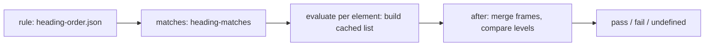

# dequelabs/axe-core — module: headings-landmarks-rules

## Responsibility

This slice holds the rules that look at page structure: heading order, empty headings, the one main landmark, unique landmarks, and "all content sits inside a landmark". Each rule is a small JSON file that picks elements and names the checks to run. The checks are JavaScript functions that read the page, and some have a second step ("after") that sees the results of every element and every frame together. Short answer: structure rules cannot judge one element alone, so they split the work in two.

## Key files

| File | Role |
|------|------|
| `lib/rules/heading-order.json` | Rule: picks headings, runs the `heading-order` check |
| `lib/rules/empty-heading.json` | Rule: a heading needs text from one of four sources |
| `lib/rules/heading-matches.js` | Filter: keep only nodes whose computed role is heading |
| `lib/rules/landmark-one-main.json` | Rule: one `main` landmark per document |
| `lib/rules/landmark-unique.json`, `landmark-unique-matches.js` | Rule and filter: landmarks must differ by role and name |
| `lib/rules/region.json` | Rule: all content inside landmarks |
| `lib/checks/navigation/heading-order-evaluate.js`, `heading-order-after.js` | Collect heading levels per frame, then compare them across frames |
| `lib/checks/navigation/region-evaluate.js`, `region-after.js` | Find content outside landmarks, then fix up iframe results |
| `lib/checks/landmarks/landmark-is-unique-evaluate.js`, `landmark-is-unique-after.js` | Record role and name, then group duplicates |
| `lib/checks/keyboard/page-has-main.json`, `page-has-heading-one.json` | Config-only checks reusing one generic function |
| `test/checks/navigation/heading-order.js` | Tests of the heading-order check |

## How it works

A rule says which elements to look at and which checks decide. A check has up to two functions: `evaluate` runs once per element, `after` runs once with all results.

1. The `heading-order` rule selects `h1`-`h6` and `[role=heading]`, then filters with `heading-matches` (`lib/rules/heading-order.json:4-5 @ e80f6b7`). The filter keeps a node only if its computed role is `heading` (`lib/rules/heading-matches.js:3-5 @ e80f6b7`).
2. The check file names both steps: `evaluate` and `after` (`lib/checks/navigation/heading-order.json:3-4 @ e80f6b7`).
3. `evaluate` runs on the first matched heading only. It builds the whole list of headings and iframes on the page, with a level for each, and caches it under `headingOrder` (`lib/checks/navigation/heading-order-evaluate.js:46-72 @ e80f6b7`). Later headings find the cache and return true at once (`lib/checks/navigation/heading-order-evaluate.js:47-49 @ e80f6b7`).
4. The level comes from `aria-level` if it is valid, else from the `hN` tag, else 2 for a bare `role=heading` (`lib/checks/navigation/heading-order-evaluate.js:6-43 @ e80f6b7`).
5. `after` merges the per-frame lists into one page-wide list. Parent frames go first, because results are sorted by ancestry length (`lib/checks/navigation/heading-order-after.js:54-64 @ e80f6b7`). Each frame's headings are spliced in where its iframe sat (`lib/checks/navigation/heading-order-after.js:84-90 @ e80f6b7`).
6. Each result then passes if its level is at most one more than the heading before it. The first heading always passes (`lib/checks/navigation/heading-order-after.js:33-48 @ e80f6b7`). A failing heading gets the previous heading attached as a related node (`lib/checks/navigation/heading-order-after.js:19-28 @ e80f6b7`).

The `region` rule works the same way. `evaluate` computes the set of "regionless" nodes once and caches it (`lib/checks/navigation/region-evaluate.js:15-19 @ e80f6b7`). `after` makes iframe results always pass and lets child elements inherit their frame's result (`lib/checks/navigation/region-after.js:4-28 @ e80f6b7`).

## Beyond the textbook

### Check in two phases: per element, then across all results

- Textbook version: a rule tests each element on its own and reports pass or fail.
- What they do: the `after` function receives every result, including results from other frames, and rewrites them.
- Why: heading order depends on the previous heading, which may live in a different iframe. The code comment says it needs "the results of any in-context iframes" in their proper order.
- Evidence: `lib/checks/navigation/heading-order-evaluate.js:51-55 @ e80f6b7`, `lib/checks/navigation/heading-order-after.js:3-13 @ e80f6b7`

### Cache the page-wide work so it runs once

- Textbook version: each matched element recomputes what it needs.
- What they do: the first element builds the heading list (or the regionless-node list) and stores it in a shared cache. The rest return at once.
- Why: with hundreds of headings or nodes, a per-element full-page scan would be quadratic. The cache keeps it linear.
- Evidence: `lib/checks/navigation/heading-order-evaluate.js:46-49 @ e80f6b7`, `lib/checks/navigation/region-evaluate.js:15-17 @ e80f6b7`

### Return "undefined" when the tool cannot decide

- Textbook version: every check is pass or fail.
- What they do: if a heading is not in the merged map (for example, it was excluded from the scan), the result is `undefined`, which axe reports as "incomplete". The check's message says "Unable to determine previous heading".
- Why: a missing previous heading means automation cannot judge; a human must look. This is the line between a violation and a "needs review".
- Evidence: `lib/checks/navigation/heading-order-after.js:42-45 @ e80f6b7`, `lib/checks/navigation/heading-order.json:10 @ e80f6b7`

### Follow the spec defaults, not the naive reading

- Textbook version: heading level equals the number in the tag.
- What they do: an invalid `aria-level` (below 1 or not a number) falls back to the tag level, or 2 for `role=heading`. High values are allowed because screen readers accept any positive level.
- Why: comments cite the WAI-ARIA heading definition and note that NVDA and VoiceOver allow any positive level.
- Evidence: `lib/checks/navigation/heading-order-evaluate.js:22-36 @ e80f6b7`

### Report one failure per duplicate group

- Textbook version: flag every landmark that has a duplicate.
- What they do: `landmark-is-unique-evaluate` always returns true and records role and lowercase accessible name. `after` keeps the first landmark of each role+name pair, marks it failed and adds the others as related nodes.
- Why: the comment says this stops every non-unique landmark being reported, so only the first is. Fewer, clearer reports.
- Evidence: `lib/checks/landmarks/landmark-is-unique-evaluate.js:5-11 @ e80f6b7`, `lib/checks/landmarks/landmark-is-unique-after.js:4-24 @ e80f6b7`

### Rules are data; checks are reused

- Textbook version: one function per rule.
- What they do: `page-has-main` and `page-has-heading-one` use the same `has-descendant-evaluate` function with different CSS selectors and `passForModal: true`. The `region` check takes a `regionMatcher` option for dialogs and SVG.
- Why: new rules need only a JSON file, and options let teams tune a check without code.
- Evidence: `lib/checks/keyboard/page-has-main.json:3-8 @ e80f6b7`, `lib/checks/keyboard/page-has-heading-one.json:3-8 @ e80f6b7`, `lib/checks/navigation/region.json:5-7 @ e80f6b7`

### Edge cases from real issues

- `region` ignores content inside `aria-live` areas and treats skip links, buttons, and iframes specially (`lib/checks/navigation/region-evaluate.js:53-60 @ e80f6b7`, `lib/checks/navigation/region-evaluate.js:108-114 @ e80f6b7`). Body text nodes are not reported, citing issue 2049 (`lib/checks/navigation/region-evaluate.js:75-82 @ e80f6b7`).
- `landmark-is-top-level` allows an `aside` inside `main`, citing issue 2651 (`lib/checks/keyboard/landmark-is-top-level-evaluate.js:17-23 @ e80f6b7`).
- Heading selection reads headings outside the current scan context, citing issue 728 (`lib/checks/navigation/heading-order-evaluate.js:51-54 @ e80f6b7`).

## Tests and what they protect

The heading-order test file has 10 tests for `evaluate` and 16 for `after` (`test/checks/navigation/heading-order.js:10-841 @ e80f6b7`). They protect:

- Level rules: invalid `aria-level` becomes 2 (`test/checks/navigation/heading-order.js:33-55 @ e80f6b7`), high levels are allowed (`test/checks/navigation/heading-order.js:56 @ e80f6b7`), and `aria-level` overrides the tag (`test/checks/navigation/heading-order.js:96 @ e80f6b7`).
- Skips: +2 fails, -1 and -2 pass, a single heading passes (`test/checks/navigation/heading-order.js:200-327 @ e80f6b7`).
- Frames: valid and invalid order across iframes, nested iframes, and a frame with no heading (`test/checks/navigation/heading-order.js:357-459 @ e80f6b7`, `test/checks/navigation/heading-order.js:755 @ e80f6b7`).
- Shadow DOM in ancestries (`test/checks/navigation/heading-order.js:692 @ e80f6b7`) and custom elements that set `aria-level` through `elementInternals` (`test/checks/navigation/heading-order.js:841-862 @ e80f6b7`).
- The "cannot decide" path: `undefined` when the heading is not in the map (`test/checks/navigation/heading-order.js:528 @ e80f6b7`). The `after` tests feed hand-written result objects, so they run without a browser page (`test/checks/navigation/heading-order.js:814-838 @ e80f6b7`).

No test for the landmark or region checks is in this slice (see the a11y-tests module).

## Error handling, performance, and security

- Performance: shared cache, one tree walk (see above). The region walk stops at landmarks and marks parents so it does not rescan (`lib/checks/navigation/region-evaluate.js:61-66 @ e80f6b7`).
- Error handling: optional chaining and defaults (`?.`, `??`) handle missing headings without throwing (`lib/checks/navigation/heading-order-after.js:35-36 @ e80f6b7`). A missing previous result is skipped (`lib/checks/navigation/heading-order-after.js:25-27 @ e80f6b7`).
- Known gap: `evaluate` carries a `TODO: es-modules_tree` and reads the global `axe._tree[0]` (`lib/checks/navigation/heading-order-evaluate.js:56-61 @ e80f6b7`).
- Security: not present in this slice.

## Technologies and services seen

- axe-core's own `cache` helper — shares computed data between element checks (`lib/checks/navigation/heading-order-evaluate.js:1 @ e80f6b7`)
- Virtual DOM tree (`axe._tree`, `virtualNode`) — a copy of the page used for queries (`lib/checks/navigation/region-evaluate.js:23 @ e80f6b7`)
- ES modules, bundled into one file (imports in each check, e.g. `lib/rules/heading-matches.js:1 @ e80f6b7`)
- Mocha-style `describe`/`it` with Chai `assert` — the check tests (`test/checks/navigation/heading-order.js:1-10 @ e80f6b7`)
- WAI-ARIA role standards via `commons/aria` and `commons/standards` (`lib/checks/keyboard/landmark-is-top-level-evaluate.js:1-2 @ e80f6b7`)
- ACT rule id `ffd0e9` linked from `empty-heading` (`lib/rules/empty-heading.json:7 @ e80f6b7`)

## Worth exploring interactively

- Heading-order across frames — steps: (1) `evaluate` lists headings and iframes with levels (`lib/checks/navigation/heading-order-evaluate.js:55-70 @ e80f6b7`); (2) frame lists are sorted parent first (`lib/checks/navigation/heading-order-after.js:57-59 @ e80f6b7`); (3) each list is spliced into place (`lib/checks/navigation/heading-order-after.js:84-90 @ e80f6b7`); (4) frame placeholders are dropped (`lib/checks/navigation/heading-order-after.js:63 @ e80f6b7`); (5) each level is compared to the previous (`lib/checks/navigation/heading-order-after.js:47 @ e80f6b7`) — fits AlgorithmStepper because the learner sees a list grow and each heading turn green, red, or grey (undefined).
- Rule, matches, evaluate, after pipeline — steps: rule selector (`lib/rules/landmark-unique.json:4 @ e80f6b7`), matches filter (`lib/rules/landmark-unique-matches.js:4-8 @ e80f6b7`), evaluate records data (`lib/checks/landmarks/landmark-is-unique-evaluate.js:8 @ e80f6b7`), after groups duplicates (`lib/checks/landmarks/landmark-is-unique-after.js:14-19 @ e80f6b7`) — fits FlowAnimation because a landmark moves through the four stages.

## Open questions

- How `getCheckEvaluate` and the runner call `after` (answered by the engine-run module).
- Whether `landmark-is-top-level` is attached to a rule in this version; only its function is in this slice.

## My insights
