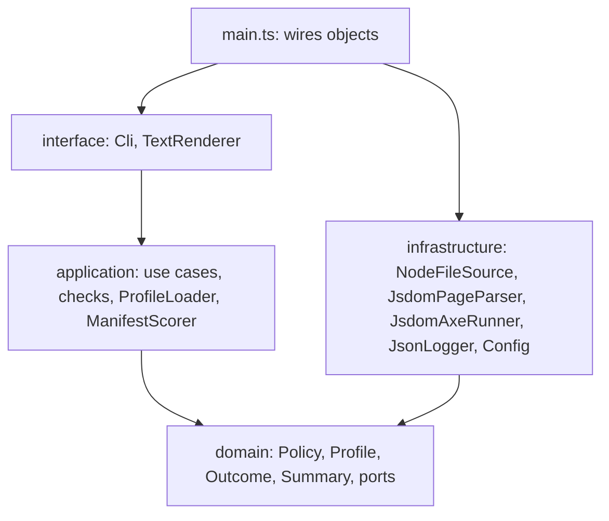

# Browser extension toolkit (install once, used across phases) — capstone

## What it is

The **toolkit-profile CLI** is a Node.js tool for a frontend team that shares one vetted set of browser extensions. It validates the extension list against a JSON permission policy first, prints a setup checklist for each phase, and then runs accessibility, SEO and security-header checks on a saved page and its saved response headers. Every check ends in pass, fail or needs review, the same idea as [[Three-valued results]].

It joins the two mini projects: the permission audit (see [[Extension permissions]]) and the release accessibility and SEO check. Project folder: `projects/frontend-engineering/learning-system-and-workstation/browser-extension-toolkit/capstone/`. Stack: Node.js with TypeScript, [[jsdom]], [[axe-core]] and Vitest. No real browser starts, so it runs in CI and in a sandbox. jsdom has no layout, so color contrast comes back as "review".

## Architecture at a glance



Dependencies point inward. More diagrams: [[visual-capstone-layers-browser-extension-toolkit|layers]], [[visual-capstone-request-flow-browser-extension-toolkit|request flow]], [[visual-capstone-deployment-browser-extension-toolkit|deployment]].

## Layers and key classes

| Layer | Key classes | Job |
|---|---|---|
| domain | `Policy`, `Profile`, `Outcome`, `Summary`, `ResponseHeaders`, ports | Rules and values; imports nothing else |
| application | `ProfileLoader`, `ManifestScorer`, `ValidateProfileUseCase`, `ChecklistBuilder`, `AuditPageUseCase`, `AccessibilityCheck`, `SeoCheck`, `SecurityHeaderCheck` | One class per use case or check |
| infrastructure | `NodeFileSource`, `JsdomPageParser`, `JsdomAxeRunner`, `JsonLogger`, `Config` | Files, jsdom, axe-core, logs, environment |
| interface | `Cli`, `TextRenderer` | Flags, exit codes, text |

The checks read [[Security response headers]] and [[Structured data]] from one shared context. Failures use [[Exit codes]]: 0 clean, 1 a check failed, 2 bad input.

## Ideas applied

- **Single responsibility:** `ManifestScorer` only scores; `TextRenderer` only prints.
- **Dependency inversion:** use cases depend on ports (`FileSource`, `AxeRunner`), so unit tests use fakes.
- **Open for extension:** a new check is a class with `run(context)` and one line in `main.ts`.
- **Encapsulation:** `Policy.fromJson` and `Profile.fromJson` make an invalid policy or profile impossible ([[Schema validation]]).
- **Composition over inheritance:** no class extends another.

Two decisions are recorded: `docs/adr/0001-policy-as-validated-data.md` and `docs/adr/0002-three-outcomes-for-every-check.md`.

## Borrowed from production

| Practice | Source | Applied in |
|---|---|---|
| Three outcomes for every check | [[axe-core-takeaways]] (1) | `Outcome.ts`, `AccessibilityCheck.ts` |
| Policy as data, validated first ([[Rules as data]]) | [[axe-core-takeaways]] (2) | `Policy.ts`, `ProfileLoader.ts` |
| Compute once, reuse | [[axe-core-takeaways]] (8) | `JsdomPageParser`, `AuditPageUseCase.run` |
| Clean up on every exit path ([[Cleanup on every exit path]]) | [[axe-core-takeaways]] (4) | `finally` in `JsdomAxeRunner.ts` |
| Tag each error with check and target | [[axe-core-takeaways]] (5) | `AuditPageUseCase.run` |
| Name tests after the rule | [[axe-core-takeaways]] (7) | `tests/unit/application.test.ts` |

## How to run it

```bash
cd projects/frontend-engineering/learning-system-and-workstation/browser-extension-toolkit/capstone
npm install
npm start        # validate, checklist, page checks on the sample page
npm test         # 51 tests
```

Try `node src/main.ts run --profile sample/profile-risky.json --page sample/page.html`: the risky extension stops the run before any page check. Set `TOOLKIT_STRICT=true` to make "needs review" fail the run.

## How to extend it

1. Add a check class (for example a robots meta check) and list it in `src/main.ts`.
2. Add a phase by editing `phases` in `policy/permission-policy.json`.
3. Add a live page source as a new infrastructure adapter; keep the checks the same.

## My insights
