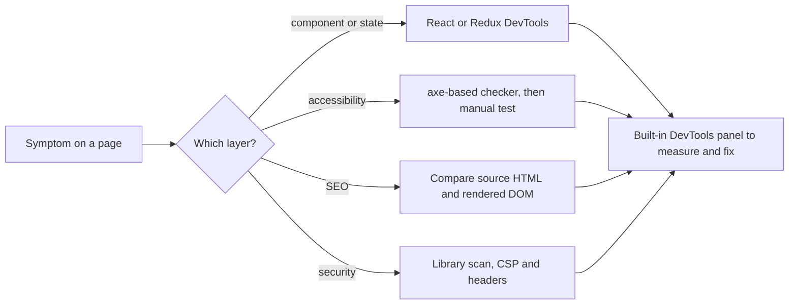

## In one sentence

A small, vetted set of browser extensions shows what built-in DevTools does not (components, store state, accessibility, SEO and security problems), and its manifest permissions tell you what each one can read.

## The mental model



Start from the layer of the symptom. An extension shows the layer; the built-in panels still measure and fix it.

## Visual refresher

- [[visual-how-it-works-browser-extension-toolkit|How a browser extension reaches the page]]: which part touches the DOM and why permissions matter.
- [[visual-framework-devtools-lab-browser-extension-toolkit|Framework DevTools lab]]: interactive mode. Redo the checkpoint where you dispatch an action and read the new store state.
- [[visual-a11y-checks-lab-browser-extension-toolkit|Accessibility checks lab]]: interactive mode. Redo the contrast checkpoint at 4.47:1.
- [[visual-security-pass-deck-browser-extension-toolkit|Security pass deck]]: branching mode. Redo the broad host access branch.
- [[visual-team-extension-profile-browser-extension-toolkit|The team extension profile]]: keep, replace with a built-in panel, or reject.

All visuals: [[visuals-browser-extension-toolkit|all visuals]].

## Key ideas

- An extension is a set of parts declared in `manifest.json`; content scripts touch the page DOM, while background scripts and popups use privileged APIs.
- Host permissions and content script `matches` decide on which sites an extension can read data, so broad hosts such as `<all_urls>` are the main risk.
- React DevTools shows the component tree and records renders in its Profiler; Redux DevTools shows each action and the store after it.
- Lab data comes from one load on your machine; field data (CrUX) comes from real users, so use both.
- Automated accessibility checks return pass, fail or needs review; keyboard and screen reader tests stay manual.
- Contrast for normal text must reach 4.5:1 (3:1 for large text), and 4.499:1 fails, because the ratio is not rounded up.
- Google indexes the rendered HTML, so compare the source HTML, the rendered DOM and the status code.

## When to use it / when not to

Use it when:
- A built-in panel cannot show the layer you need: components, store actions, accessibility rules or structured data.
- A team needs the same checks on every machine: a vetted profile gives everyone the same tools.

Do not use it when:
- A built-in panel already does the job (Lighthouse, Performance, Network): each extra extension adds risk.
- The extension asks for access to all sites and you cannot read its source or policy: reject it.
- You need a release gate: run the same checks as a script in CI, as in mini project 2.

## Trade-offs and failure modes

- Every extension can read what its permissions allow. Symptom: a "color picker" that asks for all sites and cookies.
- A clean automated report is not an accessible page. Symptom: no axe violations, but the menu cannot be used with a keyboard.
- Extensions change the page they test. Symptom: an ad blocker or content script hides a bug that real users see; test in a clean profile too.
- The source HTML hides SEO problems in a single-page app. Symptom: a title that exists only after JavaScript runs, or a soft 404 page that returns status 200.

## Commands or code worth remembering

```json
{
  "manifest_version": 3,
  "permissions": ["storage"],
  "host_permissions": ["https://example.com/*"],
  "content_scripts": [{ "matches": ["https://example.com/*"], "js": ["content.js"] }]
}
```

```js
const results = await axe.run(document);
// results.violations, results.passes, results.incomplete (needs review)
```

## What production systems do differently

- axe-core gives every check three outcomes, so doubtful cases go to a person instead of a false pass: [[axe-core-findings|axe-core findings]].
- axe-core keeps rules as data and scans every iframe through a swappable messenger, so extensions can avoid `postMessage`: [[axe-core-architecture|axe-core architecture]].
- The capstone validates the permission policy first and keeps the three outcomes: [[axe-core-takeaways|axe-core takeaways]].

## Go deeper

[[01-brief-browser-extension-toolkit|Brief]] · [[02-lesson-browser-extension-toolkit|Lesson]] · [[03-mini-projects-browser-extension-toolkit|Mini projects]] · [[00-digests-browser-extension-toolkit|Digests]] · [[00-repo-intel-browser-extension-toolkit|Repository deep dive]] · [[06-capstone-browser-extension-toolkit|Capstone]] · [[08-recall-browser-extension-toolkit|Recall cards]]

## My insights
