# Concept map of Browser extension toolkit (install once, used across phases)

Generated from the research curriculum. A solid arrow points from a concept to the concept that refines it; a dotted arrow shows a prerequisite.

```mermaid
flowchart TD
  extension_architecture_and_permissions["Extension architecture and permissions"]
  content_scripts_and_devtools_pages["Content scripts and DevTools pages"]
  extension_risk_and_vetting["Extension risk and vetting"]
  framework_devtools_extensions["Framework devtools extensions"]
  react_devtools_components_profiler["React DevTools Components and Profiler"]
  redux_devtools_time_travel["Redux DevTools actions and time travel"]
  performance_extensions["Performance extensions"]
  crux_field_data_viewers["CrUX field data and lab data"]
  accessibility_extensions["Accessibility extensions"]
  automated_a11y_rule_limits["What automated accessibility rules can and cannot catch"]
  contrast_and_vision_checks["Contrast checks"]
  headings_and_landmarks["Headings and landmarks structure"]
  seo_extensions["SEO extensions"]
  rendered_vs_source_html["Rendered HTML versus source HTML"]
  redirects_and_structured_data["Redirect chains and structured data"]
  security_privacy_extensions["Security and privacy extensions"]
  vulnerable_library_detection["Vulnerable library detection"]
  headers_cookies_and_csp["Security headers and CSP inspection"]
  ad_block_and_proxy_testing["Ad-block resilience and proxy testing"]
  design_css_helper_extensions["Design and CSS helper extensions"]
  api_data_extensions["API and data extensions"]
  request_modification_and_mocking["Request header modification and mocking"]
  team_extension_profile["A team extension profile"]
  extension_architecture_and_permissions --> content_scripts_and_devtools_pages
  extension_architecture_and_permissions --> extension_risk_and_vetting
  extension_architecture_and_permissions -. needed for .-> extension_risk_and_vetting
  content_scripts_and_devtools_pages -. needed for .-> framework_devtools_extensions
  framework_devtools_extensions --> react_devtools_components_profiler
  framework_devtools_extensions --> redux_devtools_time_travel
  performance_extensions --> crux_field_data_viewers
  accessibility_extensions --> automated_a11y_rule_limits
  accessibility_extensions --> contrast_and_vision_checks
  accessibility_extensions --> headings_and_landmarks
  seo_extensions --> rendered_vs_source_html
  seo_extensions --> redirects_and_structured_data
  extension_risk_and_vetting -. needed for .-> security_privacy_extensions
  security_privacy_extensions --> vulnerable_library_detection
  security_privacy_extensions --> headers_cookies_and_csp
  security_privacy_extensions --> ad_block_and_proxy_testing
  api_data_extensions --> request_modification_and_mocking
  extension_risk_and_vetting --> team_extension_profile
  extension_risk_and_vetting -. needed for .-> team_extension_profile
```

Back to [[visuals-browser-extension-toolkit|all visuals]].

## My insights
