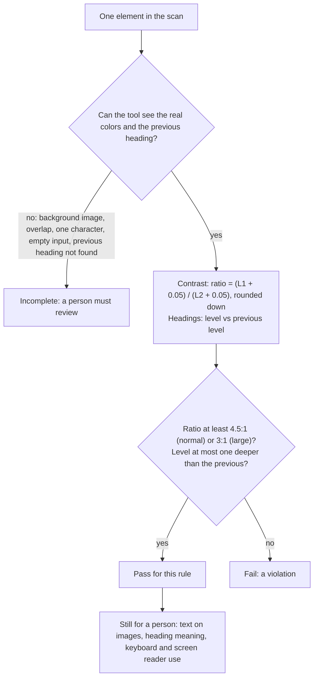

# Pass, fail or incomplete for contrast and heading checks

**Flowchart** · teaches Accessibility extensions, What automated accessibility rules can and cannot catch, Contrast and vision emulation checks

**Why this visual.** Show how an automated contrast or heading check reaches pass, fail or incomplete, and what stays for a person.

## What it shows

If the tool cannot see the real colors or the previous heading, it reports incomplete. Otherwise it measures: the contrast ratio, rounded down, against 4.5:1 or 3:1, and the heading level against the previous one. A pass covers only that rule; a person still judges meaning and real use.

Text alternative: Flowchart: an element first goes to incomplete when colors or the previous heading are unknown. Otherwise the tool compares the contrast ratio with 4.5:1 or 3:1 and the heading level with the previous level, giving pass or fail. Even a pass leaves text on images, heading meaning and keyboard use for a person.

## Check yourself

Gray #777777 text on white measures 4.48:1. Normal size. Which outcome does the check give?

Answer: Fail. The ratio is rounded down to 4.47, which is below 4.5:1, and there is no rounding up.

## Sources

- dequelabs/axe-core — https://github.com/dequelabs/axe-core (`dequelabs-axe-core-repo`)
- Selecting Web Accessibility Evaluation Tools — https://www.w3.org/WAI/test-evaluate/tools/selecting/ (`w3c-wai-selecting-evaluation-tools`)
- Understanding SC 1.4.3: Contrast (Minimum) (WCAG 2.2) — https://www.w3.org/WAI/WCAG22/Understanding/contrast-minimum.html (`w3c-wcag22-understanding-contrast-minimum`)

## Used in

- `projects/frontend-engineering/learning-system-and-workstation/browser-extension-toolkit/experiences/a11y-checks-lab/experience.json`

Back to [[visuals-browser-extension-toolkit|all visuals]].

## My insights
