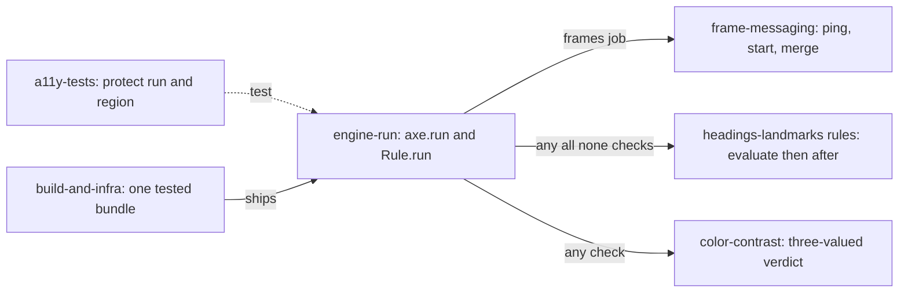

# axe-core module map

**Architecture** · teaches What automated accessibility rules can and cannot catch, Accessibility extensions

**Why this visual.** Show the six analyzed parts of axe-core and which part calls which.

## What it shows

The engine run is the centre. It starts a frame job for iframes and runs every rule on this page. Rules call small checks, such as heading order and colour contrast. Tests guard the engine, and the build ships one bundle that CI tests. Accessibility extensions wrap this engine.

Text alternative: Flowchart: engine-run points to frame-messaging for iframe jobs, to the headings and landmarks rules for any, all and none checks, and to the color-contrast check. A tests node points to engine-run with a dotted line, and the build node points to engine-run as the shipped bundle.

## Check yourself

Which part of axe-core handles iframes, and which part decides if text contrast is enough?

Answer: Frame messaging handles iframes. The colour-contrast check, called by the engine run, decides contrast.

## Sources

- dequelabs/axe-core — https://github.com/dequelabs/axe-core (`dequelabs-axe-core-repo`)

## Used in

- [[axe-core-architecture]]

Back to [[visuals-browser-extension-toolkit|all visuals]].

## My insights
