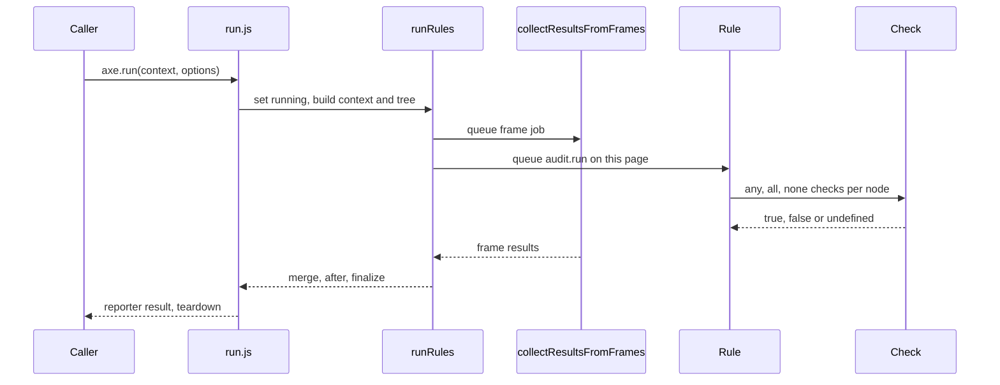

# One axe.run call from start to report

**Sequence** · teaches What automated accessibility rules can and cannot catch, Accessibility extensions

**Why this visual.** Show how one scan moves through the engine and where a check can answer 'cannot tell'.

## What it shows

The caller starts a scan. The engine sets a running flag, builds the page context, and queues two jobs: scan child frames and run the rules here. Each rule runs checks per element. A check returns true, false or undefined. The engine merges results, runs the after step, builds the report, and resets the flag.

Text alternative: Sequence diagram: the caller calls axe.run, run.js sets the running flag and calls runRules, which queues a frame job and a rule job. Rules run any, all and none checks that return true, false or undefined. Results are merged, finalized, reported to the caller and the engine is reset.

## Check yourself

What are the three possible answers of a check, and which one means a person must look?

Answer: True, false and undefined. Undefined is reported as incomplete and needs human review.

## Sources

- dequelabs/axe-core — https://github.com/dequelabs/axe-core (`dequelabs-axe-core-repo`)

## Used in

- [[axe-core-architecture]]

Back to [[visuals-browser-extension-toolkit|all visuals]].

## My insights
