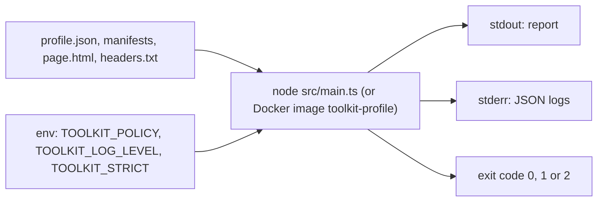

# toolkit-profile CLI deployment

**Deployment** · teaches What automated accessibility rules can and cannot catch, Extension risk and vetting

**Why this visual.** Show what the process reads and writes.

## What it shows

The tool is one Node.js process, or one Docker image with the same entry point. It reads saved files and three environment variables. It writes the report to stdout, JSON logs to stderr and an exit code of 0, 1 or 2. There is no server, no database and no network call.

Text alternative: Flowchart: saved profile, manifests, page and headers files, plus the environment variables TOOLKIT_POLICY, TOOLKIT_LOG_LEVEL and TOOLKIT_STRICT, feed one Node process. The process writes the report to stdout, JSON logs to stderr and an exit code.

## Check yourself

Where do the report and the logs go, and why does it matter in CI?

Answer: The report goes to stdout and logs to stderr, so CI can save the report without log lines mixed in. The exit code tells CI whether to fail the build.

## Sources

- dequelabs/axe-core — https://github.com/dequelabs/axe-core (`dequelabs-axe-core-repo`)

## Used in

- `projects/frontend-engineering/learning-system-and-workstation/browser-extension-toolkit/capstone/ARCHITECTURE.md`

Back to [[visuals-browser-extension-toolkit|all visuals]].

## My insights
