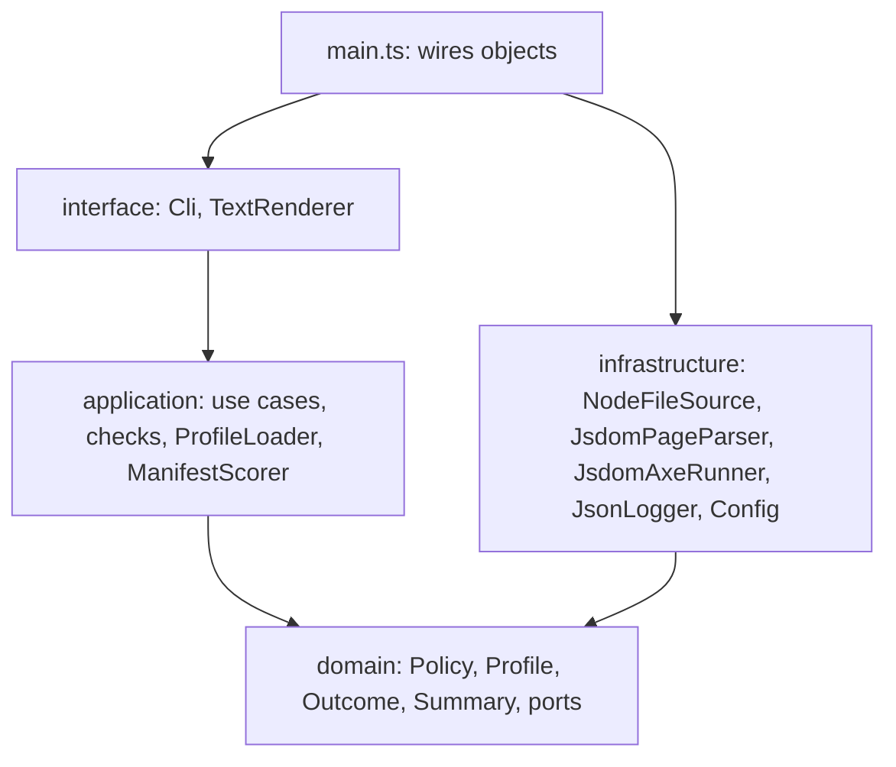

# toolkit-profile CLI layers

**Architecture** · teaches What automated accessibility rules can and cannot catch, Extension risk and vetting

**Why this visual.** Show which layer depends on which in the toolkit-profile CLI.

## What it shows

The interface layer (Cli, TextRenderer) calls the application layer: use cases, checks, ProfileLoader and ManifestScorer. Application code uses only the domain: Policy, Profile, Outcome, Summary and the ports. The infrastructure layer implements the ports with files, jsdom and axe-core. Arrows point inward, so the rules never import a disk or a DOM library.

Text alternative: Flowchart: main.ts wires the interface layer and the infrastructure layer. The interface layer depends on the application layer. The application layer and the infrastructure layer both depend on the domain layer, which depends on nothing. Dependencies point inward.

## Check yourself

Which layer would you change to read pages from a live URL instead of a file, and which layers stay the same?

Answer: Add an adapter in the infrastructure layer for the page source port. The domain, application and interface layers stay the same.

## Sources

- dequelabs/axe-core — https://github.com/dequelabs/axe-core (`dequelabs-axe-core-repo`)

## Used in

- `projects/frontend-engineering/learning-system-and-workstation/browser-extension-toolkit/capstone/ARCHITECTURE.md`
- [[06-capstone-browser-extension-toolkit]]

Back to [[visuals-browser-extension-toolkit|all visuals]].

## My insights
