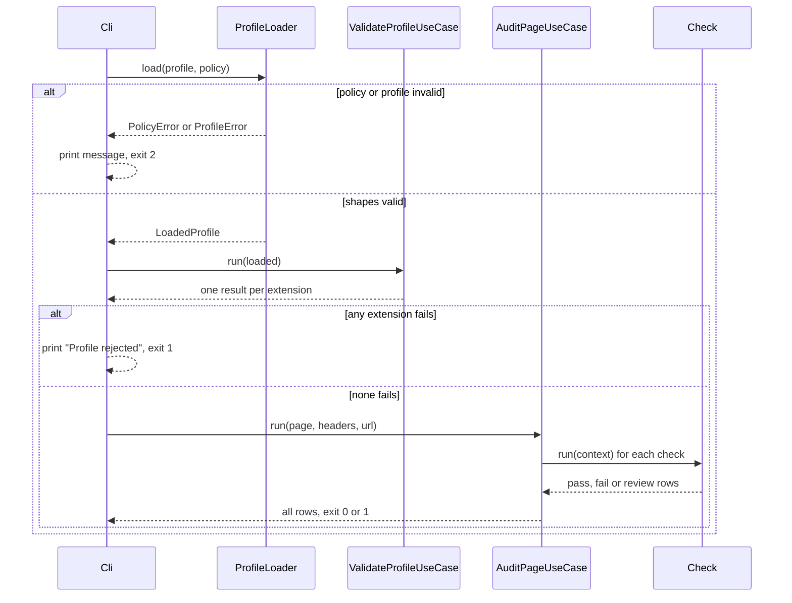

# One run of the toolkit-profile CLI

**Sequence** · teaches What automated accessibility rules can and cannot catch, Extension risk and vetting

**Why this visual.** Show the order of a run and where it stops early.

## What it shows

Cli asks ProfileLoader to load the policy and profile. A bad file ends the run with exit code 2. Otherwise ValidateProfileUseCase judges each extension. One failing extension ends the run with exit code 1 before any page check. If none fails, AuditPageUseCase runs each Check on one shared context and returns pass, fail or review rows.

Text alternative: Sequence diagram: Cli calls ProfileLoader. A policy or profile error ends the run with exit 2. Otherwise ValidateProfileUseCase runs. If an extension fails, the run stops with exit 1. If none fails, AuditPageUseCase runs each Check and returns rows to Cli.

## Check yourself

A profile lists one extension with debugger and all-sites access. Do the page checks run?

Answer: No. The extension scores above the reject limit, so Cli prints Profile rejected and exits with code 1 before AuditPageUseCase starts.

## Sources

- dequelabs/axe-core — https://github.com/dequelabs/axe-core (`dequelabs-axe-core-repo`)

## Used in

- `projects/frontend-engineering/learning-system-and-workstation/browser-extension-toolkit/capstone/ARCHITECTURE.md`

Back to [[visuals-browser-extension-toolkit|all visuals]].

## My insights
