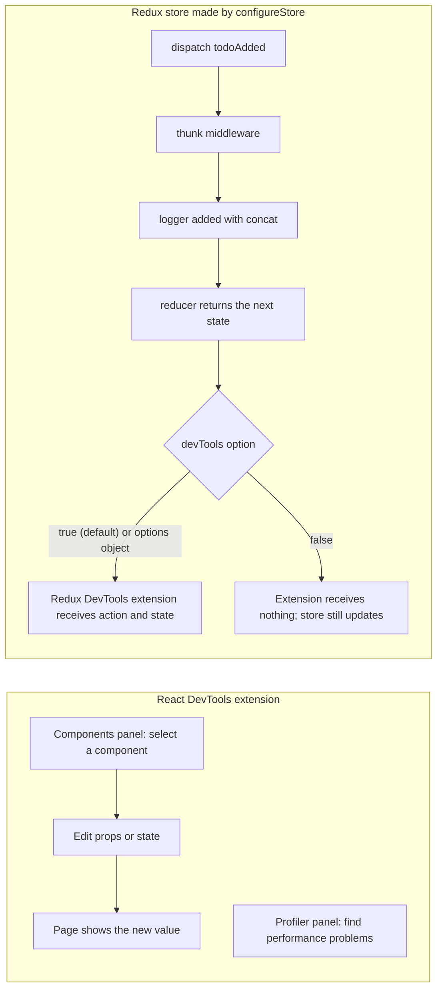

# What React DevTools and Redux DevTools read

**Workflow** · teaches Framework devtools extensions, React DevTools Components and Profiler, Redux DevTools actions and time travel

**Why this visual.** Show in one static picture where each framework devtools extension gets its data, for readers without JavaScript.

## What it shows

On a website built with React, React DevTools adds the Components and Profiler panels; in Components you select a component and edit its props or state. In Redux, a dispatched action passes the middleware in array order, the reducer returns the next state, and the store sends the action and state to the Redux DevTools extension while the devTools option is true, its default. With false, the store still updates but the extension receives nothing (react.dev React Developer Tools; redux.js.org Configuring Your Store).

Text alternative: Flowchart in two parts. React DevTools: the Components panel selects a component, its props or state are edited, and the page shows the new value; the Profiler panel finds performance problems. Redux: dispatch todoAdded goes to the thunk middleware, then the logger added with concat, then the reducer returns the next state; a devTools option decision sends action and state to the Redux DevTools extension when true or an options object, and sends nothing when false while the store still updates.

## Check yourself

Which configureStore setting stops the Redux DevTools extension from receiving actions?

Answer: devTools: false. The store still updates, but the integration with the extension is off.

## Sources

- React docs set: React Developer Tools, and Render and Commit — https://react.dev/learn/react-developer-tools (`react-devtools-docs`)
- Redux docs set: Configuring Your Store and Essentials Part 1 (Redux DevTools Extension) — https://redux.js.org/usage/configuring-your-store (`redux-configure-store-docs`)

## Used in

- `projects/frontend-engineering/learning-system-and-workstation/browser-extension-toolkit/experiences/framework-devtools-lab/experience.json`

Back to [[visuals-browser-extension-toolkit|all visuals]].

## My insights
