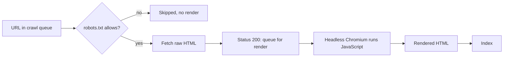

# How Google crawls, renders and indexes a JavaScript page

**Workflow** · teaches Rendered HTML versus source HTML, SEO extensions

**Why this visual.** Show that Google indexes the rendered HTML, so a tool must show you the page after JavaScript ran.

## What it shows

Googlebot checks robots.txt, fetches the raw HTML and queues pages with status 200 for rendering. A headless Chromium then runs the JavaScript. Google indexes the rendered HTML. A page blocked in robots.txt is never rendered, so an SEO extension that reads only the source HTML misses what Google sees.

Text alternative: Flowchart: a URL in the crawl queue is checked against robots.txt. If blocked it is skipped. If allowed, raw HTML is fetched, pages with status 200 are queued for rendering, a headless Chromium runs the JavaScript, and the rendered HTML is indexed.

## Check yourself

Which HTML does Google index, and what happens to a URL that robots.txt disallows?

Answer: Google indexes the rendered HTML. A disallowed URL is skipped and its JavaScript is not rendered.

## Sources

- Understand JavaScript SEO basics — https://developers.google.com/search/docs/crawling-indexing/javascript/javascript-seo-basics (`google-js-seo-basics-docs`)

## Used in

- [[google-js-seo-basics-docs-browser-extension-toolkit]]

Back to [[visuals-browser-extension-toolkit|all visuals]].

## My insights
