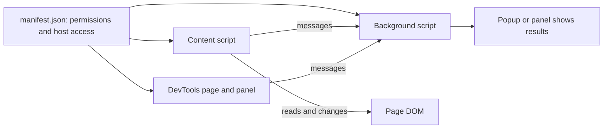

# How a browser extension reaches the page

**Architecture** · teaches Extension architecture and permissions, Content scripts and DevTools pages, Extension risk and vetting

**Why this visual.** Show which part of an extension touches the page and why the manifest permissions decide what it can see.

## What it shows

The manifest declares the extension parts and the permissions they get. A content script runs in the page and reads or changes the DOM. A DevTools page adds a panel to DevTools. Both send messages to the background script, which holds shared state, and a popup or panel shows the result. Every tool in your toolkit uses this same structure, so its permissions tell you what data it can read.

Text alternative: Flowchart: manifest.json with permissions and host access points to the background script, the content script and the DevTools page. The content script reads and changes the page DOM and sends messages to the background script. The DevTools page also sends messages to the background script, which feeds a popup or panel that shows results.

## Check yourself

An accessibility extension must read the headings on every page you open. Which part of the extension does that, and what in the manifest allows it?

Answer: A content script reads the page DOM. Host permissions (or matches for the content script) in manifest.json decide on which sites it may run.

## Sources

- Anatomy of a WebExtension (MDN) — https://developer.mozilla.org/en-US/docs/Mozilla/Add-ons/WebExtensions/Anatomy_of_a_WebExtension (`mdn-webextensions-anatomy-docs`)
- Content scripts (Chrome for Developers) — https://developer.chrome.com/docs/extensions/develop/concepts/content-scripts (`chrome-extensions-content-scripts-docs`)

## Used in

- [[01-brief-browser-extension-toolkit]]

Back to [[visuals-browser-extension-toolkit|all visuals]].

## My insights
