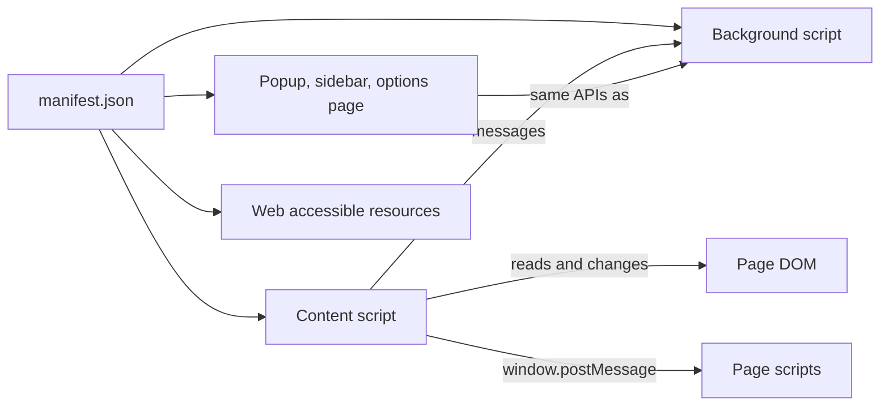

# Parts of a WebExtension and who talks to whom

**Architecture** · teaches Extension architecture and permissions, Content scripts and DevTools pages

**Why this visual.** Show the parts that manifest.json can declare and which of them touch the page.

## What it shows

manifest.json is the only required file. It points to the background script, content scripts, popup, sidebar and options pages, and web accessible resources. A content script works on the page DOM and talks to the background script by messages. It talks to page scripts only through window.postMessage. Popups, sidebars and options pages can use the same privileged APIs as the background script.

Text alternative: Flowchart: manifest.json points to a background script, a content script, popup sidebar and options pages, and web accessible resources. The content script reads and changes the page DOM, sends messages to the background script and uses window.postMessage to reach page scripts. Popup, sidebar and options pages use the same APIs as the background script.

## Check yourself

How can a content script ask the browser to run an API it is not allowed to call itself?

Answer: It sends a message to the background script, which can use any API its permissions allow.

## Sources

- Anatomy of a WebExtension (MDN) — https://developer.mozilla.org/en-US/docs/Mozilla/Add-ons/WebExtensions/Anatomy_of_a_WebExtension (`mdn-webextensions-anatomy-docs`)

## Used in

- [[mdn-webextensions-anatomy-docs-browser-extension-toolkit]]

Back to [[visuals-browser-extension-toolkit|all visuals]].

## My insights
