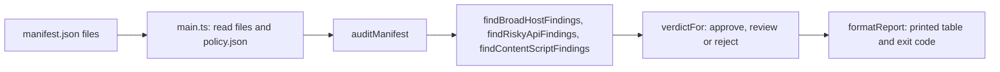

# Extension permission audit flow

**Data flow** · teaches Extension architecture and permissions, Extension risk and vetting, A team extension profile

**Why this visual.** Show how manifest files and a JSON policy become a verdict per extension.

## What it shows

main.ts reads each manifest.json and policy.json. auditManifest runs three rule functions for broad hosts, risky APIs and content scripts on all sites, adds their points, and verdictFor maps the score to approve, review or reject. formatReport prints the table and the exit code lets CI block a rejection.

Text alternative: Flowchart: manifest.json files go to main.ts, then auditManifest, then the three rule functions, then verdictFor, then formatReport.

## Check yourself

Where do the point values and thresholds come from, and why?

Answer: From policy.json, so a team can change what counts as risky without editing code.

## Sources

- Anatomy of a WebExtension (MDN) — https://developer.mozilla.org/en-US/docs/Mozilla/Add-ons/WebExtensions/Anatomy_of_a_WebExtension (`mdn-webextensions-anatomy-docs`)
- Content scripts (Chrome for Developers) — https://developer.chrome.com/docs/extensions/develop/concepts/content-scripts (`chrome-extensions-content-scripts-docs`)
- chrome.declarativeNetRequest API reference — https://developer.chrome.com/docs/extensions/reference/api/declarativeNetRequest (`chrome-declarativenetrequest-docs`)

## Used in

- `projects/frontend-engineering/learning-system-and-workstation/browser-extension-toolkit/mini-01-extension-permission-audit/README.md`

Back to [[visuals-browser-extension-toolkit|all visuals]].

## My insights
