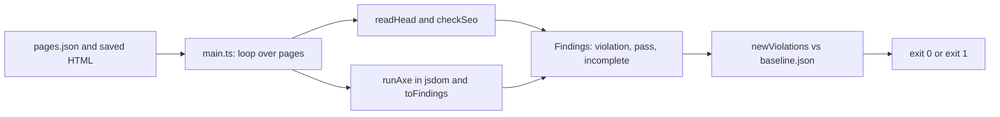

# Release a11y and SEO check flow

**Data flow** · teaches What automated accessibility rules can and cannot catch, Contrast checks, Rendered HTML versus source HTML, Redirect chains and structured data

**Why this visual.** Show how saved pages become findings with three outcomes and a CI exit code.

## What it shows

main.ts loops over the pages in pages.json. readHead and checkSeo judge the head tags, and runAxe runs axe-core in jsdom while toFindings keeps violation, pass and incomplete. newViolations compares the violations with baseline.json, and main.ts exits 1 only when a violation is new.

Text alternative: Flowchart: pages.json and saved HTML go to main.ts, which feeds readHead with checkSeo and runAxe with toFindings into one findings list, then newViolations against baseline.json, then exit 0 or 1.

## Check yourself

Why does a color-contrast result in this project not fail the build?

Answer: jsdom has no layout, so axe returns it as incomplete (needs review), and only new violations change the exit code.

## Sources

- dequelabs/axe-core — https://github.com/dequelabs/axe-core (`dequelabs-axe-core-repo`)
- Understanding SC 1.4.3: Contrast (Minimum) (WCAG 2.2) — https://www.w3.org/WAI/WCAG22/Understanding/contrast-minimum.html (`w3c-wcag22-understanding-contrast-minimum`)
- Google Search Central: JavaScript SEO basics, Redirects, and Site move with URL changes — https://developers.google.com/search/docs/crawling-indexing/javascript/javascript-seo-basics (`google-js-seo-basics-docs`)

## Used in

- `projects/frontend-engineering/learning-system-and-workstation/browser-extension-toolkit/mini-02-release-a11y-seo-check/README.md`

Back to [[visuals-browser-extension-toolkit|all visuals]].

## My insights
