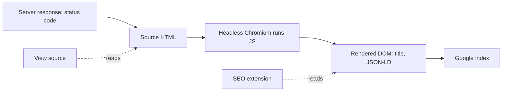

# Where the crawler and each SEO tool read the page

**Workflow** · teaches SEO extensions, Rendered HTML versus source HTML, Redirect chains and structured data

**Why this visual.** Show that the source HTML and the rendered DOM are different stages, and that each tool reads only one of them.

## What it shows

Google first reads the server response: the status code and the source HTML. Headless Chromium then runs the JavaScript, and Google indexes the rendered DOM. View source shows the source HTML. An SEO extension reads the rendered DOM, so it sees titles and JSON-LD that scripts added, but not the raw status code. Check both stages.

Text alternative: Flowchart from left to right: the server response with its status code leads to the source HTML, then headless Chromium runs JavaScript, then the rendered DOM with title and JSON-LD goes to the Google index. View source reads the source HTML. An SEO extension reads the rendered DOM.

## Check yourself

Your page title is set only by JavaScript. View source shows no title. Which tool shows what Google indexes?

Answer: The SEO extension, because it reads the rendered DOM, and Google indexes the rendered HTML after the JavaScript runs.

## Sources

- Understand JavaScript SEO basics — https://developers.google.com/search/docs/crawling-indexing/javascript/javascript-seo-basics (`google-js-seo-basics-docs`)
- Content scripts (Chrome for Developers) — https://developer.chrome.com/docs/extensions/develop/concepts/content-scripts (`chrome-extensions-content-scripts-docs`)

## Used in

- lesson page `/frontend-engineering/learning-system-and-workstation/browser-extension-toolkit/lesson/05-seo-extensions/` (file `site/src/content/lessons/frontend-engineering/learning-system-and-workstation/browser-extension-toolkit/05-seo-extensions.mdx`)

Back to [[visuals-browser-extension-toolkit|all visuals]].

## My insights
