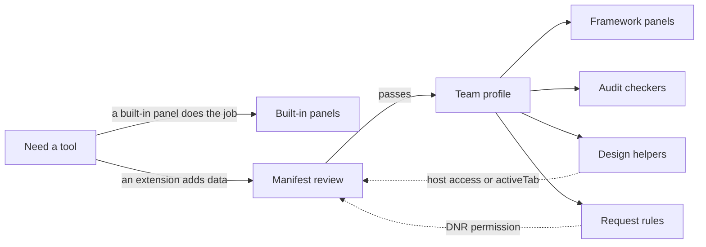

# A vetted team extension profile

**Architecture** · teaches A team extension profile, Design and CSS helper extensions, API and data extensions, Request header modification and mocking

**Why this visual.** Show how a team profile groups vetted extensions and which manifest permission each group asks for.

## What it shows

When a built-in DevTools panel does the job, the team uses the panel and installs no extension. Otherwise the extension passes a manifest review before it joins the team profile. The profile has four groups: framework panels, audit checkers such as axe-core and Retire.js, design helpers, and request rules. Design helpers need host access or activeTab. Request rules need the declarativeNetRequest permission.

Text alternative: Flowchart: a need for a tool splits two ways. If a built-in panel does the job, it leads to the built-in panels. If an extension adds data, it leads to a manifest review, then to the team profile, which branches into four groups: framework panels, audit checkers, design helpers and request rules. Dotted lines send design helpers back to the review for host access or activeTab, and request rules back for the declarativeNetRequest permission.

## Check yourself

A CSS helper wants to change styles on every site you open. Which permission do you check before it joins the profile?

Answer: Its host access: a content script can read and change the DOM of every page its manifest matches. Narrow host access, or activeTab for injection on demand, fits the job better.

## Sources

- Anatomy of a WebExtension (MDN) — https://developer.mozilla.org/en-US/docs/Mozilla/Add-ons/WebExtensions/Anatomy_of_a_WebExtension (`mdn-webextensions-anatomy-docs`)
- Content scripts (Chrome for Developers) — https://developer.chrome.com/docs/extensions/develop/concepts/content-scripts (`chrome-extensions-content-scripts-docs`)
- chrome.declarativeNetRequest API reference — https://developer.chrome.com/docs/extensions/reference/api/declarativeNetRequest (`chrome-declarativenetrequest-docs`)
- React docs set: React Developer Tools, and Render and Commit — https://react.dev/learn/react-developer-tools (`react-devtools-docs`)
- dequelabs/axe-core — https://github.com/dequelabs/axe-core (`dequelabs-axe-core-repo`)
- RetireJS/retire.js — https://github.com/RetireJS/retire.js (`retirejs-repo`)
- Performance features reference / overview (Chrome DevTools) — https://developer.chrome.com/docs/devtools/performance/overview (`chrome-devtools-perf-overview-docs`)

## Used in

- lesson page `/frontend-engineering/learning-system-and-workstation/browser-extension-toolkit/lesson/07-team-toolkit-in-practice/` (file `site/src/content/lessons/frontend-engineering/learning-system-and-workstation/browser-extension-toolkit/07-team-toolkit-in-practice.mdx`)

Back to [[visuals-browser-extension-toolkit|all visuals]].

## My insights
