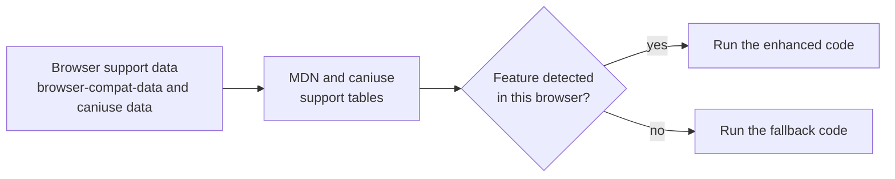

# How to learn frontend (and keep improving) in brief

## What it is

This topic is a system for learning frontend work. You read a primary source, build a small demo, measure it in DevTools, and explain it. You also check if browsers support a feature before you use it.

## The problem it solves

Frontend changes fast. A tutorial from two years ago can teach an API that changed or a workaround that is no longer needed. If you copy code without checking support, it can break for some of your users. A repeatable loop and a support check keep your knowledge correct.

## How it works in one picture

The diagram shows how you decide if you can use a web feature.

Support data feeds the tables that you read. At runtime, your code still checks for the feature and picks a path. [[visual-how-it-works-how-to-learn-frontend|explanation and sources]]

## Where it is used in the real world

- MDN builds its support tables from browser-compat-data, and caniuse combines its own data with it. You read a table instead of testing every browser yourself.
- Baseline labels a feature "Widely available" 30 months after all core browsers support it. Most sites can use it, but check your own users' browsers first.
- The TC39 stages show how mature a JavaScript proposal is. You do not learn a feature that can still change.

## What you need to know first

- [[Browser developer tools]] — DevTools let you inspect and measure a live page.
- [[Web standards]] — WHATWG and W3C write the specs that browsers implement.
- [[Git and GitHub]] — Git tracks code changes; GitHub hosts repositories and issues.

## What you will be able to do

- Explain the read, build, measure, explain loop and run it on one feature.
- Explain why primary sources beat tutorials, and find the right spec section.
- Decide whether a web feature can ship today using Baseline and caniuse.
- Build a feature check that falls back when an API is missing.
- Build a weekly routine of practice, news, code reading and teaching.

## My insights
