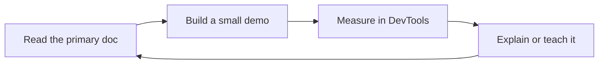

# How to learn frontend (and keep improving) in brief

## What it is

You learn frontend best through a repeatable loop: read the primary source, build a small demo, measure it in the browser, then explain it in your own words. This topic sets up that loop and the habits that keep you improving after this roadmap.

## The problem it solves

Frontend changes quickly and tutorials go stale. Following them passively leaves you unable to solve new problems on your own. A method built on primary sources and small experiments keeps you current and gives you a way to check what you actually understand.

## How it works in one picture

The loop has four steps; each feeds the next, and the last one starts the loop again.

You read the official docs first, build a tiny demo, measure what it does in DevTools, then explain it so a junior could follow. [[visual-how-it-works-how-to-learn-frontend|explanation and sources]]

## Where it is used in the real world

- A working developer checks MDN and web.dev daily as the reference, not a tutorial. (mdn-learn-web-development)
- A team checks Baseline labels before deciding a feature is safe to ship. (web-dev-baseline)
- Developers read small libraries such as nanoid to learn patterns from real code. (ai-nanoid-repo)

## What you need to know first

- [[Basic programming]] — you already studied this
- [[Web browser]] — you already studied this

## What you will be able to do

- Explain the read-build-measure-explain loop and why it beats passive tutorials.
- Decide whether a feature is safe to ship today using Baseline and caniuse.
- Build a personal learning log that records each roadmap item's four steps.
- Decide when to polyfill or progressively enhance instead of dropping support.
- Explain how reading source code and teaching accelerate frontend expertise.

## My insights
