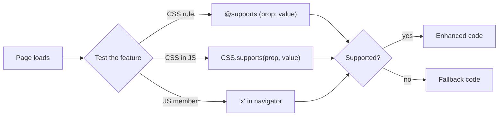

# Implementing feature detection (MDN)

Mozilla contributors, 2025, MDN Web Docs, official learning guide. Read on 2026-11-17.

## The claim in one sentence

Your code should test whether the browser supports a feature and then pick enhanced or fallback code, instead of guessing from the browser's name.

## The problem before this

Some browsers lack features your code uses. The guide says those browsers "may not display your sites properly or might fail altogether" (section "The concept of feature detection"). A common shortcut was browser sniffing: reading which browser visits the site. The guide calls that "a terrible practice that should be discouraged at all costs" (same section).

## Key ideas

### Test the feature, not the browser

Feature detection asks "can this browser do X?" and runs different code depending on the answer. The goal is that the browser "always provide a working experience" instead of crashing (Intro). Browser sniffing asks "which browser is this?", which is the practice the guide rejects.

### CSS has two tests

`@supports` is a CSS rule that applies styles only if the browser supports a CSS feature. It works like a media query and accepts `and`, `or` and `not`. The guide calls it the preferred CSS method because it needs no JavaScript. `CSS.supports(property, value)` runs the same kind of test inside JavaScript (section "CSS").

### JavaScript checks that a member exists

The `in` operator asks whether an object has a property or method. For example `"geolocation" in navigator` is true when the Geolocation API exists (sections "The concept of feature detection" and "Members of an object").

### Other JavaScript tests build an element in memory

You can create an element with `Document.createElement()` and check a property on it. The canvas example returns `!!document.createElement("canvas").getContext`, and `!!` forces a real boolean. Two further tests check what a method returns, or whether an assigned property value is kept. The guide gives no code for these two (section "JavaScript").

### Some features cannot be detected

The guide says some features are "known to be undetectable". In that case you need another approach, "such as using a polyfill". The guide names no undetectable feature and does not explain polyfills further (section "JavaScript").

## How it works

In plain words: the page runs a small test when it loads. The test answers yes or no. Yes runs the new code. No runs older code, so the visitor still gets a working page.

The diagram follows the sections "The concept of feature detection" and "Writing your own feature detection tests". [[visual-mdn-feature-detection-guide-mechanism-how-to-learn-frontend|explanation and sources]]

1. Pick the feature and the test that fits it: CSS rule, `CSS.supports()`, `in`, or an element test.
2. Run the test. The guide's geolocation code is `if ("geolocation" in navigator) { ... } else { ... }`. The `else` branch offers static maps.
3. For CSS, `@supports (grid-template-columns: subgrid) { ... }` holds the new layout rules. The guide's second example is `@supports not (...)`, which holds the fallback rules.
4. In JavaScript, the Subgrid example calls `CSS.supports("grid-template-columns", "subgrid")` and, if true, sets a stylesheet link to `subgrid-layout.css`.
5. For a media query in JavaScript, use `window.matchMedia("(width <= 480px)").matches` (section "matchMedia").

**Interpretation.** `@supports`, `CSS.supports()` and `in` differ in where they run (CSS or JavaScript) and what they test (a CSS pair or an object member). All three give the same yes or no.

## Results and evidence

- The guide lists four JavaScript test kinds: object members, element properties, method return values, and retained property values (section "JavaScript").
- It names `@supports` as the preferred CSS method because no JavaScript is needed (section "@supports").
- It gives code for geolocation, canvas, subgrid and `matchMedia`. It gives no measured data, because it is a how-to guide.

## Limitations and criticisms

- The intro promises "how to use a library", but the body names no library and shows none. I read the page for this and found nothing.
- It gives no example of an undetectable feature and does not explain polyfills (section "JavaScript"). A learner needs another source for that.
- The sample tests are small. The guide does not say when a test can pass yet the feature still behaves badly.
- Polyfills carry a security risk. [[Polyfill]] code loaded from a third-party address runs on your page. The source `sansec-polyfill-io-blog` records a 2024 attack on cdn.polyfill.io. I did not read that page in this run, so I do not report its details here.

## What practitioners took from it

Adoption in real projects could not be verified from the sources recorded for this topic, so nothing is claimed here beyond the MDN guide itself.

## How it connects to this topic

- [[01-brief-how-to-learn-frontend|How to learn frontend brief]] — this is the "run enhanced or fallback code" step in the brief's diagram.
- [[Feature detection]] — the shared concept this digest defines.
- [[Polyfill]] — the guide's one answer for undetectable features.
- [[Web standards]] — new features reach browsers at different times, which is why tests are needed.

## Test yourself

1. Why does the guide prefer `@supports` over a JavaScript test for CSS features?
2. What does `"geolocation" in navigator` check, and what does the `else` branch do in the guide's example?
3. Why is browser sniffing a bad substitute for feature detection, and what does the guide suggest for undetectable features?

## My insights
