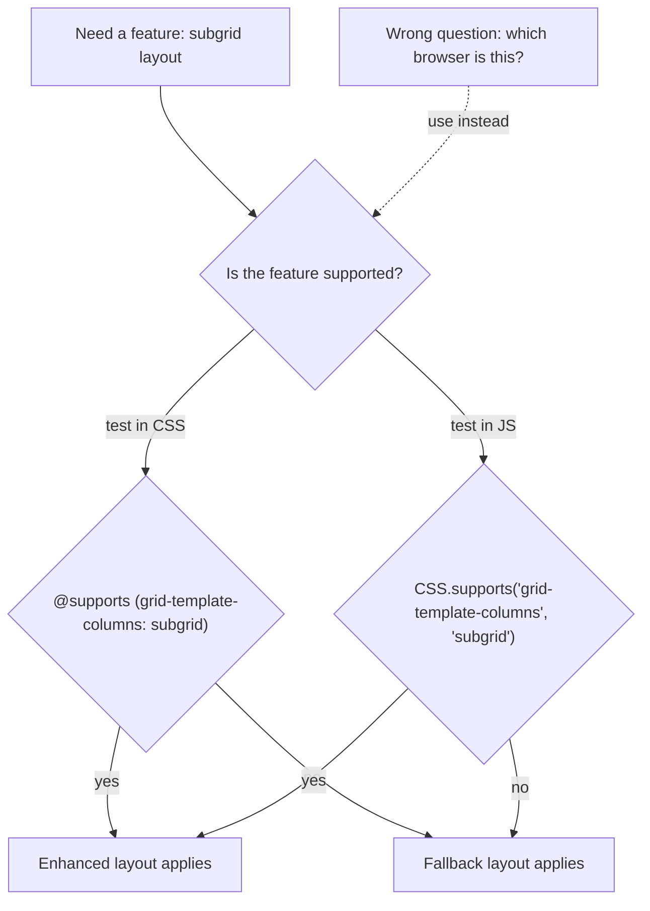

# Implementing feature detection

MDN Web Docs community (Mozilla), 2025. Official documentation page from MDN's Learn web
development course, read on 2026-11-18.

## The claim in one sentence

You can ask the running browser whether it supports a feature and then run the matching
code, so every visitor gets a working page.

## The problem before this

A page used to assume one browser. When a new CSS property or web API arrived, the page
broke for everyone else. The usual shortcut was to read the user agent string and branch
on the browser name. MDN calls that browser sniffing "a terrible practice that should be
discouraged at all costs". The page gives no reason of its own for that rule. It links to
a separate guide on the user agent string.

**Interpretation.** A sniffed branch breaks as soon as a browser changes or disguises its
name string. The code path then runs where the feature does not exist, which is the exact
crash that feature detection removes.

## Key ideas

### Test the feature, not the browser

Feature detection asks one question: does this browser have the thing I need? The source's
geolocation example tests for a `geolocation` member on the `navigator` object and calls
the API only when that test passes. The same HTML and the same script run everywhere. Only
the branch differs.

### CSS ships its own detector

`@supports` is a native at-rule that applies a block of CSS only when the browser
understands a declaration. MDN calls it the preferred method for CSS support checks,
because it needs no JavaScript and it cuts HTTP requests.

### `CSS.supports()` moves the test into JavaScript

`CSS.supports("grid-template-columns", "subgrid")` answers the same question with a
boolean. A script can use the answer to swap the `href` of a stylesheet link. MDN shows
this route before the native `@supports` version.

### Four JavaScript test patterns

MDN lists four common shapes: an object member, an element property, a method return
value, and a retained assigned value. The double
NOT `!!` in `return !!document.createElement("canvas").getContext;` forces a real boolean
instead of a truthy value.

### Some features cannot be detected

MDN says some features cannot be detected at all. In those cases you need a
polyfill rather than a test.

### `matchMedia()` tests the viewport, not a feature

`window.matchMedia("(width <= 480px)").matches` runs a media query inside JavaScript. It
selects by device traits such as width or aspect ratio, not by feature support.

## How it works

In plain words: the browser becomes the judge. You write a small test, and the browser
answers it by what it does. You keep two versions of the behaviour: the richer one and
the plain one. The page always works, and only its polish changes.

**Analogy.** A lighthouse asks the sea whether it can carry the lamp. It uses a bright
lamp for a strong sea and a dim one for a weak sea. The harbour never closes. A user agent
string is the harbour reading a ship's name off a flag that the ship can lie about.

1. The HTML links `basic-styling.css` for every browser and one conditional sheet marked
   `class="conditional"`. State: the page has a default grid layout.
2. The parser reaches `@supports (grid-template-columns: subgrid)` and asks whether it
   understands that declaration.
3. If the answer is yes, the block applies. `main` becomes a 9-column, 4-row grid, and
   `.item` spans columns 2 to 7 and rows 2 to 4 with `grid-template-columns: subgrid`.
4. If the answer is no, the block is skipped, and `@supports not (grid-template-columns:
   subgrid)` applies the regular grid layout instead. State: the page still renders.
5. MDN gives a syntax rule. A condition with a value needs a complete declaration, and it
   must not end with a semicolon.
6. When the test must happen in JavaScript, `CSS.supports("grid-template-columns",
   "subgrid")` returns a boolean.
7. The script then sets the `href` of the `.conditional` link to `subgrid-layout.css` when
   the test is true.

The diagram follows the sections "The concept of feature detection" and "Writing your own
feature detection tests".
[[visual-mdn-feature-detection-mechanism-how-to-learn-frontend|Explanation and sources of this diagram]]

## Results and evidence

- MDN calls `@supports` the preferred way to test CSS support, because it runs in CSS with
  no JavaScript and fewer HTTP requests (section "@supports").
- `@supports` offers `AND`, `OR` and `NOT` logic, so one file can carry both the enhanced
  rule and the fallback rule (section "@supports").
- `@supports` selects on feature support, while a media query selects on a media feature
  such as resolution, screen width or aspect ratio (section "@supports").
- The four JavaScript patterns cover most entry points. The `!!` in the canvas example
  keeps the result a real boolean (section "JavaScript", note under "Properties of an
  element").

## Limitations and criticisms

- Some features cannot be detected. MDN sends those cases to a polyfill instead of a test
  (section "JavaScript").
- The article promises how to use a library to speed up implementation, but it names no
  library in the body. A learner must find one elsewhere.
- The source carries no support data. It shows how to test a feature at runtime, not which
  browsers support it. You still need a separate support source before you pick a
  fallback.
- MDN's canvas example only checks that `getContext` exists, while the source names
  "specific return values of a method" as a separate pattern. The example proves less than
  the pattern list claims.
- MDN bans browser sniffing in one line and sends the reader to another page for the
  reason (section "The concept of feature detection"). That guide is not one of this
  topic's recorded sources, so this digest does not use it.

## What practitioners took from it

The source shows the pattern in a real demo. The Snapshot demo loads the Brick CSS with a
`media` attribute, so the stylesheet applies only at 480px or less. The script calls
`deck.shuffleTo(1)` only when `window.matchMedia("(width <= 480px)").matches` is true
(section "matchMedia"). The brief records that a team checks Baseline labels before
deciding a feature is safe to ship (web-dev-baseline). Feature detection is the runtime
half of that same decision, and the source itself never mentions Baseline. Adoption
beyond these recorded sources could not be verified.

## How it connects to this topic

- [[01-brief-how-to-learn-frontend|How to learn frontend brief]] — the brief's
  read-build-measure-explain loop gains a concrete measure. A feature test tells you what
  the browser actually does.
- [[Feature detection]] — the concept this digest defines.
- [[Browser sniffing]] — the anti-pattern the source rejects, and the reason every test
  asks about a feature instead of a browser name.
- [[Polyfill]] — the fallback for the features that no test can detect.
- [[Progressive enhancement]] — the outcome the two branches produce.

## Test yourself

1. Why does MDN call browser sniffing a terrible practice, and what breaks when you use it?
2. In `@supports (grid-template-columns: subgrid)`, which two syntax rules does the source
   state?
3. Which of the four JavaScript patterns does `!!document.createElement("canvas").getContext`
   follow, and what does the double NOT change?

## My insights
