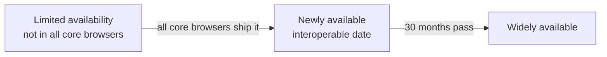

# Baseline: web platform feature availability

Chrome team and external experts (web.dev), with the WebDX Community Group, 2026; official documentation page, read on 2026-11-17.

## The claim in one sentence

Baseline gives every web feature one plain status label, based on how many core browsers support it, so you can tell if you can use it without checking each browser yourself.

## The problem before this

Before Baseline, you read support tables for each browser and judged the result yourself. A feature could work in one engine and not in another, and "good enough support" had no shared meaning. Articles and tools used different words for the same situation. Baseline replaces this with a fixed set of labels and one fixed time rule (page "Baseline", status section).

## Key ideas

### Three status labels

A feature is Limited availability, Newly available, or Widely available. Limited availability means it is "not yet supported across browsers." Newly available means all core browsers support it, so it is interoperable. Widely available is the last step.

### The core browser set

The page lists the core browsers: Chrome (desktop and Android), Edge, Firefox (desktop and Android), and Safari (macOS and iOS). A feature must work in all of them to leave Limited availability. This is a fixed list, not a market-share count.

### The 30-month rule

Widely available starts when "30 months have passed since the newly interoperable date." The newly interoperable date is the day the last core browser got support. Time, not a vote, moves the status.

### Yearly Baseline targets

Features that become Newly available in one year join that year's set. The page lists Baseline 2023, 2024, 2025 and 2026, and says 2026 is still "currently developing." A team can pick a year as its support target.

### Baseline inside tools

The page lists where the status appears: MDN, Can I Use, Lighthouse, Chrome DevTools (CSS properties in the Elements panel), VS Code, ESLint for CSS, Browserslist queries, the web-features npm package, and the Web Platform Status dashboard.

## How it works

In plain words: a feature gets a date when the last core browser supports it. From that date it is Newly available. After 30 more months it is Widely available. Before that date it is Limited availability.

The diagram follows the status section of the page "Baseline". [[visual-web-dev-baseline-docs-mechanism-how-to-learn-frontend|explanation and sources]]

1. Check the feature in the core set: Chrome, Edge, Firefox, Safari, on the platforms listed.
2. If any core browser lacks it, the label is Limited availability.
3. When the last one ships it, the date is stored and the label is Newly available.
4. At 30 months after that date, the label is Widely available.

Examples with Newly available dates from the page: Subgrid in September 2023, `:has()` in December 2023, Popover in January 2025. **Interpretation.** Adding 30 months to `:has()` gives June 2026, so by that rule it is Widely available today (2026-11-17). I computed this; the page does not state it.

## Results and evidence

- The page defines three labels, four yearly sets (2023 to 2026), and one rule of 30 months (status section).
- It gives 12 features with their Newly available month, from February 2023 to January 2025 (examples list).
- It says that when all features you use are part of Baseline, you can "trust the level of browser compatibility" (introduction).
- It names case studies: Target.com, Cybozu and RUMvision, which combined Baseline with real user data (titles only; no results on the page).

## Limitations and criticisms

- Widely available means "most sites," not all sites. Your users may still use an older browser (page, status section).
- The page does not explain how support is verified or why the window is 30 months. Limited availability has no further definition.
- The core set leaves out other browsers and older versions. **Interpretation.** If your audience is not covered by these browsers, check your own analytics.
- The 2026 set is still open, so its list can change.

## What practitioners took from it

The source page itself lists tools that show Baseline status, such as MDN, Can I Use, Lighthouse, and ESLint. No other recorded source in `sources.json` shows how teams use it, so wider adoption could not be verified.

## How it connects to this topic

- [[01-brief-how-to-learn-frontend|How to learn frontend brief]] — the brief's "can I ship it" step uses these labels.
- [[Baseline status]] — the three labels and their meaning.
- [[Core browsers]] — the set that a feature must pass.
- [[Web standards]] — specs come first; Baseline says when browsers have caught up.

## Test yourself

1. Which browsers are in the core set, and what must be true for a feature to become Newly available?
2. A feature became Newly available in August 2023. When does it become Widely available, and what does that label not promise?
3. Name three tools where you can see a Baseline status.

## My insights
