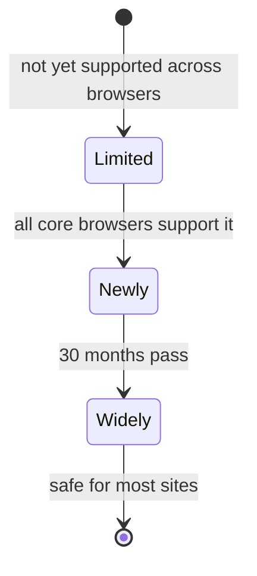

# Baseline

Chrome for Developers team (web.dev), 2026. Official documentation hub for the Baseline
browser-support status, read on 2026-11-18.

## The claim in one sentence

Baseline gives every web platform feature a simple status — Limited, Newly available, or
Widely available — so a developer can decide whether the feature is safe to use without
checking every browser by hand.

## The problem before this

Teams used to pick one browser as their "baseline" and then use only what that browser
supported. The linked overview page says many teams still used Internet Explorer as that
reference. Its developers found it confusing to work out which features all browsers
supported (section "Baseline and Google Chrome"). When browser release cycles sped up,
pinning support to browser versions became even harder to track.

## Key ideas

### Baseline grades a feature, not a browser version

Baseline asks "is this feature ready to use?" instead of "which browser versions must I
support?". The overview page says the line "wouldn't be tied to any particular browser
version, but instead based on interoperability" (section "Baseline and Google Chrome").

### Three states and two stages

A feature sits at Limited availability until every core browser supports it. It then
becomes Newly available, which means the browsers now agree on how it behaves. It
becomes Widely available once 30 months have passed (section "How do things become
Baseline?").

### The core browser set is four browsers

The core set is Chrome (desktop and Android), Edge, Firefox (desktop and Android), and
Safari (macOS and iOS). The linked article says downstream browsers are tracked by engine,
and that only Blink-based ones are included today (section "The core browser set").

### A target is either moving or fixed

Moving targets, such as Newly available and Widely available, grow as browsers ship.
Fixed targets list the features that became Newly available in one year: Baseline 2023,
2024, 2025, and 2026. A fixed set never changes (section "Baseline targets" and the
linked article "How to choose your Baseline target").

### Baseline answers support, not decisions

The linked article sorts features outside your target into three buckets: Enhancement,
Additive, and Critical. The bucket depends on how the feature fails when a browser does
not support it.

### Support data now reaches everyday tools

Lighthouse audits a page for Baseline features. Browserslist accepts Baseline queries.
ESLint lints CSS against Baseline. Chrome DevTools shows Baseline for CSS properties.
The `web-features` package publishes the underlying data.

## How it works

In plain words: watch each new web feature. When all four core browsers ship it, mark
it Newly available. Wait 30 months. Mark it Widely available. A team then picks a target
and uses every feature inside it without checking browsers again.

**Analogy.** The stages work like a bridge. The feature must be built by every core
browser before anyone crosses, and the bridge must then stand for 30 months before the
traffic counts as normal.

The state change follows the section "How do things become Baseline?".

Step trace on one feature, CSS Nesting:

1. Before August 2023 the feature sits at Limited availability, because it is not yet
   supported across browsers (section "How do things become Baseline?").
2. All four core browsers ship it, so it becomes Newly available in August 2023
   (section "Baseline targets").
3. The feature joins the Baseline 2023 target, the set of features that became Newly
   available in that year (section "Baseline targets").
4. **Interpretation.** Thirty months after August 2023 is February 2026, so the feature
   reaches Widely available then, under the 30-month rule.
5. A project that picks the Baseline 2025 target can use CSS Nesting without checking
   browser versions again (linked article "How to choose your Baseline target").

[[visual-web-dev-baseline-mechanism-how-to-learn-frontend|Explanation and sources of this diagram]]

## Results and evidence

- Newly available is a guarantee. Every core browser supports the feature, so the browsers
  agree on how it behaves (section "How do things become Baseline?").
- Widely available is a guarantee with a number attached. The rule is "30 months have
  passed since the newly interoperable date" (section "How do things become Baseline?").
- The page lists four fixed targets, Baseline 2023 through Baseline 2026, and calls 2026
  the latest and still developing set (section "Baseline targets").
- Dated examples appear with their month: CSS Nesting in August 2023, `:has()` in
  December 2023, the `<search>` element in October 2023, and Popover in January 2025
  (section "Baseline targets").
- Tooling has shipped: the Lighthouse Baseline features audit, Baseline Alerts on the
  Web Platform Status dashboard, Browserslist Baseline queries, the Baseline Checker
  tool for Google Analytics data, ESLint CSS Baseline rules, VS Code Baseline support,
  Chrome DevTools CSS property info, and a Netlify extension (section "Baseline and
  tooling").
- Governance sits with a community group. The Chrome team originated Baseline, and the
  W3C WebDX Community Group now defines it (section "Who defines Baseline?" and the
  linked overview page).

## Limitations and criticisms

- The source never says how "supported" is measured. It gives no test suite, no data
  source, and no browser version numbers. The only stated rule is support in every core
  browser.
- The source never explains why 30 months. The number appears as a rule without a
  rationale. The overview page also notes that the original launch used a slightly
  different definition, so the standard moved after it shipped.
- Baseline says nothing about quality. The linked article states that "Baseline doesn't
  tell you what you should do here", and it puts the choice of a target back on the
  developer.
- The core browser set names four browser families but no versions. The linked article
  says the version mapping covers only Blink-based downstream browsers, and that other
  engines may appear later.
- A fixed target ages. The linked article warns that fixed targets go out of date over
  time, so a team must re-check its target regularly.

## What practitioners took from it

The Baseline page records three case studies. Target used Baseline to modernize features,
Cybozu eliminated browser compatibility overhead, and RUMvision joined Baseline data to
its real user monitoring data. The same page lists shipped tools, so the practice is not
only theory: ESLint, Browserslist, Lighthouse, VS Code, and Chrome DevTools all read
Baseline status now. The linked article adds that teams can join their own analytics
browser-version data to Baseline targets through the `baseline-browser-mapping` module.

## How it connects to this topic

- [[01-brief-how-to-learn-frontend|How to learn frontend brief]] — the brief's
  ship-safety goal and its "read the primary doc" step both rest on this source.
- [[Browser support]] — Baseline gives this long-standing problem one shared label.
- [[Interoperability]] — the property Baseline measures instead of browser versions.
- [[Baseline target]] — the decision this source asks a team to make and record.

## Test yourself

1. What must be true before a feature moves from Limited availability to Newly available?
2. How long must pass after the newly interoperable date before a feature is Widely
   available?
3. A feature sits outside your Baseline target. Which three failure buckets does the
   linked article give, and what decision does Baseline leave to you?

## My insights
