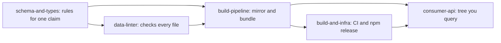
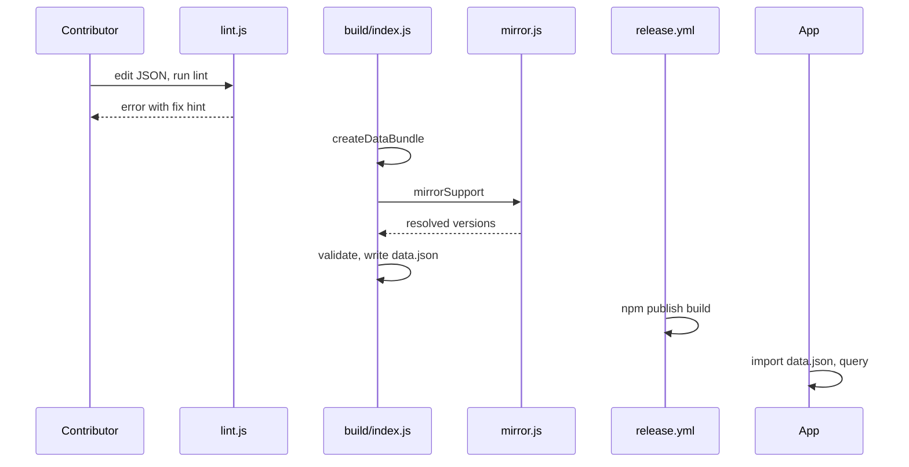

# mdn/browser-compat-data — architecture

Browser Compat Data (BCD) is a data repository with a small code shell around it. Contributors edit thousands of JSON files. The code checks them, turns them into one file, and ships that file to npm. All lines below are at commit 8f942b4 (see [[browser-compat-data-overview]]).

## Module map

| Module | Responsibility | Note |
|--------|----------------|------|
| schema-and-types | Defines what one "supported since version N" claim may look like, and makes TypeScript types from it | [[browser-compat-data-module-schema-and-types\|schema-and-types]] |
| data-linter | Checks every file in four scopes and fixes what a machine can fix | [[browser-compat-data-module-data-linter\|data-linter]] |
| build-pipeline | Resolves `"mirror"` values, adds derived fields, validates, writes `data.json` | [[browser-compat-data-module-build-pipeline\|build-pipeline]] |
| consumer-api | The exported tree, plus helpers to query and walk it | [[browser-compat-data-module-consumer-api\|consumer-api]] |
| build-and-infra | CI jobs, release by pull request, npm publish, bots | [[browser-compat-data-module-build-and-infra\|build-and-infra]] |

## The picture

The schema is the shared rule book: the linter validates files with it through one Ajv setup (`scripts/lib/ajv.js:10-20 @ 8f942b4`), and the build validates the public form with `schemas/public.schema.json` (`scripts/build/index.js:284-290 @ 8f942b4`, `scripts/build/index.js:15 @ 8f942b4`). The build writes `build/`, and CI publishes only that folder (`.github/workflows/release.yml:63 @ 8f942b4`). The `exports` map points package users at the built file (`package.json:7-17 @ 8f942b4`). [[visual-browser-compat-data-module-map-how-to-learn-frontend|explanation and sources]]

## Main flow

In plain words: a person edits a JSON file, the checks reject bad claims, and the build computes every derived value. A release publishes the result, and an app reads it as one object.

1. The contributor runs the linter. It loads files, then runs checks per file, per browser, per feature and over the whole tree (`lint/lint.js:76-160 @ 8f942b4`). It exits 1 on any error (`lint/lint.js:288 @ 8f942b4`). Messages carry a fix hint, and `lint/fix.js` repairs what it can (`lint/fix.js:38-53 @ 8f942b4`).
2. CI runs the linter with `--fail-on-warnings` in its own job (`.github/workflows/test.yml:60 @ 8f942b4`).
3. The build loads all folders through `index.js` (`index.js:28-52 @ 8f942b4`) and `createDataBundle` applies the transforms (`scripts/build/index.js:248-257 @ 8f942b4`).
4. For each `"mirror"` entry, `mirrorSupport` reads the upstream browser and `bumpSupport` maps each version to a downstream release (`scripts/build/index.js:82-86 @ 8f942b4`, `scripts/build/mirror.js:105-141 @ 8f942b4`).
5. `writeData` validates the bundle and writes it with a stable key order (`scripts/build/index.js:284-290 @ 8f942b4`).
6. The release workflow runs tests, builds and publishes `build/` with provenance (`.github/workflows/release.yml:55-63 @ 8f942b4`), then sends an event to `mdn/bcd-utils` (`.github/workflows/release.yml:76-81 @ 8f942b4`).
7. An app imports the package root, which is `build/data.json` (`package.json:13-16 @ 8f942b4`). It splits a dotted path and steps down the tree (`utils/query.js:16-20 @ 8f942b4`). That helper is not in the package `exports` (the helpers are in `utils/`, absent from `package.json:7-26 @ 8f942b4`), so an app writes its own lookup.

[[visual-browser-compat-data-request-flow-how-to-learn-frontend|explanation and sources]]

Animation candidate (hops for a `flow` scene):

- Contributor → lint.js: run checks on edited files (`lint/lint.js:118-124 @ 8f942b4`)
- lint.js → Contributor: error with fix hint (`lint/linter/test-versions.js:19-26 @ 8f942b4`)
- build/index.js → mirror.js: `mirrorSupport` for a `"mirror"` entry (`scripts/build/index.js:82-86 @ 8f942b4`)
- mirror.js → build/index.js: resolved versions (`scripts/build/mirror.js:347-369 @ 8f942b4`)
- build/index.js → build/: validated `data.json` (`scripts/build/index.js:284-290 @ 8f942b4`)
- release.yml → npm: publish `build/` (`.github/workflows/release.yml:63 @ 8f942b4`)

## Module dependencies (when useful)

The consumer helpers do not depend on the build. In the source tree, `index.js` loads JSON itself, and `iterSupport` treats an unresolved `"mirror"` as unsupported (`utils/iter-support.js:7-9 @ 8f942b4`). The published file has no such gap, because the build resolved it first (`scripts/build/mirror.js:347-369 @ 8f942b4`). This split means source files stay short for contributors and the published file stays simple for readers.

## Worth exploring interactively

- Resolve one support cell (FlowAnimation): `chrome_android: "mirror"` becomes Chrome's `66` through the `upstream` field (`api/AbortController.json:17 @ 8f942b4`, `scripts/build/mirror.js:347-369 @ 8f942b4`).
- Mirror Chrome to Edge (AlgorithmStepper): scan each Edge release for a matching engine version (`scripts/build/mirror.js:119-141 @ 8f942b4`).
- Consumer lookup (FlowAnimation): path string, tree steps, support array, or `version_added: false` when missing (`utils/query.js:16-25 @ 8f942b4`, `utils/iter-support.js:16-20 @ 8f942b4`).
- Lint a version claim (AlgorithmStepper): release exists, ranged value allowed, removed after added (`lint/linter/test-versions.js:35-162 @ 8f942b4`).
- Tag a key with a web feature (AlgorithmStepper): the `tags` array changes at each step (`scripts/tag-web-features.js:98-127 @ 8f942b4`).

## Design decisions worth noticing

Decision candidates for a branching deck:

- Store derived values or derive them at build time. BCD derives `mirror` and `version_last` in the build (`scripts/build/index.js:97-109 @ 8f942b4`); the alternative is to type every cell by hand, which drifts. See [[browser-compat-data-pattern-derive-dont-copy|pattern: derive, don't copy]].
- Ship source files or one built file. BCD ships one `data.json` (`package.json:9-16 @ 8f942b4`); the source index loads all files at import time, which is slow (`index.js:66 @ 8f942b4`).
- Strict schema or loose schema. BCD rejects unknown keys and teaches in its error text (`schemas/compat-data.schema.json:93 @ 8f942b4`, `schemas/compat-data.schema.json:59-61 @ 8f942b4`). See [[browser-compat-data-pattern-schema-first-data|pattern: schema first]].
- Exact version or honest range. BCD allows `≤N` only for old releases (`lint/linter/test-versions.js:15-16 @ 8f942b4`). See [[browser-compat-data-pattern-honest-uncertainty|pattern: honest uncertainty]].
- Publish from a human release or on every merge. BCD opens a draft release pull request and a human merges it (`docs/publishing.md:10 @ 8f942b4`). See [[browser-compat-data-pattern-guarded-release|pattern: guarded release]].

Baseline note: the `status` block has no `baseline` field in the code read, and Baseline lives in `web-features` (`scripts/tag-web-features.js:22-30 @ 8f942b4`). Details: [[browser-compat-data-findings|Findings]].

## Not analyzed

- `api/`, `css/`, `html/`, `javascript/`, `http/`, `svg/`, `mathml/`, `webassembly/`, `webdriver/`, `webextensions/`, `mediatypes/` — about 3,200 data files of the same shape as the one sample read.
- `scripts/migrations/`, `scripts/bulk-editor/`, `scripts/update-browser-releases/` — maintenance tools.
- `release_notes/`, `RELEASE_NOTES.md`, `docs/` (except testing and publishing) — prose.
- `GOVERNANCE.md`, `CODE_OF_CONDUCT.md`, issue templates — community files.
- Also not read: `lint/utils.js`, `scripts/release/semver-pulls.js`, `types/public.d.ts`.

## My insights
