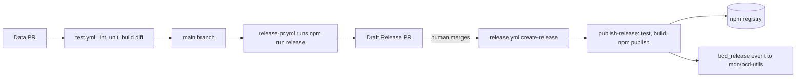

# mdn/browser-compat-data — module: build-and-infra

## Responsibility

This slice shows how a pile of JSON files about browser support becomes an npm package that apps install. It covers the package manifest, the CI checks, the weekly release flow, and two bots that update data on a schedule. Everything here is checked at commit `8f942b4`.

## Key files

| File | Role |
|------|------|
| `package.json` | Package name, entry points, scripts, dev dependencies |
| `tsconfig.json` | Type-checks plain JavaScript files without compiling them |
| `.github/workflows/test.yml` | Format, lint, unit test, and build-diff jobs on every pull request |
| `.github/workflows/release-pr.yml` | Keeps a "Release vX.Y.Z" pull request up to date |
| `.github/workflows/release.yml` | Creates the GitHub release, publishes to npm, notifies MDN |
| `.github/workflows/update-browser-releases.yml` | Weekday bot that opens a PR with new browser versions |
| `.github/workflows/update-web-features.yml` | Weekday bot that tags features with web-features ids |
| `scripts/release/index.js` | The release script run by `release-pr` |
| `scripts/tag-web-features.js` | Writes `web-features:<id>` tags into the data files |
| `docs/publishing.md` | Human description of the release process |
| `.github/dependabot.yml`, `.github/CODEOWNERS` | Dependency update policy and review ownership |

## How it works

The path of one support claim, such as "supported since version N", from a data file to an app:

1. A contributor edits a JSON data file and opens a pull request. CI runs `eslint`, `prettier --check`, and `tsc --noEmit` in one job (`.github/workflows/test.yml:34-38 @ 8f942b4`), the data linter in another (`.github/workflows/test.yml:60 @ 8f942b4`), and unit tests in a third (`.github/workflows/test.yml:102 @ 8f942b4`).
2. A fourth job builds both the base branch and the PR, formats both `build/` folders, and prints a `git diff` of the two (`.github/workflows/test.yml:127-165 @ 8f942b4`). The reviewer sees how the published file changes.
3. After merge to `main`, the `release-pr` workflow runs `npm run release` (`.github/workflows/release-pr.yml:54-55 @ 8f942b4`). The script fetches `main`, finds the last tag, and lists merged PRs by semver label (`scripts/release/index.js:102-112 @ 8f942b4`).
4. The script bumps major if any PR has the major label, minor if any has the minor label, otherwise patch (`scripts/release/index.js:113-121 @ 8f942b4`). It writes statistics and lists of added and removed features into `RELEASE_NOTES.md` (`scripts/release/index.js:133-141 @ 8f942b4`).
5. It force-pushes a `release` branch and opens or edits a draft PR (`scripts/release/index.js:67-79 @ 8f942b4`).
6. A human marks that PR ready and merges it. A push whose message starts with `Release v` runs `create-release`, which calls `gh release create` (`.github/workflows/release.yml:23-37 @ 8f942b4`).
7. The published release triggers `publish-release`: `npm ci`, `npm test`, `npm run build`, then `npm publish build/ --access public --provenance` (`.github/workflows/release.yml:55-63 @ 8f942b4`). It then uploads `data.json` as a release asset and dispatches a `bcd_release` event to `mdn/bcd-utils` (`.github/workflows/release.yml:66, 76-81 @ 8f942b4`).

The picture follows the steps above; each arrow is cited in them.

## Beyond the textbook

### Publish only the build folder, with provenance and keyless login

- Textbook version: run `npm publish` from the repository root with a long-lived token.
- What they do: publish the `build/` folder only, with `--provenance`. The workflow grants `id-token: write`, commented as OIDC for npm Trusted Publishing. No npm token appears in the workflow.
- Why: the comment names the intent. Provenance lets consumers verify which workflow built the package.
- Evidence: `.github/workflows/release.yml:18 @ 8f942b4`, `.github/workflows/release.yml:63 @ 8f942b4`.

### The package ships data, types for two module systems, and a legacy entry

- Textbook version: one `main` file.
- What they do: the `exports` map gives `require` and `import` the same `build/data.json` but different type files, plus a `./forLegacyNode` entry and a `./types` entry.
- Why: apps on CommonJS, ES modules, and old Node all need to read the data with correct types.
- Evidence: `package.json:7-26 @ 8f942b4`. The `prepare` script generates types and builds on install (`package.json:103 @ 8f942b4`).

### Type-check JavaScript without writing TypeScript

- Textbook version: choose JavaScript or TypeScript.
- What they do: `allowJs` and `checkJs` with `strict` and `noEmit`, so `tsc` only checks the `.js` files. `npm run format` chains eslint, prettier, and `tsc`.
- Why: type safety on scripts with no build step. (Inferred from the settings.)
- Evidence: `tsconfig.json:8-10 @ 8f942b4`, `tsconfig.json:18 @ 8f942b4`, `package.json:108 @ 8f942b4`.

### Review the effect on the published file, not only the source diff

- Textbook version: review the changed source files.
- What they do: the `diff-build` job builds base and PR side by side in parallel, formats the outputs, and diffs them. For the `release` branch, the base is the last published npm version, not `main`.
- Why: a data edit can change many generated entries. The diff shows the real output change, and the release PR is compared with what users already have.
- Evidence: `.github/workflows/test.yml:113-123 @ 8f942b4`, `.github/workflows/test.yml:150-165 @ 8f942b4`. Concurrent runs for the same PR are cancelled (`.github/workflows/test.yml:108-110 @ 8f942b4`).

### Releases decided by labels, with a human gate

- Textbook version: bump the version by hand.
- What they do: PR labels (`semver-major-bump`, `semver-minor-bump`) choose the bump. The script waits for a person to fill in "Notable changes" for non-patch releases when run locally. In CI, `!process.env.GITHUB_ACTIONS` skips that wait, and a human merge starts the release.
- Why: `docs/publishing.md` says release is triggered manually so that ready PRs make it into the release.
- Evidence: `docs/publishing.md:10, 32 @ 8f942b4`, `scripts/release/index.js:146-149 @ 8f942b4`.

### Bots keep support data fresh

- Textbook version: data is edited only by people.
- What they do: two cron jobs run on weekdays at 04:30 UTC. One runs `update-browser-releases` for all browsers and opens a PR limited to `browsers/*.json`. The other runs `tag-web-features` and opens a PR with `web-features-tags`.
- Why: new browser versions and feature groupings arrive without a human editing hundreds of files. Limiting `add-paths` keeps bot PRs from touching other files.
- Evidence: `.github/workflows/update-browser-releases.yml:7, 37, 50 @ 8f942b4`, `.github/workflows/update-web-features.yml:7, 48, 59-61 @ 8f942b4`.

### Link to the Baseline world through tags

- Textbook version: look up "can I use it" on a website.
- What they do: `tag-web-features.js` reads the `web-features` package. For each compat key it adds a tag `web-features:<id>` to that feature's `__compat` block. Other `web-features:` tags are removed first, except `web-features:snapshot:` ones, because one key in two features is ambiguous for some consumers. Keys it cannot place print "Not migrated".
- Why: tags tie each browser-support record to a named web feature, which is how Baseline status is looked up.
- Evidence: `scripts/tag-web-features.js:22-30 @ 8f942b4`, `scripts/tag-web-features.js:87-109 @ 8f942b4`, `scripts/tag-web-features.js:141-143 @ 8f942b4`.
- Observation: the removal loop calls `compat.tags.pop(index)` (`scripts/tag-web-features.js:115 @ 8f942b4`). JavaScript's `pop` takes no argument and removes the last item, so it removes the last tag, not the one at `index`. This only matters when the matched tag is not last; I did not test it. A good reminder to read code, not trust comments.

### Supply-chain hygiene

- Textbook version: `uses: actions/checkout@v4`.
- What they do: every action is pinned to a full commit SHA with the version in a comment. Jobs get read-only `permissions`, and `persist-credentials: false` is set. Dependabot waits 3 days before updating (`cooldown`), but not for `web-features`, `@webref/xref`, or the content inventory, which carry data. `CODEOWNERS` assigns workflows to the engineering team.
- Why: a short cooldown avoids freshly published, possibly malicious versions; the data packages are exempt because freshness matters for them.
- Evidence: `.github/workflows/test.yml:9-10, 21-23 @ 8f942b4`, `.github/dependabot.yml:9-14 @ 8f942b4`, `.github/CODEOWNERS:9 @ 8f942b4`.

## Tests and what they protect

The test workflow separates three gates: style and types (`.github/workflows/test.yml:34-38 @ 8f942b4`), data rules with `--fail-on-warnings` (`.github/workflows/test.yml:60 @ 8f942b4`), and unit tests (`.github/workflows/test.yml:102 @ 8f942b4`). The unit test script runs Node's built-in test runner with `c8` coverage over every `*.test.js` (`package.json:106 @ 8f942b4`). If the lint job fails, CI runs `lint:fix` and uploads the resulting diff as an artifact, so a contributor can apply the fix (`.github/workflows/test.yml:62-82 @ 8f942b4`). Publishing re-runs `npm test` before `npm publish` (`.github/workflows/release.yml:57 @ 8f942b4`). The linter and tests themselves are covered in the data-linter note.

## Error handling, performance, and security

- Failure of publish is reported to the merged release PR, pinging `@mdn/bcd-releasers` (`.github/workflows/release.yml:84-98 @ 8f942b4`).
- Release jobs only run on the upstream repository (`.github/workflows/release.yml:23 @ 8f942b4`), so forks do not publish.
- The release script checks for the GitHub CLI and write access before doing work (`scripts/release/index.js:96-99 @ 8f942b4`), and has a `--dry-run` mode (`scripts/release/index.js:165-170 @ 8f942b4`).
- Install of base and PR run in parallel in the diff job (`.github/workflows/test.yml:150-155 @ 8f942b4`).
- Node 24 or later is required and pinned in `.nvmrc` (`package.json:29-31 @ 8f942b4`, `.nvmrc:1 @ 8f942b4`).

## Technologies and services seen

- GitHub Actions — all CI, release, and bot automation (`.github/workflows/test.yml:1 @ 8f942b4`)
- npm registry — where the package is published with provenance (`.github/workflows/release.yml:63 @ 8f942b4`)
- GitHub CLI (`gh`) — creates releases and PRs (`.github/workflows/release.yml:37 @ 8f942b4`, `scripts/release/index.js:73 @ 8f942b4`)
- mdn/bcd-utils repository dispatch — triggers MDN deployment (`.github/workflows/release.yml:76-81 @ 8f942b4`)
- peter-evans/create-pull-request — bot PRs (`.github/workflows/update-browser-releases.yml:41 @ 8f942b4`)
- Dependabot — dependency updates (`.github/dependabot.yml:1-3 @ 8f942b4`)
- web-features npm package — feature ids for tagging (`package.json:98 @ 8f942b4`, `scripts/tag-web-features.js:10 @ 8f942b4`)
- ajv, ajv-formats, ajv-errors, better-ajv-errors — JSON schema validation (`package.json:67-70 @ 8f942b4`)
- json-schema-to-typescript — type generation (`package.json:87 @ 8f942b4`)
- TypeScript, ESLint, Prettier — type and style checks (`package.json:78, 93, 96 @ 8f942b4`)
- c8 and the Node test runner — unit tests and coverage (`package.json:71, 106 @ 8f942b4`)
- lefthook — git hooks (`package.json:88 @ 8f942b4`)
- yargs, fdir, tempy, es-main — script helpers (`package.json:85, 95, 77, 100 @ 8f942b4`)
- @webref/xref and @ddbeck/mdn-content-inventory — web spec and MDN content data (`package.json:58, 66 @ 8f942b4`)

## Worth exploring interactively

- Release pipeline from merge to npm — steps: merge to `main` (`.github/workflows/release-pr.yml:5-7 @ 8f942b4`); release script picks bump (`scripts/release/index.js:113-121 @ 8f942b4`); draft release PR (`scripts/release/index.js:73 @ 8f942b4`); human merge triggers `create-release` (`.github/workflows/release.yml:23 @ 8f942b4`); `publish-release` tests, builds, publishes (`.github/workflows/release.yml:57-63 @ 8f942b4`); event to bcd-utils (`.github/workflows/release.yml:76-81 @ 8f942b4`) — fits FlowAnimation because the learner would watch one change move between workflows and the registry.
- Tagging a compat key with a web feature — steps: build map from `web-features` (`scripts/tag-web-features.js:22-30 @ 8f942b4`); crawl JSON files (`scripts/tag-web-features.js:39-49 @ 8f942b4`); look up the key (`scripts/tag-web-features.js:81 @ 8f942b4`); remove old tags (`scripts/tag-web-features.js:98-116 @ 8f942b4`); add the new tag (`scripts/tag-web-features.js:123-127 @ 8f942b4`); write the file (`scripts/tag-web-features.js:135 @ 8f942b4`) — fits AlgorithmStepper because the `tags` array changes at each step.

## Open questions

The label names (`semver-major-bump`) come from `docs/publishing.md`; the code that reads them is in `scripts/release/semver-pulls.js`, outside this slice. How Baseline status itself is computed lives in the `web-features` package, not here.

## My insights
