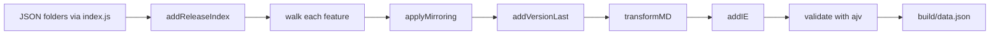

# mdn/browser-compat-data — module: build-pipeline

## Responsibility

The contributors write support data as many small JSON files. This module turns them into one published file, `data.json`. On the way it fills in values that humans left out, such as `"mirror"` entries. It also writes TypeScript types and a `package.json` for the npm package. Analyzed at commit 8f942b4 (full SHA in [[browser-compat-data-overview]]).

## Key files

| File | Role |
|------|------|
| `scripts/build/index.js` | The build: transforms, validation, writing the `build/` folder |
| `scripts/build/mirror.js` | Computes a downstream browser's support from its upstream browser |
| `scripts/build/index.test.js` | Unit tests of the transforms and the manifest |
| `scripts/build/mirror.test.js` | Unit tests of the version mapping and note rewriting |
| `scripts/lib/data-folders.js` | The list of top-level data folders |
| `scripts/lib/stringify-and-order-properties.js` | Writes JSON with a fixed key order |

## How it works

In plain words: the build loads all the JSON, walks every feature, patches each one, checks the result against a schema, and writes it out.

1. `main` clears old output but keeps three tracked files (`scripts/build/index.js:416-426 @ 8f942b4`).
2. It then writes the manifest, data, legacy wrapper, types and verbatim files in parallel (`scripts/build/index.js:428-434 @ 8f942b4`).
3. `createDataBundle` imports the merged data from `index.js`, applies transforms and adds a `__meta` block with version and timestamp (`scripts/build/index.js:248-257 @ 8f942b4`, `scripts/build/index.js:56-59 @ 8f942b4`).
4. `applyTransforms` adds a release `index`, then walks each feature and runs four steps: mirroring, `version_last`, Markdown to HTML, and a missing IE entry (`scripts/build/index.js:231-242 @ 8f942b4`).
5. `writeData` validates the bundle against the public schema, then writes it with a stable key order (`scripts/build/index.js:284-290 @ 8f942b4`).

The `"mirror"` step: when a browser entry is the string `mirror`, `mirrorSupport` finds the upstream browser (for example Chrome for Edge) and copies its data (`scripts/build/index.js:78-89 @ 8f942b4`, `scripts/build/mirror.js:347-369 @ 8f942b4`). `bumpSupport` then converts each version number to the matching downstream release by comparing engine versions (`scripts/build/mirror.js:105-141 @ 8f942b4`).

## Beyond the textbook

### Support data is derived, not typed by hand

- Textbook version: store each browser's support value as a plain table cell.
- What they do: a contributor writes `"mirror"` for downstream browsers. The build computes the version from the upstream browser's release and engine data.
- Why: the code compares engine and engine version, so one upstream fact is stored once and reused (inferred from the code, not from a comment). The code also handles WebKit to Blink (`isChromeWebKitToBlink`), so Chromium forks do not inherit pre-Blink versions.
- Evidence: `scripts/build/mirror.js:123-141 @ 8f942b4`, `scripts/build/index.js:82-86 @ 8f942b4`

### Edge cases drop data rather than guess

- Textbook version: copy the upstream value and move on.
- What they do: if the upstream version is newer than any downstream release, the result is `version_added: false` and notes are not copied. A flag is dropped if the target browser does not accept flags. If `version_added` equals `version_removed`, the feature counts as unsupported.
- Why: the code comments say a feature that came after the downstream release must not carry over notes.
- Evidence: `scripts/build/mirror.js:280-283 @ 8f942b4`, `scripts/build/mirror.js:292-295 @ 8f942b4`, `scripts/build/mirror.js:314-317 @ 8f942b4`

### Ranges with "≤" survive the mapping

- Textbook version: version fields are plain numbers.
- What they do: a version like `≤37` means "at most 37, exact value unknown". The mirror keeps the `≤`. `getPreviousVersion` leaves such values alone.
- Why: the data admits uncertainty, and the code does not turn a guess into a false precise value.
- Evidence: `scripts/build/mirror.js:76-77 @ 8f942b4`, `scripts/build/mirror.js:139-140 @ 8f942b4`, `scripts/build/index.js:97-98 @ 8f942b4`

### A hand-built table where an algorithm fails

- Textbook version: one rule maps all versions.
- What they do: Safari on iOS uses a manual map, because release numbers cannot be derived from WebKit versions. From Safari 15 on, equal numbers are assumed to match.
- Why: stated in the code comment.
- Evidence: `scripts/build/mirror.js:48-65 @ 8f942b4`, `scripts/build/mirror.js:90-103 @ 8f942b4`

### Operating-system notes are filtered when mirroring desktop to mobile

- Textbook version: copy notes as they are.
- What they do: a list of known OS-only notes (for example "Only on Windows.") is removed when a desktop browser mirrors to a mobile one. Real partial-implementation notes stay.
- Why: an OS limit of a desktop browser says nothing about the mobile browser. Tests name this case.
- Evidence: `scripts/build/mirror.js:17-46 @ 8f942b4`, `scripts/build/mirror.js:256-278 @ 8f942b4`, `scripts/build/mirror.test.js:302-318 @ 8f942b4`

### Notes are rewritten with browser names and versions

- Textbook version: copy the notes.
- What they do: `updateNotes` replaces "Chrome" with the target browser's name and maps "version N". If a version has no match, the whole note is dropped.
- Why: a note that says "Chrome 19" would be wrong for Edge. Dropping it is safer than showing a false one.
- Evidence: `scripts/build/mirror.js:157-194 @ 8f942b4`, `scripts/build/mirror.test.js:184-195 @ 8f942b4`

### `version_last` is derived at build time

- Textbook version: store `version_removed` only.
- What they do: the build adds `version_last`, the last release that still had the feature. It finds that release by sorting release numbers with semantic version comparison.
- Why: consumers then need no release list to answer "was it still there in version X". The test shows `20` removed becomes `19` and `4` becomes `3.6`.
- Evidence: `scripts/build/index.js:97-109 @ 8f942b4`, `scripts/build/index.test.js:99-103 @ 8f942b4`

### Stable output: key order and JSON stringify

- Textbook version: `JSON.stringify` the object.
- What they do: the source files use a fixed order of keys. The order lists are in `propOrder`. Release keys like `"3.6"` would be moved by JavaScript, so they are sorted by `compareVersions` and written by hand. The public bundle is written with `fast-json-stable-stringify`.
- Why: a comment explains that JavaScript moves number-like keys to the end. A fixed order keeps diffs small and the output the same on every run.
- Evidence: `scripts/lib/stringify-and-order-properties.js:8-50 @ 8f942b4`, `scripts/lib/stringify-and-order-properties.js:73-103 @ 8f942b4`, `scripts/build/index.js:288 @ 8f942b4`

### The package is built to be consumed by many module systems

- Textbook version: ship the source JSON.
- What they do: the published manifest has CommonJS and ESM entries with types, a legacy Node wrapper, and a types export. It is built from a small allowed list of keys from the main `package.json`, and the build throws if one is missing.
- Why: the code comment says the wrapper exists for old Node versions without import assertions.
- Evidence: `scripts/build/index.js:295-304 @ 8f942b4`, `scripts/build/index.js:352-399 @ 8f942b4`

## Tests and what they protect

- The tests use Node's built-in runner and `node:assert/strict` (`scripts/build/index.test.js:4-5 @ 8f942b4`).
- `addVersionLast` is checked for a number, an array, `preview` and `true` values (`scripts/build/index.test.js:58-105 @ 8f942b4`).
- `createManifest` checks that all required fields exist (`scripts/build/index.test.js:145-158 @ 8f942b4`).
- The mirror tests hold tables of expected version pairs per browser, like Edge 1 to 79, Edge 80 to 80 (`scripts/build/mirror.test.js:48-70 @ 8f942b4`).
- Failure cases: an unmapped note, a browser without an upstream, and missing upstream data (`scripts/build/mirror.test.js:184-195 @ 8f942b4`, `scripts/build/mirror.test.js:337-354 @ 8f942b4`).
- Edge cases: flags, a feature removed before Chromium Edge, and ranges (`scripts/build/mirror.test.js:382-438 @ 8f942b4`, `scripts/build/mirror.test.js:457-481 @ 8f942b4`).
- The file writers have no unit tests. They are excluded from coverage with `c8 ignore` markers (`scripts/build/index.js:279 @ 8f942b4`, `scripts/build/index.js:346 @ 8f942b4`).

## Error handling, performance, and security

- Mirroring fails loudly: it throws on an unresolved `mirror`, a missing upstream, or a missing source release (`scripts/build/mirror.js:111-115 @ 8f942b4`, `scripts/build/mirror.js:219-224 @ 8f942b4`, `scripts/build/mirror.js:349-362 @ 8f942b4`).
- A chain of mirrors is resolved by recursion (`scripts/build/mirror.js:364-367 @ 8f942b4`).
- Schema validation prints each error on its own, because the library joins messages wrongly (`scripts/build/index.js:271-275 @ 8f942b4`). Note that `validate` only logs. It does not exit with an error, so this module does not stop the build on its own. Whether CI treats this log as failure is not known from this slice.
- Markdown in notes is converted with `marked`, then three entity replacements are applied (`scripts/build/index.js:66-71 @ 8f942b4`). The code comment says "sanitizes", but I saw no HTML filter here. Treat this as an open question.
- `main` removes old outputs but keeps `.gitignore`, `.npmignore` and `tsconfig.json` (`scripts/build/index.js:417-426 @ 8f942b4`).

## Technologies and services seen

- `compare-versions` — sorts and compares version strings such as `3.6` (`scripts/build/index.js:11 @ 8f942b4`, `scripts/build/mirror.js:4 @ 8f942b4`)
- `fast-json-stable-stringify` — deterministic JSON output (`scripts/build/index.js:10 @ 8f942b4`)
- `marked` — Markdown notes to HTML (`scripts/build/index.js:12 @ 8f942b4`)
- `better-ajv-errors` and `ajv` (through `createAjv`) — schema validation messages (`scripts/build/index.js:8 @ 8f942b4`, `scripts/build/index.js:16 @ 8f942b4`)
- `es-main` — runs `main` only when the file is run directly, not when tests import it (`scripts/build/index.js:9 @ 8f942b4`, `scripts/build/index.js:439-441 @ 8f942b4`)
- `node:test` and `node:assert/strict` — the test runner (`scripts/build/index.test.js:4-5 @ 8f942b4`)
- `c8` — coverage, seen only as ignore comments (`scripts/build/index.js:279 @ 8f942b4`)
- JSON Schema (`schemas/public.schema.json`) and a type generator (`compilePublicTypes`) — checks data and makes `types.d.ts` (`scripts/build/index.js:15 @ 8f942b4`, `scripts/build/index.js:328 @ 8f942b4`)

## Worth exploring interactively

- Mirror one feature from Chrome to Edge — steps: the `mirror` string is found (`scripts/build/index.js:82 @ 8f942b4`); the upstream is read (`scripts/build/mirror.js:349-356 @ 8f942b4`); each Edge release is scanned for a matching engine version (`scripts/build/mirror.js:119-141 @ 8f942b4`); notes are rewritten (`scripts/build/mirror.js:320-336 @ 8f942b4`); the result goes back into the feature (`scripts/build/index.js:83-85 @ 8f942b4`) — fits AlgorithmStepper because the learner would see the version number change from Chrome 19 to the matching downstream release.
- The build run — steps: clear `build/` (`scripts/build/index.js:421-426 @ 8f942b4`); load and transform (`scripts/build/index.js:248-257 @ 8f942b4`); validate (`scripts/build/index.js:266 @ 8f942b4`); write files in parallel (`scripts/build/index.js:428-434 @ 8f942b4`) — fits FlowAnimation because the data moves from folders to a single `data.json`.

## Open questions

- Which scripts call `stringifyAndOrderProperties` and `data-folders.js`? The grep for importers failed in this slice, so the link to the linter and formatter is not shown here.
- Does CI fail when `validate` logs errors? That depends on the workflows, which belong to another slice.

## My insights
