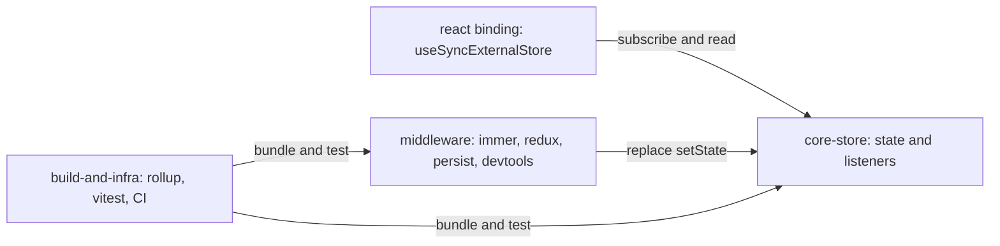
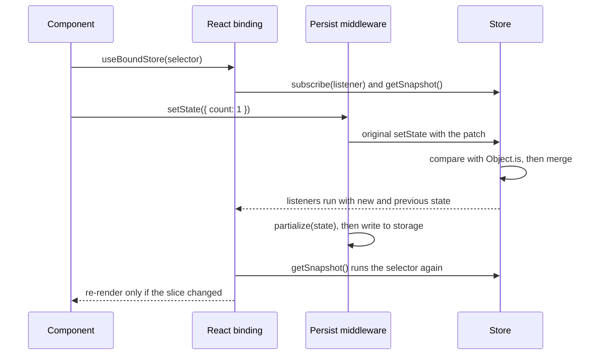
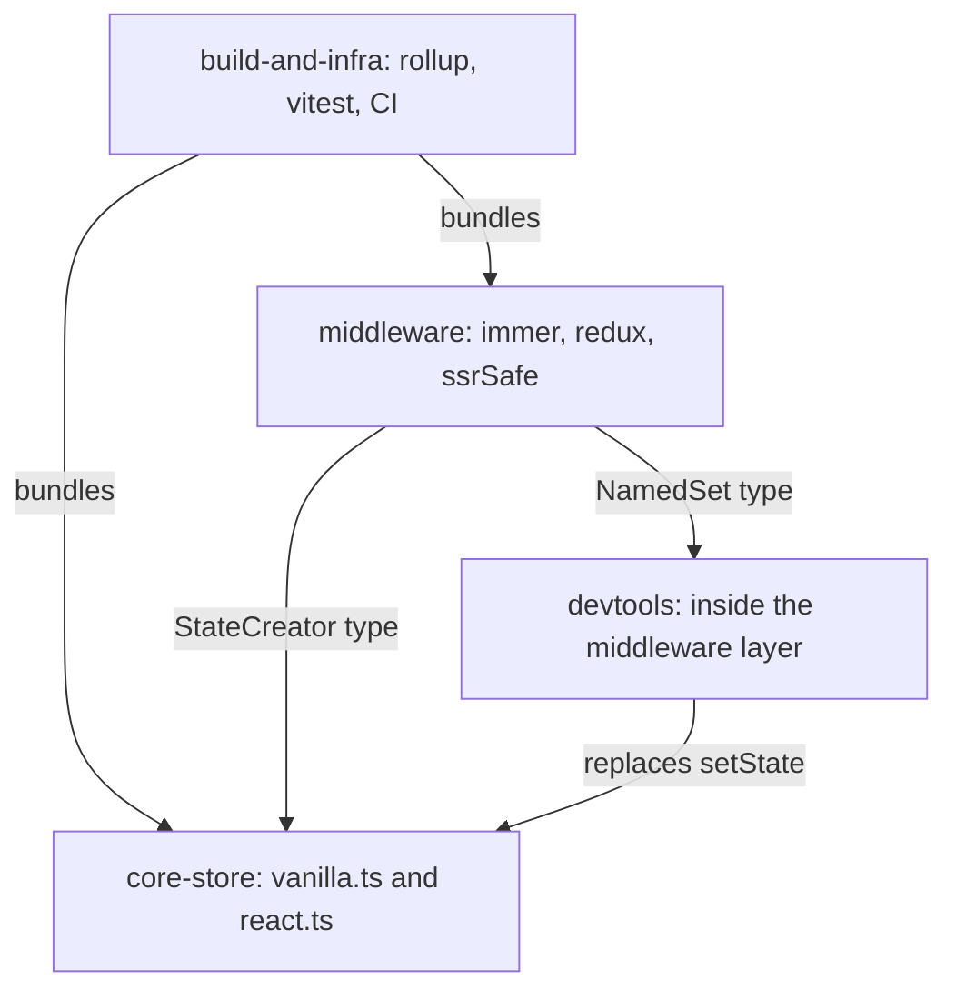

# pmndrs/zustand — architecture

Zustand keeps its whole public library in 16 TypeScript files under `src/`. This note
maps the four analysed modules, follows one write through them, and lists the code
paths a lesson page can turn into a simulation.

## Module map

| Module | Responsibility | Note |
|--------|----------------|------|
| core-store | Holds the state in a closure, merges patches, keeps the listeners, and gives React a snapshot | [[zustand-module-core-store]] |
| middleware | The extension point: `combine`, `immer`, `redux`, `ssrSafe`, `subscribeWithSelector` | [[zustand-module-middleware]] |
| persist-and-devtools | `persist` saves and restores the state; `devtools` records actions and travels back in time | [[zustand-module-persist-and-devtools]] |
| build-and-infra | Manifests, Rollup bundles, the strict `tsconfig`, Vitest, and eight CI workflows | [[zustand-module-build-and-infra]] |

### The picture

The React binding does not write on its own. It subscribes to the store and reads a
snapshot (`src/react.ts:30-34 @ 9fed2eb`). Every middleware reaches the store by
replacing a method on the live store object
(`src/middleware/immer.ts:76-84 @ 9fed2eb`). The build machinery bundles and tests both
the core and the middleware
(`rollup.config.mjs:93-104 @ 9fed2eb`, `vitest.config.mts:5-16 @ 9fed2eb`).
[[visual-zustand-module-map-how-to-learn-frontend|explanation and sources]]

## Main flow

One write from a component, through the store, back to the component.

The steps, in plain words:

1. A component asks the hook for one slice. The hook subscribes to the store and
   returns a snapshot function (`src/react.ts:30-34 @ 9fed2eb`).
2. The component writes a patch. Because `persist` replaced `setState` on the store
   object, the write lands in the middleware first (`src/middleware/persist.ts:220-232 @ 9fed2eb`).
3. The middleware hands the patch to the original `setState`, which compares the next
   value with the current one using `Object.is` (`src/vanilla.ts:73 @ 9fed2eb`).
4. When the value changed, the store merges the patch over the current state with
   `Object.assign` and calls every listener with the new and the previous state
   (`src/vanilla.ts:75-79 @ 9fed2eb`).
5. The middleware saves the part of the state it was told to keep
   (`src/middleware/persist.ts:210-216 @ 9fed2eb`).
6. The React binding runs the selector again. The component re-renders only when the
   selected slice changed (`src/react.ts:32 @ 9fed2eb`, `tests/basic.test.tsx:131-164 @ 9fed2eb`).

[[visual-zustand-main-flow-how-to-learn-frontend|explanation and sources]]

## Module dependencies

The dependency direction is one way. The core store imports no framework at all, so the
same store runs in a script and in a test without React
(`src/vanilla.ts:1-14 @ 9fed2eb`, `tests/vanilla/basic.test.ts:5-6 @ 9fed2eb`).
The middleware layer depends on the core, never the other way round
(`src/vanilla.ts:28-37 @ 9fed2eb`). Two middlewares even know each other: the redux
middleware imports the `NamedSet` type from the devtools file so the devtools middleware
can label a dispatch (`src/middleware/redux.ts:2 @ 9fed2eb`).

## Worth exploring interactively

- One write, one re-render — fits FlowAnimation. The learner watches a value travel
  from a component into the store and back out to the DOM. The component subscribes and
  reads a snapshot (`src/react.ts:30-34 @ 9fed2eb`), the write is prepared and compared
  (`src/vanilla.ts:66-73 @ 9fed2eb`), the state is merged and the listeners are notified
  (`src/vanilla.ts:75-79 @ 9fed2eb`), and the render counter decides the outcome
  (`tests/basic.test.tsx:131-164 @ 9fed2eb`).
- The hydration life cycle — fits FlowAnimation. The store starts empty, the saved value
  arrives, the version is checked, the state is merged, and the finish listeners run
  (`src/middleware/persist.ts:259 @ 9fed2eb`, `src/middleware/persist.ts:262 @ 9fed2eb`,
  `src/middleware/persist.ts:291 @ 9fed2eb`, `src/middleware/persist.ts:314 @ 9fed2eb`).
- The version-and-migration decision — fits StateMachine. A stored value arrives and the
  outcome is one of three: use it, migrate it, or drop it
  (`src/middleware/persist.ts:263 @ 9fed2eb`, `src/middleware/persist.ts:266 @ 9fed2eb`,
  `src/middleware/persist.ts:276 @ 9fed2eb`).
- The immer wrapping path — fits AlgorithmStepper. The middleware replaces `store.setState`
  (`src/middleware/immer.ts:76 @ 9fed2eb`), runs the updater through `produce`
  (`src/middleware/immer.ts:78 @ 9fed2eb`), and the learner watches one object change
  step by step while the untouched branch keeps its identity
  (`tests/immer.test.tsx:41-62 @ 9fed2eb`).

### Animation candidates

The main execution flow, ready for a guided walkthrough:

1. component → react binding: subscribe and read a snapshot (`src/react.ts:30-34 @ 9fed2eb`)
2. component → store api: write a patch (`src/vanilla.ts:66-73 @ 9fed2eb`)
3. persist middleware → store api: compare with `Object.is` and merge the patch (`src/vanilla.ts:73-78 @ 9fed2eb`)
4. store api → listeners: notify with the new and the previous state (`src/vanilla.ts:79 @ 9fed2eb`)
5. react binding → store api: run the selector again (`src/react.ts:32 @ 9fed2eb`)
6. react binding → component: re-render only when the selected slice changed (`tests/basic.test.tsx:131-164 @ 9fed2eb`)

### Decision candidates

1. Merge or replace? The store merges a patch over the current state. It replaces only
   when you ask for it or when the new value is not an object
   (`src/vanilla.ts:75-78 @ 9fed2eb`). The alternative is to always replace, which loses
   the untouched branches.
2. Migrate or drop? A stored value with a different version runs the `migrate` function.
   Without one, the middleware logs an error and drops the value
   (`src/middleware/persist.ts:266-278 @ 9fed2eb`). The alternative is to merge an old
   shape into the store and hope.
3. Connect to the devtools extension or stay untouched? The middleware connects only
   when the extension exists and the build is not a production build
   (`src/middleware/devtools.ts:250-260 @ 9fed2eb`). The alternative is a developer
   tool that ships to users.
4. Which equality check? `Object.is` by default, `shallow` for one level, and `useShallow`
   to keep the previous reference (`src/vanilla/shallow.ts:48-73 @ 9fed2eb`,
   `src/react/shallow.ts:6-11 @ 9fed2eb`). The alternative is a new object on every
   read, which re-renders every subscriber.

## Design decisions worth noticing

The store and React never talk to each other directly. The store keeps a set of
listeners, and React is one of the callers
(`src/vanilla.ts:64 @ 9fed2eb`, `src/react.ts:30-34 @ 9fed2eb`). That boundary is why
one store can serve a React app, a vanilla script, and a test at the same time. See
[[zustand-findings|finding 4]].

The middleware contract is a function that takes a store creator and returns a new one.
Each middleware replaces a method on the live store object instead of wrapping the
functions inside it, so a call from outside the creator gets the same behaviour
(`src/middleware/immer.ts:76-84 @ 9fed2eb`, `tests/immer.test.tsx:64-73 @ 9fed2eb`).
The public type stays exact while the runtime stays loose
(`src/middleware/immer.ts:48-50 @ 9fed2eb`). See
[[zustand-pattern-middleware-as-decorator|middleware as a decorator]].

The two middlewares that reach outside the process both treat failure as data. A
storage that cannot be reached only warns (`src/middleware/persist.ts:197-208 @ 9fed2eb`),
and a failed read arrives as an error argument rather than an exception
(`src/middleware/persist.ts:317-326 @ 9fed2eb`). The same rule shows up in the
hydration, which carries a number so a late read cannot win
(`src/middleware/persist.ts:190-192 @ 9fed2eb`). See
[[zustand-pattern-versioned-persistence|versioned persistence]].

A write merges a patch over the current state, and the untouched branches keep their
identity (`src/vanilla.ts:75-78 @ 9fed2eb`). That is the rule that lets a component
subscribe to one slice and ignore the rest. See
[[zustand-pattern-write-as-patch|write as a patch]].

## Not analyzed

These slices from the slice plan were skipped, so the deep dive does not cover them:

- `tests/devtools.test.tsx` (3,520 lines) — one very large test file, too big for a
  worker slice. The devtools behaviour in this deep dive comes from the source only.
- `docs/` (44 files) — the documentation site.
- `examples/` (41 files) — the demo and starter apps. They show usage, not structure.
- `pnpm-lock.yaml` — a generated lockfile.
- `README.md` — read by the scout for the overview; it holds no code to analyse.
- `.github/ISSUE_TEMPLATE/`, `.github/DISCUSSION_TEMPLATE/`, `.github/FUNDING.yml`,
  `FUNDING.json` — community templates and funding metadata.

## My insights
