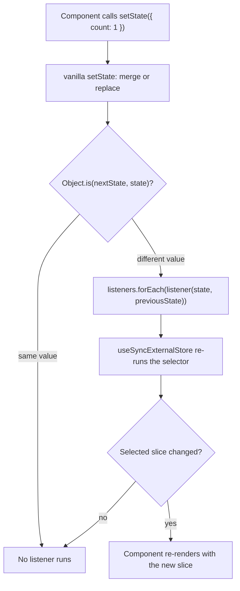

# pmndrs/zustand — module: core-store

## Responsibility

This slice holds the store itself and the way React reads it. `createStore` keeps the state
in one closure variable and a set of listeners. `useStore` and the bound hook `create`
connect that store to React. A component then re-renders only when the slice it selected
changes (`src/vanilla.ts:60-100`, `src/react.ts:17-64`). The slice also holds the equality
helpers that decide whether a change is real: `shallow` for plain values
(`src/vanilla/shallow.ts:48-74`) and `useShallow` for hooks (`src/react/shallow.ts:4-12`).
The store lives outside the React tree, so it is an [[External store]] in the React sense.

## Key files

| File | Role |
|------|------|
| `src/vanilla.ts` | The store: `createStore`, `setState`, `getState`, `getInitialState`, `subscribe` (`src/vanilla.ts:60-100`) |
| `src/react.ts` | The React binding: `useStore` on top of `useSyncExternalStore`, and `create`, which returns a hook (`src/react.ts:17-64`) |
| `src/traditional.ts` | A second React binding built on the `use-sync-external-store` shim, with a custom equality function (`src/traditional.ts:2-88`) |
| `src/vanilla/shallow.ts` | `shallow`, the one-level value comparison (`src/vanilla/shallow.ts:12-74`) |
| `src/react/shallow.ts` | `useShallow`, a selector wrapper that keeps the previous result (`src/react/shallow.ts:4-12`) |
| `src/index.ts` | Re-exports the vanilla and the React API (`src/index.ts:1-2`) |
| `src/shallow.ts` | Re-exports `shallow` and `useShallow` (`src/shallow.ts:1-2`) |

## How it works

Notice that the store itself never talks to React. It only keeps a list of listeners, and
React is one of the callers.

1. `createStore` runs the initializer once and closes over the state variable and a `Set` of
   listeners (`src/vanilla.ts:60-64`).
2. `setState` takes either a patch object or a function of the current state, computes the
   next value, and compares it with the current one (`src/vanilla.ts:66-73`).
3. If the value changed, the store merges the patch over the current state with
   `Object.assign`. A real replacement happens only when `replace` is true, or when the new
   value is not an object. Then every listener is called with the new and the previous state
   (`src/vanilla.ts:75-80`).
4. `subscribe` adds a listener to the set and returns the function that removes it
   (`src/vanilla.ts:88-92`).
5. `getState` returns the live state. `getInitialState` returns the value the initializer
   produced, which is kept in its own variable (`src/vanilla.ts:83-86`).
6. `useStore` hands `subscribe`, a snapshot function and a server snapshot to
   `React.useSyncExternalStore` (`src/react.ts:30-34`). The snapshot is wrapped in
   `useCallback` with `[api, selector]` as dependencies. A selector written outside the
   component is therefore not re-created on every render (`src/react.ts:32`).
7. `create` wraps the store in a hook and copies the store API onto the hook function. So
   `useBoundStore()` and `useBoundStore.setState` are one and the same object
   (`src/react.ts:53-61`).

## Beyond the textbook

### A write is a patch, not a replacement

- Textbook version: `setState` replaces the state object.
- What they do: an object patch is merged over the current state. A real replacement happens
  only when you pass `replace` as true, or when the new value is not an object.
- Why: a component usually owns one slice, and merging leaves the rest of the store alive.
  The untouched branches keep their identity, which is [[Structural sharing]].
- Evidence: `src/vanilla.ts:75-78 @ 9fed2eb`, `tests/vanilla/basic.test.ts:109-120 @ 9fed2eb`

### A change is a change of identity, and `NaN` is not a change

- Textbook version: compare the old and the new value with `===`.
- What they do: the store compares with `Object.is`, so writing `NaN` over a store that
  already holds `NaN` wakes nobody.
- Why: `Object.is` treats `NaN` as equal to itself, so a no-op write cannot wake every
  subscriber of the store.
- Evidence: `src/vanilla.ts:73 @ 9fed2eb`, `tests/basic.test.tsx:459-468 @ 9fed2eb`

### The store remembers its first state for the server

- Textbook version: one `getState` to read the state.
- What they do: `getInitialState` returns the value the initializer produced. The React
  binding passes it to `useSyncExternalStore` as the server snapshot.
- Why: on the server there is no client-side change yet, so the first client render has to
  reproduce the server markup. The test renders on the server, hydrates on the client and
  checks that no hydration error is logged.
- Evidence: `src/vanilla.ts:85-86 @ 9fed2eb`, `src/react.ts:33 @ 9fed2eb`,
  `tests/ssr.test.tsx:35-64 @ 9fed2eb`, `tests/vanilla/basic.test.ts:73-78 @ 9fed2eb`

### The hook is also the imperative API

- Textbook version: a hook to read state, and a separate store object to write it.
- What they do: `Object.assign(useBoundStore, api)` copies `setState`, `getState`,
  `getInitialState` and `subscribe` onto the hook function itself.
- Why: one value then serves both sides. A component reads with `useBoundStore(selector)`.
  A test or an event handler writes with `useBoundStore.setState(...)`. The inline snapshot
  in the test pins the exact shape of that object.
- Evidence: `src/react.ts:56-58 @ 9fed2eb`, `tests/basic.test.tsx:22-43 @ 9fed2eb`

### The vanilla build must not pull React in

- Textbook version: one entry point that exports everything.
- What they do: the core store is a separate module with no React import at all. Its test
  mocks the `react` module, so any accidental import fails.
- Why: the same store has to run where React is not there, such as a script or a test of
  the store alone. The mock is the guard that keeps that boundary real.
- Evidence: `src/vanilla.ts:1-14 @ 9fed2eb`, `tests/vanilla/basic.test.ts:5-6 @ 9fed2eb`

### Equality is a value comparison, and the hook keeps the old reference

- Textbook version: compare the selected value with `===` and leave the rest to the caller.
- What they do: `shallow` compares one level of an object, array, `Map`, `Set` or any
  iterable. `useShallow` returns the previous result again when the new result is
  shallow-equal, so React sees the same reference.
- Why: a selector that builds a new array, such as `state.todos.map(...)`, would otherwise
  re-render every subscriber on every store change. The test checks the returned instance is
  the very same object as before.
- Evidence: `src/vanilla/shallow.ts:12-73 @ 9fed2eb`, `src/react/shallow.ts:6-11 @ 9fed2eb`,
  `tests/shallow.test.tsx:91-119 @ 9fed2eb`, see [[Shallow equality]]

## Tests and what they protect

- The shape of the store is pinned by an inline snapshot. The initializer receives `setState`,
  `getState` and the api object, and the api object holds exactly four functions
  (`tests/basic.test.tsx:22-43 @ 9fed2eb`, `tests/vanilla/basic.test.ts:13-39 @ 9fed2eb`).
- Re-render control: a component that selects `count` does not re-render when another slice
  changes (`tests/basic.test.tsx:131-164 @ 9fed2eb`).
- Edge cases of the write path: `NaN` over `NaN` fires nothing, and `setState(..., true)`
  replaces. The store may also hold `null`, a number or even `undefined`
  (`tests/vanilla/basic.test.ts:99-138 @ 9fed2eb`, `tests/basic.test.tsx:729-744 @ 9fed2eb`).
- Subscription bookkeeping: unsubscribing stops that listener while the others keep
  working. A listener receives the new state and the previous one
  (`tests/subscribe.test.tsx:73-107 @ 9fed2eb`, `tests/subscribe.test.tsx:122-135 @ 9fed2eb`).
- Two React regressions are tied to reported issues. Unmounting has to remove the right
  subscriber (issue 84), and a re-render must not overwrite another subscriber (issue 86)
  (`tests/basic.test.tsx:613-701 @ 9fed2eb`).
- The cost of a selector is measured, not assumed. A selector defined outside the component
  is called once, while an inline arrow is called again on every render
  (`tests/basic.test.tsx:482-562 @ 9fed2eb`).
- Equality is checked at the value level for primitives, objects, arrays, `Set`s, functions,
  `URLSearchParams` and generators. The known trap is kept as a test: two different `Date`
  objects count as equal (`tests/vanilla/shallow.test.tsx:5-14 @ 9fed2eb`,
  `tests/vanilla/shallow.test.tsx:16-42 @ 9fed2eb`,
  `tests/vanilla/shallow.test.tsx:108-167 @ 9fed2eb`,
  `tests/vanilla/shallow.test.tsx:198-224 @ 9fed2eb`,
  `tests/vanilla/shallow.test.tsx:227-235 @ 9fed2eb`).
- Types are protected at the type level with `@ts-expect-error`, so `setState({ count:
  undefined })` fails to compile (`tests/types.test.tsx:109-136 @ 9fed2eb`), see
  [[Type-level testing]].
- Nothing external is faked. The only mock in this slice is the React module mock that
  guards the vanilla boundary, and the DOM matchers come from one setup file
  (`tests/vanilla/basic.test.ts:5-6 @ 9fed2eb`, `tests/setup.ts:1 @ 9fed2eb`). A small
  helper rewrites a `Map` into plain data before a snapshot compares it
  (`tests/test-utils.ts:6-18 @ 9fed2eb`).

## Error handling, performance, and security

- The store catches nothing. `setState` calls the listeners synchronously, so a listener
  that throws surfaces at the call site of `setState` (`src/vanilla.ts:79 @ 9fed2eb`).
- An error thrown inside a selector happens during render, so a React error boundary
  catches it. The test proves that the boundary renders its fallback
  (`tests/basic.test.tsx:321-368 @ 9fed2eb`).
- Performance: the listeners live in a `Set`, so adding and removing one is cheap. Every
  write walks the whole set and copies the state with `Object.assign`
  (`src/vanilla.ts:64 @ 9fed2eb`, `src/vanilla.ts:75-79 @ 9fed2eb`). The modern binding
  re-runs the selector on every render, because `useCallback` only keeps the subscription
  stable (`src/react.ts:32 @ 9fed2eb`).
- Limits: none. There is no timeout, no queue, no size cap and no batching inside the
  store. Batching comes from React instead (`tests/basic.test.tsx:166-190 @ 9fed2eb`).
- Security: nothing in this slice touches the network, the disk or untrusted input. The
  state lives in memory in a closure (`src/vanilla.ts:63 @ 9fed2eb`). Validating the
  values a user typed stays the job of the application.

## Technologies and services seen

- React — `useSyncExternalStore` provides the subscription, `useCallback` the stable
  snapshot and `useDebugValue` a readable label in the React DevTools. `useRef` keeps the
  previous result inside `useShallow` (`src/react.ts:30-35 @ 9fed2eb`,
  `src/react/shallow.ts:5 @ 9fed2eb`).
- use-sync-external-store — the shim used by the traditional entry point, which accepts a
  custom equality function (`src/traditional.ts:2 @ 9fed2eb`,
  `src/traditional.ts:36-42 @ 9fed2eb`).
- TypeScript — the store API, the mutator types and the `setState` overloads are all
  type-level code (`src/vanilla.ts:9-58 @ 9fed2eb`).
- Vitest — the test runner of the suite (`tests/basic.test.tsx:11 @ 9fed2eb`,
  `tests/vanilla/basic.test.ts:1 @ 9fed2eb`).
- @testing-library/react — renders components and wraps state changes in `act`
  (`tests/basic.test.tsx:9 @ 9fed2eb`).
- react-dom — `renderToString` on the server and `hydrateRoot` on the client in the
  server-side rendering test (`tests/ssr.test.tsx:3 @ 9fed2eb`,
  `tests/ssr.test.tsx:36-39 @ 9fed2eb`), see [[Hydration]].
- @testing-library/jest-dom — the DOM matchers loaded for the whole suite
  (`tests/setup.ts:1 @ 9fed2eb`).

## Worth exploring interactively

- One write, one re-render — fits FlowAnimation because the learner watches a value travel
  from the component into the store and through the listener set. Then it travels back into
  `useSyncExternalStore` and out to the DOM. Steps: the component subscribes and reads a
  snapshot (`src/react.ts:30-34 @ 9fed2eb`), the write is prepared and compared
  (`src/vanilla.ts:66-73 @ 9fed2eb`), the state is merged and the listeners are notified
  (`src/vanilla.ts:75-79 @ 9fed2eb`), the selector runs again and the render counter
  decides the outcome (`src/react.ts:32 @ 9fed2eb`, `tests/basic.test.tsx:131-164 @ 9fed2eb`).
- Why did this component re-render? — fits AlgorithmStepper because the same store is read
  three ways and the render counter moves differently each time. Steps: `shallow` compares
  one level of the value (`src/vanilla/shallow.ts:48-73 @ 9fed2eb`), `useShallow` reuses the
  previous instance when the values match (`src/react/shallow.ts:6-11 @ 9fed2eb`), the test
  shows the returned instance is identical to the earlier one
  (`tests/shallow.test.tsx:91-119 @ 9fed2eb`), and the `Date` case shows the limit of the
  comparison (`tests/vanilla/shallow.test.tsx:227-235 @ 9fed2eb`).

## Open questions

- The `Mutate` and `StoreMutators` types let middleware change the shape of the store.
  They are declared in this slice, but used by the middleware slice
  (`src/vanilla.ts:20-41 @ 9fed2eb`).
- Why the library ships two React bindings, `create` and `createWithEqualityFn`, instead of
  one is a decision of the `traditional` entry point (`src/traditional.ts:82-88 @ 9fed2eb`).

## My insights
