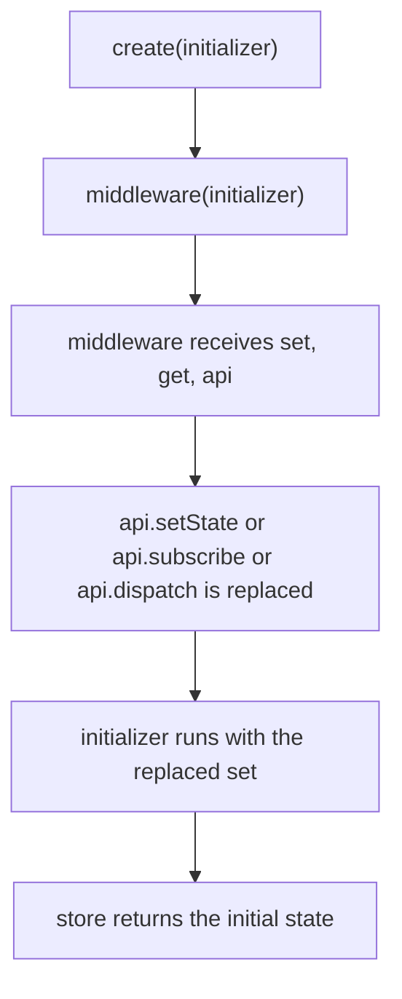

# pmndrs/zustand — module: middleware

## Responsibility

The middleware layer is the extension point of the library. A [[Middleware]] takes the
function that creates a store and returns a new one, so it can add one capability without
changing the store code. Five capabilities ship: `combine`, `immer`, `redux`, `ssrSafe`
and `subscribeWithSelector`. The public barrel re-exports them and their option types
(`src/middleware.ts:1-17 @ 9fed2eb`). The layer also carries the type contract, because
every middleware must say what it adds to the store type.

## Key files

| File | Role |
|------|------|
| `src/middleware.ts` | Public barrel: the names and the option types the library exposes |
| `src/middleware/combine.ts` | Merges a plain initial state with the state a creator returns |
| `src/middleware/immer.ts` | Lets a function updater mutate a draft instead of building a new object |
| `src/middleware/redux.ts` | Adds a `dispatch` that runs a reducer |
| `src/middleware/ssrSafe.ts` | Bans state writes while the code runs on the server |
| `src/middleware/subscribeWithSelector.ts` | Adds a selector and an equality check to `subscribe` |
| `tests/middlewareTypes.test.tsx` | Type-level tests for the contract, 34 cases |
| `tests/immer.test.tsx` | Runtime tests for the immer middleware |

## How it works

The contract is the `StateCreator` type. It is a function that takes `setState`,
`getState` and the store API, and returns the initial state
(`src/vanilla.ts:28-37 @ 9fed2eb`). Two type lists travel with it: `Mis` names the
mutators applied inside the creator, `Mos` names the mutators applied outside. Each
middleware registers a name in the `StoreMutators` interface by declaration merging
(`src/middleware/immer.ts:14-19 @ 9fed2eb`), and `StoreMutatorIdentifier` is the union
of those names (`src/vanilla.ts:40-41 @ 9fed2eb`).

At runtime every middleware follows the same three steps: it replaces a method on the
live store API object, it passes the replaced method to the creator, and it returns what
the creator returns.

1. The middleware receives the store API as its third argument
   (`src/middleware/immer.ts:73 @ 9fed2eb`).
2. It assigns a new method onto that API object
   (`src/middleware/immer.ts:76 @ 9fed2eb`, `src/middleware/subscribeWithSelector.ts:51 @ 9fed2eb`,
   `src/middleware/redux.ts:42 @ 9fed2eb`).
3. It calls the creator with the replaced method
   (`src/middleware/immer.ts:84 @ 9fed2eb`).
4. The public type is joined to the runtime code by a cast, so the implementation stays
   loose and the exposed type stays exact (`src/middleware/immer.ts:87 @ 9fed2eb`).

Each middleware then adds its own feature. `combine` merges the initial state with the
created state through `Object.assign`, so the merge is shallow and the created keys win
(`src/middleware/combine.ts:14 @ 9fed2eb`). `immer` runs a function updater through
immer's `produce` and skips it for a plain value (`src/middleware/immer.ts:76-82 @ 9fed2eb`).
`redux` adds a `dispatch` that runs a reducer and passes the action as the third argument
of `set` (`src/middleware/redux.ts:42-45 @ 9fed2eb`). `ssrSafe` replaces both `set` and
`api.setState` with a function that throws when the code runs on the server
(`src/middleware/ssrSafe.ts:19-23 @ 9fed2eb`). `subscribeWithSelector` replaces
`subscribe` with a version that reads a selector, compares it with `Object.is` by
default, and keeps the old one-argument form working
(`src/middleware/subscribeWithSelector.ts:51-68 @ 9fed2eb`).

## Beyond the textbook

### The middleware changes the store object, not only the functions inside it

- Textbook version: a middleware wraps `set` and `get` in new functions and passes the
  wrappers down to the creator.
- What they do: each middleware assigns onto the live store API object, so a call to
  `store.setState` from outside the creator gets the same behaviour.
- Why: the immer test calls `store.setState` on a vanilla store built with the
  middleware and still gets a draft, which only works because the API method itself was
  replaced (`tests/immer.test.tsx:64-73 @ 9fed2eb`).
- Evidence: `src/middleware/immer.ts:76-84 @ 9fed2eb`,
  `src/middleware/subscribeWithSelector.ts:50-51 @ 9fed2eb`.

### The type system keeps a registry that other packages can add to

- Textbook version: a plugin API uses a plain function type, and the library loses track
  of what a plugin adds.
- What they do: each middleware declares a `StoreMutators` entry through declaration
  merging and passes the names as type arguments. The names say which mutators are
  inside and which are outside.
- Why: the type test file writes its own middleware, `org/example`, and shows that it
  can widen the type of `getState` while leaving the type of `setState` alone
  (`tests/middlewareTypes.test.tsx:19-38 @ 9fed2eb`,
  `tests/middlewareTypes.test.tsx:108-115 @ 9fed2eb`).
- Evidence: `src/middleware/immer.ts:14-19 @ 9fed2eb`, `src/middleware/redux.ts:28-32 @ 9fed2eb`,
  `src/middleware/subscribeWithSelector.ts:21-26 @ 9fed2eb`.

### The runtime is written loosely and the public type is written strictly

- Textbook version: one function, one type, checked by the compiler.
- What they do: each file declares an `Impl` type full of `any`, then exports the
  implementation cast to a precise public type with `as unknown as`.
- Why: `setState` has several overloads that the compiler cannot resolve, so the
  implementation casts once instead of fighting the type system. The file admits the
  ideal inference "is infeasible since it is an intersection with a partial type"
  (`src/middleware/immer.ts:48-50 @ 9fed2eb`).
- Evidence: `src/middleware/immer.ts:69-87 @ 9fed2eb`, `src/middleware/redux.ts:34-50 @ 9fed2eb`.

### Two middlewares talk to each other through a flag

- Textbook version: every middleware is independent of the others.
- What they do: the redux middleware sets `dispatchFromDevtools = true` on the store API,
  so the devtools middleware knows a dispatch already exists. It also passes the action
  as the third argument of `set`, so devtools can label the update.
- Why: the redux middleware imports the `NamedSet` type from the devtools file, so the
  coupling shows up in the types as well (`src/middleware/redux.ts:2 @ 9fed2eb`).
- Evidence: `src/middleware/redux.ts:42-46 @ 9fed2eb`.

### The barrel avoids a hard dependency

- Textbook version: every middleware is exported from one entry point.
- What they do: the barrel exports `redux`, `devtools`, `subscribeWithSelector`,
  `combine`, `persist` and `ssrSafe`, but not `immer`. Immer has its own entry point.
- Why: `immer` is an optional peer dependency, so the barrel leaves it out and the
  package stays optional for the user (`package.json:169-171 @ 9fed2eb`). The test
  suite imports it from its own entry point (`tests/immer.test.tsx:3 @ 9fed2eb`).
- Evidence: `src/middleware.ts:1-17 @ 9fed2eb`, `package.json:161 @ 9fed2eb`.

### The server-side guard fails loudly

- Textbook version: a server middleware skips the update, which hides the bug until the
  page hydrates.
- What they do: `ssrSafe` throws `Cannot set state of Zustand store in SSR` from both
  `set` and `api.setState`.
- Why: a store shared between requests on the server must not change, so a loud error
  points at the code that writes during render. The file calls the middleware
  experimental and says the name will change, so the barrel exports it as
  `unstable_ssrSafe` (`src/middleware/ssrSafe.ts:3-5 @ 9fed2eb`,
  `src/middleware.ts:17 @ 9fed2eb`).
- Evidence: `src/middleware/ssrSafe.ts:19-23 @ 9fed2eb`.

## Tests and what they protect

`tests/immer.test.tsx` holds the runtime tests of this slice. Five cases protect the
behaviour: a draft mutation through a function updater
(`tests/immer.test.tsx:7-21 @ 9fed2eb`); a plain value must not go through `produce`
(`tests/immer.test.tsx:23-31 @ 9fed2eb`); `replace: true` replaces the whole state
(`tests/immer.test.tsx:33-39 @ 9fed2eb`); a nested update makes a new object while the
old object keeps its old contents (`tests/immer.test.tsx:41-62 @ 9fed2eb`); and the
middleware also works with the vanilla `createStore`
(`tests/immer.test.tsx:64-73 @ 9fed2eb`). The last case is the one that proves the
middleware edits the store object itself.

`tests/middlewareTypes.test.tsx` is a [[Type-level testing]] suite. It uses the
`expectTypeOf` helper from Vitest (`tests/middlewareTypes.test.tsx:1 @ 9fed2eb`) inside
a component that is never rendered, then only checks that the component exists
(`tests/middlewareTypes.test.tsx:55 @ 9fed2eb`). The cases cover no middleware, one,
two, three and four middlewares stacked
(`tests/middlewareTypes.test.tsx:40 @ 9fed2eb`, `tests/middlewareTypes.test.tsx:352 @ 9fed2eb`,
`tests/middlewareTypes.test.tsx:532 @ 9fed2eb`, `tests/middlewareTypes.test.tsx:635 @ 9fed2eb`).
Each case also checks that a store with a middleware still fits the plain
`StoreApi<object>` shape (`tests/middlewareTypes.test.tsx:81-84 @ 9fed2eb`), so a
middleware must not change the basic store. Negative checks use `@ts-expect-error`:
`get().foo` and `set({ count: '1' })` must not compile
(`tests/middlewareTypes.test.tsx:212-215 @ 9fed2eb`). If the error ever stops being an
error, the file stops compiling and the suite fails.

Many cases carry the number of the GitHub issue they protect, which turns the file into a
list of past regressions: `#2700`, `#3510`, `#619, #632`, `#631`, `#650`, `#616` and
`#3371` (`tests/middlewareTypes.test.tsx:183 @ 9fed2eb`,
`tests/middlewareTypes.test.tsx:201 @ 9fed2eb`, `tests/middlewareTypes.test.tsx:678 @ 9fed2eb`,
`tests/middlewareTypes.test.tsx:703 @ 9fed2eb`, `tests/middlewareTypes.test.tsx:728 @ 9fed2eb`,
`tests/middlewareTypes.test.tsx:636 @ 9fed2eb`, `tests/middlewareTypes.test.tsx:812 @ 9fed2eb`).
The last one covers a sliced store where each slice returns a different type but shares
one store type (`tests/middlewareTypes.test.tsx:812-848 @ 9fed2eb`). One case also shows
a user naming the mutator list by hand when they call `create`, so the store type is
known without inference (`tests/middlewareTypes.test.tsx:769-787 @ 9fed2eb`). No mocks,
no network, no timers appear in either file.

## Error handling, performance, and security

- Error handling: only `ssrSafe` throws, and it throws a plain `Error` with a fixed
  message (`src/middleware/ssrSafe.ts:20 @ 9fed2eb`). No middleware checks the shape of
  the state it writes. `subscribeWithSelector` catches nothing, so an error in a
  selector or a listener travels up to whoever called `set`
  (`src/middleware/subscribeWithSelector.ts:56-61 @ 9fed2eb`).
- Performance: `subscribeWithSelector` computes the selected slice on every change and
  compares it with the previous one, so a listener runs only when its own slice changed
  (`src/middleware/subscribeWithSelector.ts:54-61 @ 9fed2eb`). `immer` produces a new
  object only when the draft changed, so untouched branches keep their identity. This
  is [[Structural sharing]] (`tests/immer.test.tsx:56-61 @ 9fed2eb`). `combine` copies
  the initial state once per store with `Object.assign`
  (`src/middleware/combine.ts:14 @ 9fed2eb`).
- Security: not present in this slice. Nothing is parsed, no secret is read, and no
  network call is made. The only guard is the server-side write ban.

## Technologies and services seen

- immer — the `produce` function and the `Draft` type that make draft updates safe
  (`src/middleware/immer.ts:1-2 @ 9fed2eb`).
- TypeScript declaration merging — `declare module '../vanilla'` lets each middleware
  add a name to the mutator registry (`src/middleware/immer.ts:14 @ 9fed2eb`,
  `src/middleware/redux.ts:28 @ 9fed2eb`, `src/middleware/subscribeWithSelector.ts:21 @ 9fed2eb`).
- Vitest `expectTypeOf` — the type assertion helper behind the type-level suite
  (`tests/middlewareTypes.test.tsx:1 @ 9fed2eb`).
- The TypeScript `@ts-expect-error` directive — asserts that a line must not compile
  (`tests/middlewareTypes.test.tsx:212 @ 9fed2eb`).
- The library's own `create` and `createStore` — the two entry points the tests build
  stores with (`tests/middlewareTypes.test.tsx:2 @ 9fed2eb`,
  `tests/middlewareTypes.test.tsx:12 @ 9fed2eb`).
- No external service, database or network client is used in this slice.

## Worth exploring interactively

- The immer wrapping path — the middleware replaces `store.setState`
  (`src/middleware/immer.ts:76 @ 9fed2eb`), runs a function updater through `produce`
  (`src/middleware/immer.ts:78 @ 9fed2eb`), and calls the creator with the replaced
  `set` (`src/middleware/immer.ts:84 @ 9fed2eb`); the action then mutates the draft and
  returns a new state while the untouched branch keeps its identity
  (`tests/immer.test.tsx:41-62 @ 9fed2eb`) — fits an AlgorithmStepper because the
  learner watches one object change step by step.
- The subscribeWithSelector path — the middleware keeps the original `subscribe`
  (`src/middleware/subscribeWithSelector.ts:50 @ 9fed2eb`), replaces `api.subscribe`
  with a version that reads the selector
  (`src/middleware/subscribeWithSelector.ts:51-55 @ 9fed2eb`), compares the next slice
  with the current one on every change
  (`src/middleware/subscribeWithSelector.ts:56-58 @ 9fed2eb`), and calls the listener
  only when they differ (`src/middleware/subscribeWithSelector.ts:59-61 @ 9fed2eb`) —
  fits a FlowAnimation because the learner sees a store change travel through the
  wrapped subscribe and stop when the selected slice did not change.

## Open questions

- `combine` merges with `Object.assign`, so a nested object in the initial state is
  replaced whole by a same-named key in the created state. No test in this slice pins
  that down, so the depth of the merge is untested here.
- `ssrSafe` is marked experimental, and this slice does not show whether the devtools
  or persist middleware cooperate with it.
- The mutator registry is global per type declaration. Whether two packages can
  register the same name is not shown here.
- The runtime behaviour of `combine`, `redux`, `ssrSafe` and `subscribeWithSelector` is
  not covered in this slice. Their tests live in other files that belong to other
  slices.

## My insights
