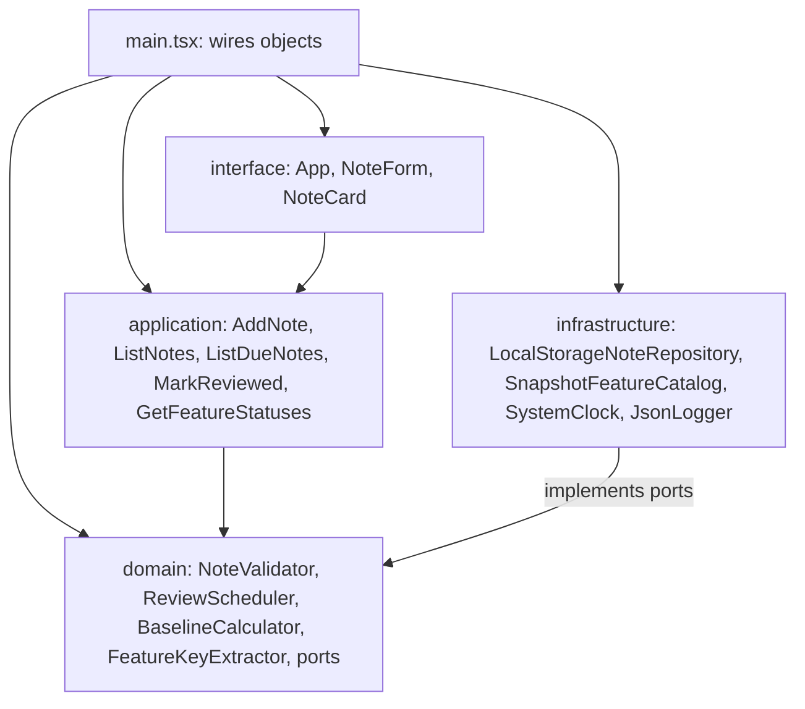

# How to learn frontend (and keep improving) — capstone

## What it is

The TIL learning journal is a local web app for a developer who works through a long roadmap. It saves one today-I-learned note per item, keeps the primary source links beside it, shows the Baseline status of web features the note names, and lists notes due for review. It uses [[Spaced review]] and is [[Local-first software]]: no server, no secrets. The status rule is the one from mini project 1, grown into a class. See [[Baseline status]] and [[Core browsers]].

The project is in `projects/frontend-engineering/learning-system-and-workstation/how-to-learn-frontend/capstone/`. Stack: [[React]], [[Vite]], [[Vitest]], [[TypeScript]], data from [[browser-compat-data]].

## Architecture at a glance



Visual notes: [[visual-capstone-layers-how-to-learn-frontend]], [[visual-capstone-request-flow-how-to-learn-frontend]], [[visual-capstone-deployment-how-to-learn-frontend]].

## Layers and key classes

- **Domain:** `NoteValidator`, `ReviewScheduler`, `BaselineCalculator`, `FeatureKeyExtractor`, and the ports `NoteRepository` and `FeatureCatalog`.
- **Application:** `AddNote`, `ListNotes`, `ListDueNotes`, `MarkReviewed`, `GetFeatureStatuses`.
- **Infrastructure:** `LocalStorageNoteRepository`, `SnapshotFeatureCatalog`, `Config`, `JsonLogger`, `SystemClock`.
- **Interface:** function components `App`, `NoteForm`, `NoteCard`, `FeatureBadges`.

## Ideas applied

- The learning loop: log, link a source, review on a schedule (`ReviewScheduler`).
- Primary sources: the validator refuses a note with no source or a non-web link.
- Baseline and feature support: a badge per feature, with "unknown" when data is missing. See [[Feature detection]] for the runtime side.
- Staying current: `npm run data` refreshes the snapshot when the data package updates.
- Validation with fix-it messages: [[Schema validation]]. Derived data: [[Derived data]].

## Borrowed from production

| Practice | Source | Applied in |
|----------|--------|-----------|
| One status function, browser set as data | [[browser-compat-data-takeaways]] (item 1) | `src/domain/baseline-calculator.ts` |
| Dotted-path walk with a clear error | [[browser-compat-data-takeaways]] (item 2) | `src/infrastructure/compat-tree-reader.ts` |
| Missing data is "unknown", `≤N` is "maybe earlier" | [[browser-compat-data-takeaways]] (items 4, 5) | `src/domain/baseline-calculator.ts` |
| Schema-first note with fix-it messages | [[browser-compat-data-takeaways]] (item 7) | `src/domain/note-validator.ts` |
| One tiny test per edge case | [[browser-compat-data-takeaways]] (item 8) | `tests/unit/baseline-calculator.test.ts` |

## How to run it

```bash
cd projects/frontend-engineering/learning-system-and-workstation/how-to-learn-frontend/capstone
npm install
npm run dev
npm test
```

Node.js 22.12 or newer (Vitest 5 and Vite 8 require it). Clearing browser site data deletes the notes.

## How to extend it

Add a feature key to `scripts/feature-keys.ts` and run `npm run data`. Add a use case as one class in `src/application` and wire it in `src/main.tsx`. Swap storage by writing a new `NoteRepository` adapter.

## My insights
