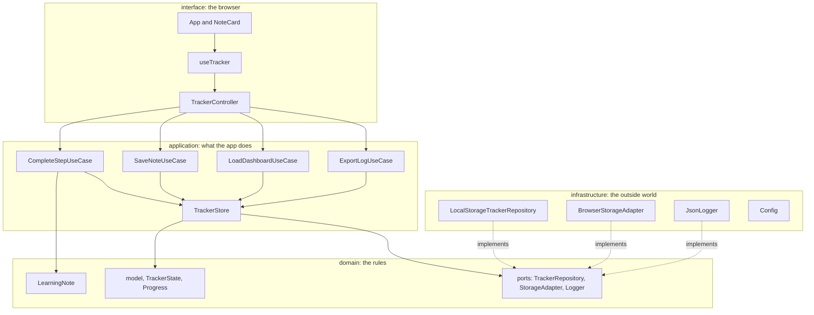

# How to learn frontend (and keep improving) — capstone

## What it is

Learning tracker is a static web app for a developer who works through a
frontend roadmap. Every roadmap item becomes one note, and every note holds
the four steps of the learning loop: read, build, measure, explain. A dashboard
shows how much of the roadmap is done and names the steps that are still
missing. The log lives in the browser, so nothing leaves the machine, and the
developer can export it as Markdown.

The project is in
`projects/frontend-engineering/learning-system-and-workstation/how-to-learn-frontend/capstone/`.

## Architecture at a glance



Every arrow points inward. The domain holds the rules of a note and knows
nobody, so it runs and is tested without a browser. The full version is in
`ARCHITECTURE.md`.

Diagrams with their explanations and sources:
[[visual-capstone-architecture-how-to-learn-frontend]],
[[visual-capstone-request-flow-how-to-learn-frontend]],
[[visual-capstone-deployment-how-to-learn-frontend]].

## Layers and key classes

| Layer | Key classes | What the layer is for |
|-------|-------------|-----------------------|
| domain | `LearningNote`, `model.ts`, `TrackerState.ts`, `Progress.ts`, `errors.ts`, `ports.ts` | The rules of one note and of the four steps, with no dependency on the browser |
| application | `TrackerStore`, `CompleteStepUseCase`, `SaveNoteUseCase`, `LoadDashboardUseCase`, `ExportLogUseCase` | One class per thing the app does |
| infrastructure | `LocalStorageTrackerRepository`, `BrowserStorageAdapter`, `JsonLogger`, `Config` | The adapters to the browser, the log, and the environment |
| interface | `TrackerController`, `useTracker`, `App`, `Dashboard`, `NoteCard`, `AppErrorBoundary` | The React parts that turn input into use-case calls |

## Ideas applied

- [[Dependency inversion]]: the use cases depend on the ports in
  `src/domain/ports.ts`, so the unit tests need no browser.
- [[Patch-based update]]: a change is a patch, so the notes that did not change
  keep their identity and the dashboard only redraws what moved.
- [[Versioned persistence]]: the saved log carries a version number and an old
  version is migrated instead of thrown away.
- [[Type-level testing]]: the four steps are a union of four strings, so a
  fifth step or a wrong step name is a compile error, not a runtime surprise.
- [[Artefact testing]]: one test builds the app with Vite and checks the files
  that come out, because the bundle is what the developer opens.
- [[Web Storage API]]: the log stays in the browser, and nothing is sent
  anywhere.

## Borrowed from production

- A write is a patch, not a replacement, from
  [[zustand-findings|zustand findings]], finding 1.
- The saved log carries a version and a migration, from
  [[zustand-findings|zustand findings]], finding 2.
- A late load cannot overwrite newer work, from
  [[zustand-findings|zustand findings]], finding 3.
- The type system holds the contract of the four steps, from
  [[zustand-takeaways|zustand takeaways]], practice 6.
- The tests run against the built bundle as well, from
  [[zustand-takeaways|zustand takeaways]], practice 8.

## How to run it

```bash
cd projects/frontend-engineering/learning-system-and-workstation/how-to-learn-frontend/capstone
npm install
cp .env.example .env
npm run dev      # the local address the terminal prints
npm test         # 42 unit tests and 8 integration tests
npm run build    # writes dist/, a static site any host can serve
```

Read `ARCHITECTURE.md` for every class and the two decision records in
`docs/adr/`.

## How to extend it

- Add a fifth step to the loop: change `STEP_IDS` in `src/domain/model.ts`.
  The compiler then names every place that still uses four steps.
- Save the log on a server: write a class that implements
  `TrackerRepository` and register it in `src/main.tsx`. No use case changes.
- Show a streak or a weekly summary: add a pure function to
  `src/domain/Progress.ts` and one column to the dashboard.

## My insights
