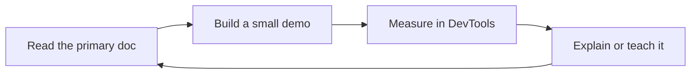

# How to learn frontend (and keep improving) — final notes

## In one sentence

Learn frontend with a repeatable read-build-measure-explain loop built on primary sources and browser-support literacy, so you can solve new problems instead of only following tutorials.

## The mental model



Read the four boxes clockwise: each step feeds the next, and explaining leads back to reading the next topic.

## Visual refresher

- [[visual-how-it-works-how-to-learn-frontend|The learning loop]] — the one cycle the whole method repeats.
- [[visual-baseline-ship-decision-how-to-learn-frontend|Baseline ship decision]] — trace a feature's label to its ship-readiness.
- [[visual-mdn-publish-review-loop-how-to-learn-frontend|Publish and review]] — how teaching exposes gaps.

All visuals: [[visuals-how-to-learn-frontend|all visuals]].

## Key ideas

- Prefer primary sources over tutorials, because they sit closest to the spec (WHATWG, TC39, W3C) and do not go stale.
- The loop works because the measure and explain steps check understanding that reading alone cannot.
- Baseline grades a feature Limited, Newly available, or Widely available across the core browsers over a 30-month window.
- Feature detection asks the running browser with `@supports` and `CSS.supports()`, never the user-agent string, which lies.
- Reading a small library such as nanoid or zustand teaches real patterns faster than more tutorials.
- Publishing and surviving review is how you find the gaps you did not know you had.
- Staying current means skimming official release notes and one yearly survey, not every blog post.

## When to use it / when not to

Use the loop when you start any new frontend topic, because it forces evidence instead of passive watching. Use Baseline before shipping a feature, and feature detection when support varies.

Do not use a tutorial as the authority when a spec or MDN page exists. Do not parse the user agent to detect features. Do not skip the measure or explain step, or you keep the gap.

## Trade-offs and failure modes

The loop feels slower than watching a course, but the slowdown is the point. Skipping measure hides that the demo only worked by luck. Sniffing the user agent breaks on every new browser. A polyfill adds download weight, so use one only when the feature is required, and progressively enhance otherwise.

## Commands or code worth remembering

```css
@supports (display: grid) { /* grid layout */ }
```

```js
if ("indexedDB" in window) { /* use it */ }
```

```bash
git clone --depth 1 https://github.com/pmndrs/zustand.git  # read it, don't run it
```

## What production systems do differently

- A write is a patch, not a replacement, so untouched state keeps its identity ([[zustand-findings|findings]]).
- Saved data carries a version number; a mismatch runs migrate or drops the value ([[zustand-findings|findings]]).
- The same tests run against the built bundles, not only the source ([[zustand-findings|findings]]).
- Middlewares replace a method on the live store object, so every caller gets the same behaviour ([[zustand-findings|findings]]).

## Go deeper

- [[01-brief-how-to-learn-frontend|Brief]]
- [[02-lesson-how-to-learn-frontend|Lesson]]
- [[03-mini-projects-how-to-learn-frontend|Mini projects]]
- [[00-digests-how-to-learn-frontend|Digests]]
- [[00-repo-intel-how-to-learn-frontend|Repository deep dive]]
- [[06-capstone-how-to-learn-frontend|Capstone]]

## My insights
