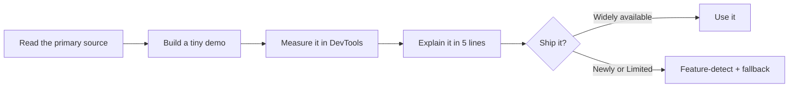

# How to learn frontend (and keep improving) — final notes

## In one sentence

Learn each frontend feature from its primary source, prove it in a small demo, and check browser support before you ship it.

## The mental model



The top row is the roadmap's own learning loop. The decision at the end applies Baseline and feature detection to what you learned.

## Visual refresher

- [[visual-baseline-status-lab-how-to-learn-frontend|Baseline status lab]] — interactive. Redo the checkpoint where the last core browser ships and the 30-month clock starts.
- [[visual-feature-detect-lab-how-to-learn-frontend|Feature detection lab]] — interactive. Redo the experiment that turns subgrid off and reaches the fallback.
- [[visual-how-it-works-how-to-learn-frontend|From support data to a runtime check]] — the path from browser-compat-data to your `if` statement.

All visuals: [[visuals-how-to-learn-frontend|all visuals]].

## Key ideas

- Read MDN, specs and official docs first, because tutorials go stale and specs do not.
- A TC39 proposal is stable only at Stage 4, because earlier stages can still change.
- Baseline "Newly available" means every core browser supports the feature; "Widely available" follows 30 months later, because users need time to update.
- MDN tables come from browser-compat-data, and caniuse mixes its own data with it, so check both when they disagree.
- Detect the feature, not the browser, because browser sniffing breaks when browsers change.
- Load a polyfill only for browsers that lack the feature, and never from a third-party CDN.
- Read real source with a map: the folder layout, the comments, then the call sites.
- Contribute in the open: read the README and CONTRIBUTING, pick an issue, then open a pull request. An issue needs the steps to reproduce the bug, because a maintainer cannot fix what they cannot see.

## When to use it / when not to

Use it when:

- You meet a new API or CSS feature. Run the loop once; you keep a tested note instead of a vague memory.
- You plan a release. Check Baseline first; a Widely available feature ships with no fallback code.

Do not use it when:

- A feature is behind a flag or in an origin trial only. Test it, but do not ship it to all users.
- A table says "partial". Read the note on that cell; partial support needs feature detection, not trust.

## Trade-offs and failure modes

- The loop is slower than copying a snippet. You pay minutes now to avoid hours of debugging later.
- Baseline is a summary for "most sites". Your audience may use older browsers; check your own analytics.
- A third-party polyfill CDN can be taken over. In 2024 the polyfill.io domain was sold and served malware to over 100,000 sites.
- Survey results, such as State of JS, are a trend snapshot from self-selected people, not market share.

## Commands or code worth remembering

```js
// CSS: apply a rule only when the browser supports it
// @supports (grid-template-columns: subgrid) { ... }
CSS.supports("grid-template-columns", "subgrid"); // true or false
"share" in navigator;                             // Web Share API present?
import bcd from "@mdn/browser-compat-data";       // prebuilt support data
bcd.css.properties.gap.__compat.support.safari;   // one support statement or an array
```

## What production systems do differently

- browser-compat-data stores no Baseline field; Baseline is a separate layer linked by tags. See [[browser-compat-data-findings|finding 1]].
- It records uncertainty honestly: `≤N`, `preview` and `false` instead of a guessed number. See [[browser-compat-data-pattern-honest-uncertainty|honest uncertainty]].
- Derived browsers such as Edge say `"mirror"` in source and get real versions at build time. See [[browser-compat-data-findings|finding 3]].
- Releases need a human merge and publish with provenance. See [[browser-compat-data-pattern-guarded-release|guarded release]].

## Go deeper

[[01-brief-how-to-learn-frontend|Brief]] → [[02-lesson-how-to-learn-frontend|Lesson]] → [[03-mini-projects-how-to-learn-frontend|Mini projects]] → [[00-digests-how-to-learn-frontend|Digests]] → [[00-repo-intel-how-to-learn-frontend|Repository deep dive]] → [[06-capstone-how-to-learn-frontend|Capstone]] → [[08-recall-how-to-learn-frontend|Recall cards]] → [[09-resources-how-to-learn-frontend|Resources]]

## My insights
