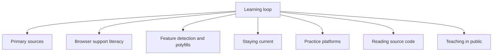

# Concept map of How to learn frontend (and keep improving)

Generated from the research curriculum. A solid arrow points from a concept to the concept that refines it; a dotted arrow shows a prerequisite.

Back to [[visuals-how-to-learn-frontend|all visuals]].

## My insights
